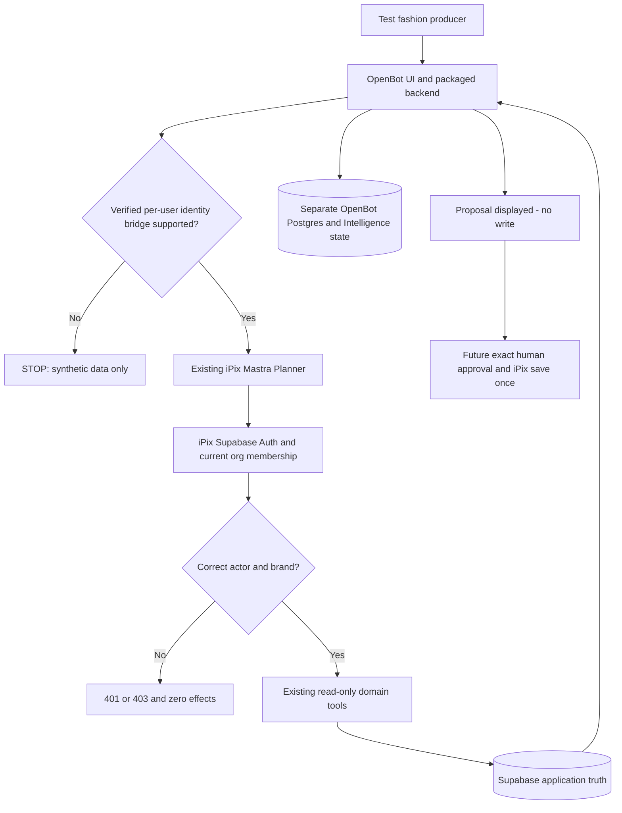

# ADR 006 — Evaluate OpenBot as an iPix workspace without replacing production

**Status:** Proposed; conditional synthetic-data pilot recommended. **Human approval pending. Production replacement NOT APPROVED.**
**Date:** 2026-11-23
**Task:** [IPI-1489](https://linear.app/amo100/issue/IPI-1489) · [Existing iPix coworker ownership IPI-1390](https://linear.app/amo100/issue/IPI-1390)
**Repos:** https://github.com/amoai-tech/ipixai · https://github.com/amoai-tech/ipix-open
**Verified baselines:** iPix `origin/main` at `13bf2af385ebbe68a78c652daf5cffa3db95df24`, local OpenBot v1.1.2 at `8826a0fe3827b80c519b6b8a274e74efbaef7868`. Revalidate at execution.

## Summary and decision

**User outcome:** An authorized fashion producer asks for a six-outfit Maaji shoot, receives a real shot list and COP budget, reviews the exact artifact, and eventually saves one canonical shoot under the correct brand.

**Faster/better approach:** Preserve **one** existing iPix Supabase tenancy and business database, **one** Mastra Production Planner, current CopilotKit/AG-UI business UI, current exact approval/save-once, and Cloudinary media ownership. Evaluate OpenBot as a *second, isolated user-interface/workspace pilot* using a synthetic read-only Planner. Do not rebuild existing functionality or move production before proof.

**Decision recommendation:** **Conditional GO for a limited synthetic-data feasibility pilot only; NO-GO for a commercial multi-brand deployment or cutover.** The owner must explicitly accept or reject this ADR. There is no implied sign-off from an agent-generated decision.

| Option | Value | Costs and risks | Verdict |
| --- | --- | --- | --- |
| A. Improve current iPix with OpenBot patterns ([IPI-1390](https://linear.app/amo100/issue/IPI-1390)) | Reuses existing working auth, Mastra, GenUI, approval and business APIs | Missing coworker/computer UX must be selectively adapted | **Production default; safest fallback** |
| B. Pilot isolated OpenBot v1.1.2 | Reuses coworker UI, component catalog and remote Mastra harness | Second session and storage plane, licensing, published backend, actor bridge and org isolation unknown | **Conditional nonproduction experiment** |
| C. Replace live iPix with OpenBot for all brands | Possible product expansion only if demonstrated | Unverified multi-brand security, commercial rights and migration risks | **NO-GO** |

### Target-state ownership (proposal, not deployed)

**The bridge remains unverified.** The final approval/save node is future work in IPI-1495, not authorization under this ADR. No live brand data enters OpenBot until Org A/B access and isolation are proven.

## Verified current state and boundaries

- **iPix owns business identity and data.** Existing [ADR 003](./003-supabase-owns-tenancy.md), `src/lib/auth/operator-auth.ts`, `src/mastra/server-auth.ts`, and Supabase Auth/RLS implement user/tenant boundaries. Current iPix Mastra server allowlists `GET /api/agents` and `POST /api/agents/production-planner/stream`; the registry key is `default`, whereas the Agent ID is `production-planner`. Probe the actual remote-agent contract instead of guessing.
- **Mastra owns production agents, tools, workflows and AI state.** Existing [ADR 002](./002-mastra-owns-ai-memory.md), `src/mastra/runtime.ts`, `src/mastra/workflows/shoot-plan-review.ts` and `src/app/api/shoots/save/route.ts` are reuse candidates. The save endpoint accepts only an authorized `approvalId`, not an arbitrary model-generated shoot payload.
- **OpenBot remains separate.** Its v1.1.2 `docker-compose.yml` pulls `ghcr.io/copilotkit/openbot` for the server; no editable `server/src` exists in the public checkout. It operates its own Postgres and Intelligence state. **Never repoint OpenBot `DATABASE_URL` at iPix Supabase** or run OpenBot migrations against iPix.
- **OpenBot v1.1.2 tenant warning.** `OPENBOT_MULTIPLE_ORGANIZATIONS=true` logs that some state is not kept apart. A separate OpenBot organization or service token does **not** by itself establish a matching Supabase actor/role, secure memory, files, skills, tools or computers.
- **Local baseline is not certification.** The OpenBot v1.1.2 installation was previously health-checked; 4/4 focused A2UI tests passed, but local Bun is 1.4.0 versus declared 1.4.3, and no secure end-to-end OpenBot→iPix flow passed.
- **No duplicate migration owner.** [IPI-1171](https://linear.app/amo100/issue/IPI-1171) retains production Supabase GitHub Integration ownership; [IPI-1441](https://linear.app/amo100/issue/IPI-1441) human migration governance requires its own completion proof.

## Licensing, cost and data ownership — hard commercial gate

**Reference — REFERENCE ONLY:** https://github.com/CopilotKit/OpenBot/blob/v1.1.2/README.md → MIT application-source statement and separate Intelligence entitlement. Use for legal due diligence; do not assume MIT alone grants commercial CopilotKit Intelligence use.

**Reference — REFERENCE ONLY:** https://open.bot/pricing → published pricing, current at review (not a quote). Business pay-as-you-go is **up to USD 29 per active user/month**; model provider usage and hosting are extra, and the page describes a **5% charge on model spend above USD 5,000/month per organization**. Personal use is for experimentation. The pricing FAQ says **embedding agents in one's own product requires a separate Intelligence license**, distinct from OpenBot for Business use. Confirm reseller/white-label/SaaS product rights, data retention, hosting, user count, vendor support and customer terms **in writing** before production.

**Reference — REFERENCE ONLY:** https://github.com/CopilotKit/OpenBot/releases/tag/v1.1.3 → official newer stable release. Use to assess whether org authority and Intelligence isolation have changed. **Do not copy** the v1.1.3 organization-migration path into pinned v1.1.2 or auto-upgrade: release notes warn organization data and memory boundaries change. Evaluate a newer stable release only in disposable staging with backup/rollback.

## Auth and security options to prove, not assume

**Option 1:** Existing Supabase session/actor delegated to an iPix-controlled API, with exact organization membership rechecked on the server. Must prove a *supported* OpenBot per-user identity mechanism. A shared OpenBot service token is not the end-user identity.

**Option 2:** [Supabase OAuth 2.1 / OIDC server](https://supabase.com/docs/guides/auth/oauth-server) as the identity provider, **only if OpenBot's actual packaged Better Auth deployment supports that provider**, with PKCE, audience, current roles and revocation verified. OpenBot's `OPENBOT_ORGANIZATION_AUTH_URL` is documented as another **OpenBot authority origin**, not a generic Supabase OIDC provider. [Supabase third-party custom OIDC](https://supabase.com/docs/guides/auth/third-party/custom-oidc) points the opposite direction (Supabase trusting another provider); don't confuse the two.

**Hard stop:** If actor identity is not verifiable across the boundary; if Org B can see Org A's business data, conversations, memory, files, secrets, tools or computer workspaces; if a privileged service key bypasses RLS; or if commercial terms prohibit SaaS embedding, **do not proceed**. Existing iPix remains production.

## Implementation steps and direct reference mapping

### Step 1 — Approve scope instead of rebuilding iPix

**Destination:** `docs/adr/006-openbot-conditional-pilot.md`, IPI-1489, IPI-1390.

**Reference — MODEL**
- URL: https://linear.app/amo100/issue/IPI-1390
- Source: existing AI Coworker epic; its OpenBot-reuse-first approach.
- Use: preserve current product/runtime ownership as the comparison and fallback.
- Do not copy: treating a new OpenBot repository as an already approved production migration.
- Change: owner records an explicit conditional decision; reconcile two overlapping epics without rewriting historical work.
- Verify: signed/recorded decision, fallback, allowed scope and explicit production exclusion.
- **Checkpoint:** No implicit human approval; STOP before real data.

### Step 2 — Prove OpenBot v1.1.2 foundation and tenant loader

**Destination:** existing `ipix-open` root and `examples/ipix/agents.yaml` (IPI-1490 and IPI-1491).

**Reference — REUSE / ADAPT**
- URL: https://github.com/CopilotKit/OpenBot/blob/v1.1.2/docker-compose.yml
- Source: `server.image`, `working_dir`, isolated `DATABASE_URL`.
- Use: existing pinned Docker image, supported configuration and restart mechanism.
- Do not copy: a nonexistent `server/src` patch, second repo clone, or custom transport.
- Apply to: existing Compose/runtime and tests; verify image digest and configuration.
- Verify: exact build/CI, health, signed-in test chat, replay and restart.
- **Checkpoint:** STOP if the backend cannot load a supported extension.

**Reference — ADAPT**
- URL: https://github.com/CopilotKit/OpenBot/blob/v1.1.2/examples/fintech/agents.yaml
- Source: `picked-harness`, `remote_agent_id` and endpoint placeholders.
- Use: minimum synthetic fashion coworker config.
- Do not copy: fintech identities, permissive write grants or unused bots.
- Apply to: `examples/ipix/agents.yaml`; `TENANT_PACKAGE_DIR` must exist inside the published image.
- Verify: YAML parsing and loaded coworker after runtime restart.
- **Checkpoint:** File creation alone is insufficient.

### Step 3 — Prove actor identity and two-tenant denial

**Destination:** existing iPix authorized APIs; supported OpenBot identity extension TBD (IPI-1492).

**Reference — ADAPT**
- URL: https://github.com/amoai-tech/ipixai/blob/main/src/mastra/server-auth.ts
- Source: `resolveMastraIdentity()`, `plannerMastraAuth`, exact route allowlist.
- Use: actual Supabase user token, live organization membership and scoped Mastra resource ID.
- Do not copy: browser orgId, user metadata, email-only mapping, OpenBot shared service token as user, or service-role bypass.
- Apply to: iPix server authorization; choose connector only after inspecting supported OpenBot capability.
- Verify: two synthetic Org A/B identities; forged/expired/revoked/wrong-org and wrong-thread denials; zero unauthorized effects.
- **Checkpoint:** HARD STOP on any tenant disclosure.

### Step 4 — Test one real existing Mastra agent in a read-only mode

**Destination:** `examples/ipix/agents.yaml` and existing `src/mastra/runtime.ts` (IPI-1493).

**Reference — ADAPT**
- URL: https://github.com/CopilotKit/OpenBot/blob/v1.1.2/agent-mastra/src/mastra/index.ts
- Source: ordinary Mastra server + authenticated endpoint, no bespoke AG-UI route.
- Use: OpenBot native `remote-mastra` connection to existing Production Planner.
- Do not copy: demo agent, old custom `/ag-ui` SSE example, second Planner or broad tool grants.
- Apply to: pinned tenant config with verified registry key vs agent ID.
- Verify: authenticated discovery and stream, source IDs, correct CopilotKit render, stop/error handling, no writes.
- **Checkpoint:** Unauthorized actor denied and synthetic plan rendered.

### Step 5 — Compare observable business value and decide go/no-go

**Destination:** IPI-1489/1490–1493 proof links and future product decision.

**Reference — REFERENCE ONLY**
- URL: https://open.bot/builders
- Source: agent federation, coworker UI and supported interfaces.
- Use: identify user-facing benefits to measure against existing iPix.
- Do not copy: marketing examples as passing runtime proof.
- Apply to: a side-by-side six-outfit shoot-planning workflow.
- Verify: actual functionality, usability, performance, cost, tenancy, reliability and migration risk.
- **Checkpoint:** All safety/entitlement checks plus explicit human product approval; otherwise use existing iPix and selectively adapt OpenBot patterns.

## Verification and status

| Gate | Evidence now | Status |
| --- | --- | --- |
| Current Supabase, Mastra, approval and domain ownership | Clean `origin/main`, ADR 002/003 and current code | Verified architecture |
| Pinned local OpenBot/packaged backend | `v1.1.2` checkout and Compose; partial A2UI tests | Partial foundation |
| Commercial SaaS/white-label Intelligence entitlement | Published price/terms only, no signed vendor approval | **OPEN / BLOCKED** |
| Secure supported per-user identity bridge | Not demonstrated | **OPEN / HARD STOP** |
| Cross-org OpenBot + Intelligence separation | Not demonstrated | **OPEN / HARD STOP** |
| Runtime-loaded fashion tenant package | Not demonstrated | OPEN |
| Authenticated existing Mastra stream via OpenBot | Not demonstrated | OPEN |
| Live production multi-brand deployment | Not attempted | **NOT APPROVED** |

**Rollback:** The existing iPix application, domain, Supabase and current Mastra deployments remain untouched; pilot is separate and disposable. Stop OpenBot containers and archive synthetic pilot state on failed gate; do not delete or mutate production.

**Next action:** Human owner accepts or rejects this ADR's exact conditional scope; if accepted, carry out IPI-1490 foundation certification followed by IPI-1491 tenant config and the synthetic IPI-1492 identity proof, then IPI-1493 streaming proof. Do not mark the migration or this approval as complete from diagrams, local health, or a proposed ADR.

**Owner approval:** PENDING (human owner must record approval for exact ADR/PR revision).
**Production cutover:** NO-GO.
