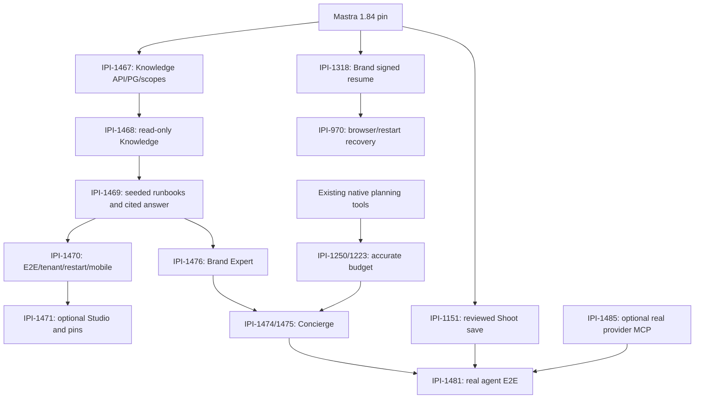

# Task: iPix AI Platform — Verified Progress Task Tracker

**Reviewed:** November 22, 2026 (America/Bogota). **Coordination epic:** [IPI-1484 — AI-PLATFORM-TRACKER-EPIC](https://linear.app/amo100/issue/IPI-1484).
**Evidence:** GitHub main 078291810c, current Linear task status/titles, direct HTTP checks, inspected src/mastra, PR status and official Mastra Knowledge docs. This is a progress audit, **not production certification**.

## Process: Examine → Verify → Validate → Measure → Identify

1. **Examine:** inspect existing code, live behavior, task history and canonical owners.
2. **Verify:** compare exact Linear issue/title with GitHub code and PR head; old issue prose is not proof.
3. **Validate:** reproduce the real path, focused tests, authorized vs unauthorized API, durable DB state, mobile and refresh.
4. **Measure:** percentage describes evidence for the **specific task**, not total product readiness.
5. **Identify:** record actual failure, risk, first failing boundary and smallest fix.

**Evidence rubric:** 0% = no task-specific implementation; 25% = task plan/partial code; 50% = changed code/focused tests but live proof missing; 75% = demonstrated key journey or validated docs PR, remaining approval/merge/post-deploy proof; 100% = exact task-scope completion with final evidence. A docs PR at 75% does not imply a live feature is working. **Dots:** 🟢 verified task-scope complete · 🟡 in progress/partial · 🔴 observed failure · 🔵 not started.

## Progress Tracker — task, proof, failures and next action

| Exact Linear task / workstream | Short outcome | State / % | PR or proof | Missing / next step |
| --- | --- | --- | --- | --- |
| [IPI-1484 — AI-PLATFORM-TRACKER-EPIC — Verify iPix Agents, Workflows, Tools, MCP, Knowledge and Copilot](https://linear.app/amo100/issue/IPI-1484) | Coordinated, evidence-backed tracker | 🟡 **25%** · Todo | This file + live Linear epic | Keep statuses current; no application feature certified |
| [IPI-1460 — MASTRA-UPG-007 — Upgrade iPix Mastra to 1.84](https://linear.app/amo100/issue/IPI-1460) | Version pin | 🟢 **100%** · Done, pin scope only | main package pin, Linear Done | Doesn't prove downstream workflows |
| [IPI-1143 — MASTRA-EPIC — Govern One Current Mastra Runtime Across iPix](https://linear.app/amo100/issue/IPI-1143) | Secure, current local Studio | 🟡 **50%** · In Progress | [PR #365](https://github.com/amoai-tech/ipixai/pull/365) open, changes requested | Finish PR and live auth/reload checks; Studio port now down |
| [IPI-1473 — MASTRA-AGENTS-EPIC — Build and Verify iPix Concierge and Specialist Agents on One Secure Runtime](https://linear.app/amo100/issue/IPI-1473) | Concierge + specialists | 🔵 **0%** · Todo | Existing epic | Prove at least one delegation path, not new runtime |
| [IPI-1474 — AGENTS-001 — Prove Safe Concierge Delegation Before Changing the Agent Registry](https://linear.app/amo100/issue/IPI-1474) | Identity-safe delegation | 🔵 **0%** · Backlog | — | One trusted supervisor-to-specialist route |
| [IPI-1475 — AGENTS-002 — Add One iPix Concierge That Delegates Safely to Specialists](https://linear.app/amo100/issue/IPI-1475) | One AI assistant | 🔵 **0%** · Backlog | — | Real specialist output in existing Copilot |
| [IPI-1476 — AGENTS-003 — Add Brand Expert Using Existing Brand Intelligence and Knowledge](https://linear.app/amo100/issue/IPI-1476) | Brand fact specialist | 🔵 **0%** · Backlog | — | Real Brand evidence and exact citations |
| [IPI-1477 — AGENTS-004 — Add Research Expert for Cited Competitor and Website Research](https://linear.app/amo100/issue/IPI-1477) | Source-backed research | 🔵 **0%** · Backlog | — | One useful public read-only research path |
| [IPI-1478 — AGENTS-005 — Add CRM Expert With Authorized Contact and Deal Context](https://linear.app/amo100/issue/IPI-1478) | Customer follow-up intelligence | 🔵 **0%** · Backlog | — | Real org-scoped contacts, draft-only first |
| [IPI-1479 — AGENTS-006 — Add Ecommerce Expert for Grounded Product and Variant Questions](https://linear.app/amo100/issue/IPI-1479) | Exact catalog facts | 🔵 **0%** · Backlog | — | Actual ProductRef and variant ID |
| [IPI-1480 — AGENTS-007 — Add Campaign Expert for Brand-Safe Campaign Planning](https://linear.app/amo100/issue/IPI-1480) | Campaign proposal | 🔵 **0%** · Backlog | — | Real reviewed campaign strategy |
| [IPI-1481 — AGENTS-008 — Verify Agent Delegation, Tenant Isolation, Recovery and Real Journeys](https://linear.app/amo100/issue/IPI-1481) | Agent release proof | 🔵 **0%** · Backlog | — | End-to-end UI/API/DB + negative tests |
| [IPI-1318 — BRAND-MASTRA-PARITY-001 — Restore and Prove Exact Crawl → Mastra Resume → Brand DNA Draft](https://linear.app/amo100/issue/IPI-1318) | Exact crawl → resumed draft | 🟡 **25%** · Todo | Existing 6-step workflow source | Fresh signed callback + same run/draft DB proof |
| [IPI-970 — BI-RUN-001 — Keep Brand Intelligence Running After the Browser Closes](https://linear.app/amo100/issue/IPI-970) | Durable async execution | 🟡 **25%** · Todo | Existing suspend/snapshot design | Browser close, server restart, idempotent retry |
| [IPI-1151 — E2E-PLAYWRIGHT-002 — Certify Brand → Shoot → Planner Critical Journey](https://linear.app/amo100/issue/IPI-1151) | Review/save/reopen one Shoot | 🟡 **50%** · In Progress | [PR #367](https://github.com/amoai-tech/ipixai/pull/367) open | Complete exact-head review, UI/API/DB, retry/mobile |
| [IPI-993 — MASTRA-WF-000 — iPix Mastra Workflow & Tool Orchestration Platform](https://linear.app/amo100/issue/IPI-993) | Optional future workflow standardization | 🔵 **0%** · Backlog | [PR #368](https://github.com/amoai-tech/ipixai/pull/368) docs only | Defer M7 abstractions; not a development blocker |
| [IPI-1049 — TOOL-001 — Let the Planner Build Shoot Type, Deliverables, Shot List, and Budget Safely](https://linear.app/amo100/issue/IPI-1049) | Typed planning tools | 🟢 **100%** · Done, tool-definition scope | [PR #94](https://github.com/amoai-tech/ipixai/pull/94), current src/mastra/tools | Other budgets and full /app E2E tracked separately |
| [IPI-1208 — PLANNER-TOOLGATE-001 — Exclude Consequential Write Tools From the Planner's Tool Set During Plan-Generation Turns](https://linear.app/amo100/issue/IPI-1208) | Guard 5 planning vs 2 Brand actions | 🟢 **100%** · Done, tool-gate scope | Current planner-tool-gate.ts, Linear evidence | Retest with every new MCP/agent capability |
| [IPI-1250 — PLAN-BUDGET-001 — Fix composeShootPlan's Budget Using the Wrong Asset Count](https://linear.app/amo100/issue/IPI-1250) | Use correct asset count | 🔵 **0%** · Backlog | — | Fix existing computation, focused tests |
| [IPI-1223 — PLANNER-E2E-001 — Fix the Production Planner Budget E2E in /app](https://linear.app/amo100/issue/IPI-1223) | Reliable user-facing budget | 🟡 **25%** · In Progress | Linear records earlier failing E2E; not rerun today | Reproduce on current head and fix first failing boundary |
| [IPI-1466 — iPix Knowledge — Let Production Copilot Answer From Shared Company Docs](https://linear.app/amo100/issue/IPI-1466) | Shared runbooks | 🔵 **0%** · Todo | Existing Knowledge epic and five children | Follow 1467 → 1468 → 1469 → 1470 |
| [IPI-1467 — iPix Knowledge 1 — Verify Native API, Tenant Scopes, and Postgres Compatibility](https://linear.app/amo100/issue/IPI-1467) | Version, scopes, DB contract | 🔵 **0%** · Todo | Core 1.84 pinned; no Knowledge registration | Inspect current *live* DB & installed SDK first |
| [IPI-1468 — iPix Knowledge 2 — Add One Tenant-Scoped, Read-Only Mastra Knowledge Instance](https://linear.app/amo100/issue/IPI-1468) | One Knowledge reader | 🔵 **0%** · Todo | main has no Knowledge registration or KNOWLEDGE_ROUTES | Prove server-derived scopes, no agent write |
| [IPI-1469 — iPix Knowledge 3 — Seed Real Runbooks and Show Sources in Existing Copilot](https://linear.app/amo100/issue/IPI-1469) | Cited checklist answers | 🔵 **0%** · Todo | No seeding implementation on main | 3–5 source-controlled docs, idempotent seed, cited reply |
| [IPI-1470 — iPix Knowledge 4 — Prove Retrieval, Security, Persistence, and Mobile End-to-End](https://linear.app/amo100/issue/IPI-1470) | Knowledge certification | 🔵 **0%** · Todo | — | Org A/B denial, restart, 390px, actual sourced answer |
| [IPI-1471 — iPix Knowledge 5 — Optional Pinned Context and Secure Studio After Pilot Proof](https://linear.app/amo100/issue/IPI-1471) | Later Studio/pinned Knowledge | 🔵 **0%** · Backlog | Studio Knowledge routes off on main | Do only after secure pilot, not a prerequisite |
| [IPI-1485 — MCP-AGENT-001 — Prove One Useful External MCP Capability in iPix Production Copilot](https://linear.app/amo100/issue/IPI-1485) | One useful external tool | 🔵 **0%** · Todo | [PR #370](https://github.com/amoai-tech/ipixai/pull/370) docs only | Choose provider, compare SDK/native, scoped read in /app |
| [IPI-1002 — MASTRA-WF-009 — Standardize External Integrations Only After Repeated Need](https://linear.app/amo100/issue/IPI-1002) | Standardize repeated patterns | 🔵 **0%** · Backlog | — | Defer until multiple integrations prove same need |
| [IPI-1144 — COPILOTKIT-EPIC — Give Every iPix Workspace One Secure AI Interaction Layer](https://linear.app/amo100/issue/IPI-1144) | Single authorized chat/GenUI | 🟡 **50%** · In Progress | Existing Next.js CopilotKit route | Real cross-domain cards, actions, release proof |
| [IPI-1390 — AI-COWORKER-EPIC — Make Production Copilot Safe, Persistent, and Actionable Across iPix](https://linear.app/amo100/issue/IPI-1390) | Work surfaces | 🔵 **0%** · Todo | — | Defer duplicate task/state engines |
| [Docs: workflow roadmap](https://github.com/amoai-tech/ipixai/pull/368) | Workflow references/plan | 🟡 **75%** · docs PR open | PR #368 | Merge/review; no runtime behavior implemented |
| [Docs: tools roadmap](https://github.com/amoai-tech/ipixai/pull/369) | Tool references/plan | 🟡 **75%** · docs PR open | PR #369 | Merge/review; no agent tool deployed |
| [Docs: MCP product-agent roadmap](https://github.com/amoai-tech/ipixai/pull/370) | 16 capabilities and stages | 🟡 **75%** · docs PR open | PR #370 | Merge/review; no MCP adapter deployed |
| **Local Studio /knowledge (port 4211)** | Local diagnostic viewer | 🔴 **0%** · FAILED live check | curl localhost:4211/knowledge → connection refused, Nov 22 | Start current 1.84 Studio; authenticate; then inspect Knowledge route (historically 404) |

**Important:** Numeric values are scoped, evidence-calibrated estimates; they cannot be summed into a truthful overall product percentage. A narrow version-pin task at 100% does not mean Knowledge, Agents or MCP are production-ready. Current hosted Postgres schema, deployed Next.js SHA and current end-to-end business flow were not read directly in this documentation review; mark them **unverified**.

## Blockers, failure points, and fixes

| Issue | Evidence / consequence | Smallest fix / proof |
| --- | --- | --- |
| 🔴 4211 Studio unavailable | HTTP connection refused | Start correct 1.84 local Studio with existing auth; recheck /knowledge and authorized APIs |
| 🔵 Knowledge not registered | GitHub main src/mastra/runtime.ts has no knowledge instance or routes | IPI-1467 verified SDK/storage/scopes, then IPI-1468 in-process reader |
| 🟡 Mastra Knowledge alpha | Official Mastra scopes note warns about cross-scope information flows | Start non-sensitive generic runbooks only; server derives scopes; no Knowledge write tool; deny wrong org |
| 🟡 PG compatibility not freshly checked | IPI-1467 records historic missing Knowledge tables, no current SQL proof | Read-only current schema, versioned additive migration if needed, restart test |
| 🟡 Brand workflow unproven after callback | Existing step definitions but IPI-1318 Todo | Signed webhook → exact run/crawl ID → one persisted draft |
| 🟡 Shoot Plan PR awaiting merge/proof | PR #367 open | Exact reviewed hash/revision + one save + retry/DB readback + 390px |
| 🔵 Concierge not implemented | IPI-1474–1481 Backlog | Prove one real delegation before more agents |
| 🔵 MCP product feature absent | No @mastra/mcp in current main; no explicit MCPServer registration | One named product/provider need first; no redundant in-process MCP hop |
| 🟡 Docs PRs open | #368/#369/#370 not merged | Finish review/CI, link to canonical docs, do not label product feature Done |

## Dependencies and recommended order

**Safe parallel work:** IPI-1467 SDK/PG verification, IPI-1318 fresh Brand trace, IPI-1250 deterministic budget correction and PR #367 Shoot review. **Do not block** these on M7 generic workflow standardization, MCP Studio or optional pinned Knowledge.

## Exact proof required to mark Done

For each linked task: fresh Linear title/status; implementation branch and exact PR SHA; changed files; focused tests; allowed and denied tenant/identity cases; no duplicate paid external effect or domain write; hosted/live SHA; actual /app UI and 390px; correct persisted Supabase records; genuine citations; failure/retry/restart; post-merge evidence. Anything missing is **unverified**, not “probably working”.

**Existing owners retained:** [Agents IPI-1473](https://linear.app/amo100/issue/IPI-1473), [Knowledge IPI-1466](https://linear.app/amo100/issue/IPI-1466), [Workflows M7 IPI-993](https://linear.app/amo100/issue/IPI-993), [CopilotKit IPI-1144](https://linear.app/amo100/issue/IPI-1144), [Mastra Runtime IPI-1143](https://linear.app/amo100/issue/IPI-1143), [Global V2 Progress IPI-1295](https://linear.app/amo100/issue/IPI-1295). [New IPI-1484](https://linear.app/amo100/issue/IPI-1484) coordinates them; it does not change their parent/implementation owner.
