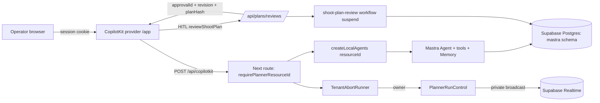
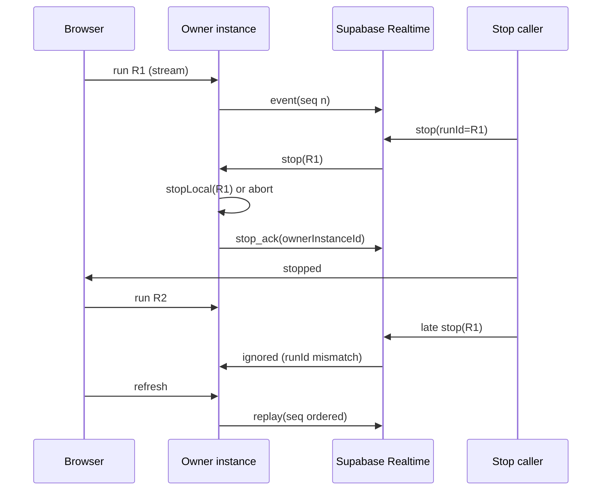
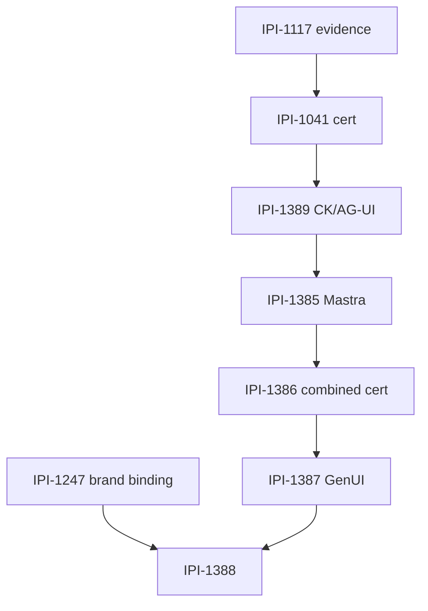

# IPI-1384 · CopilotKit + Mastra Upgrade — Verified Roadmap

**What this is:** the implementation-ready roadmap for moving iPix from the certified CopilotKit `1.73.3` / AG-UI `0.0.59` / Mastra `1.71.0` Planner to CopilotKit `1.85.0` / AG-UI `1.0.2` / Mastra `1.82.0`, then shipping trusted Generative UI and interactive Shoot Plans.

**Verified against:** `origin/main` = `37e9cfe381d4926823120e282645420aed5f6001` (PR #310), production certification run [42449475147](https://github.com/amoai-tech/ipixai/actions/runs/42449475147), the installed lockfile, published npm manifests/tarballs, GitHub release notes, and a live compatibility experiment (see [Appendix A](#appendix-a--evidence-log)).

**Read this before writing code.** Every claim below is either marked **VERIFIED** (reproduced in this audit) or **UNVERIFIED** (needs the named proof). Nothing here is marked Done.

---

## 1. Executive summary

**Are we ready to begin?** Yes for one thing only: **IPI-1389 preparation**. The CopilotKit/AG-UI package set is source-compatible with today's code — with Mastra held at `1.71.0`, `tsc --noEmit` is clean and 64 targeted runtime tests pass on the exact target versions (Appendix A.3). Everything downstream is blocked or unproven.

**What is blocked**

| Blocker | Why it blocks | Evidence |
|---|---|---|
| IPI-1117 cross-instance + revocation proof | IPI-1041 certification cannot be called complete without it | Only a two-process local Realtime contract exists; no hosted distinct-instance evidence |
| IPI-1041 production certification scope | The production cert only runs the Stop journey, not HITL or tenant isolation | [`playwright.production-cert.config.ts`](../../playwright.production-cert.config.ts) `testMatch` = setup + `planner-stop-journey` |
| IPI-1387 / IPI-1388 | The Generative UI API **does not exist** in `@copilotkit/react-core@1.73.3` | `GenerativeUISurface`, `standardUI`, `createGenerativeUI` absent from the 1.73.3 tarball; present in 1.85.0 |
| Linear updates | No Linear MCP/CLI/token in this session | `.claude/settings.local.json` names a Linear MCP that is not mounted here |

**Fastest safe path**

```text
(1) IPI-1389 branch, prepared + green            ← can start now, merge after IPI-1041
(2) IPI-1117 evidence (log + revocation)          ← needs hosted run + disposable accounts
(3) IPI-1041 certification re-run on merged SHA
(4) IPI-1385 Mastra branch (separate PR)
(5) IPI-1386 combined certification
(6) IPI-1247 (parallel) → IPI-1387 → IPI-1388
```

**The single most important correction:** the earlier plan said "CopilotKit 1.85 + AG-UI 1.0.0". The real install target is **AG-UI `1.0.2`**, because `@copilotkit/runtime@1.85.0` pins `@ag-ui/client` and `@ag-ui/core` to exactly `1.0.2`. Installing the latest `1.0.4` creates a second AG-UI copy and risks `AbstractAgent` class-identity mismatches. Also, `package.json` `overrides` pin the whole `@ag-ui/*` family to `0.0.59`; `npm install` **fails with `EOVERRIDE`** until those overrides move with the dependency.

---

## 2. Verified baseline

**VERIFIED**

| Fact | Value |
|---|---|
| `origin/main` | `37e9cfe381d4926823120e282645420aed5f6001` — "Keep Planner Reconnect and Stop Working Across Vercel Servers (#310)" |
| PR #310 | merged `2026-11-08T04:52:56Z`, head `8206c26682d090673fb55158208a559788c51dbc`, 23 files |
| Production certification | run `42449475147`, `conclusion: success`, `headSha` exactly `37e9cfe…`, dispatched `2026-11-08T05:06:52Z` |
| Production deployment | `ipixai-2l8yo6zwv-amoco.vercel.app`, `target=production`, `READY`, `githubCommitSha=37e9cfe381d4`, created `2026-11-08T05:02:20Z` |
| Install | `npm ci` exit 0 on a clean detached worktree |
| Baseline typecheck | `npx tsc --noEmit` exit 0 |
| Baseline tests | not re-run in full at baseline; the same suites pass on the upgraded set (Appendix A.3) |

**Installed family (lockfile, not `package.json` ranges)**

| Package | Installed | Role |
|---|---:|---|
| `@copilotkit/runtime` | 1.73.3 | `CopilotRuntime`, `createCopilotEndpoint`, `InMemoryAgentRunner` |
| `@copilotkit/react-core` | 1.73.3 | `CopilotKit`, `CopilotChat`, `useAgent`, `useHumanInTheLoop` |
| `@copilotkit/channels` | 0.11.0 | only used by the starter `channels.mts`, not the Planner |
| `@ag-ui/client` / `core` / `encoder` / `proto` | 0.0.59 | transport types; **pinned by `overrides`** |
| `@ag-ui/mastra` | 1.1.4 | `MastraAgent.getLocalAgents` bridge |
| `@mastra/core` | 1.71.0 | Agent, Memory, workflows |
| `@mastra/memory` | 1.32.1 | working memory + message history |
| `@mastra/pg` | 1.27.1 | `PostgresStore` (`schemaName: "mastra"`, `disableInit: true`) |
| `@mastra/client-js` | 1.50.0 | remote-agent path (legacy, not the Planner route) |
| `@mastra/observability` | 1.18.1 | Sentry bridge |
| `mastra` (CLI) | 1.31.3 | build/dev |
| `next` | 16.3.5 | host |

**Local checkout warning (VERIFIED):** the working tree at `/home/sk/ipixai` is on `ai/skills-copilotkit-mastra-runtime-sync` at `8902390`, **4 commits ahead and 6 behind** `origin/main`. It does **not** contain `src/lib/copilotkit/planner-run-control.ts`, `planner-run-control-supabase.ts`, or the current `tenant-abort-runner.ts`. Implementing from that checkout would build on the pre-#310 Planner. Sync or use a clean worktree first.

**What already works (do not rebuild)**

- In-process Planner: server-derived `resourceId` → `createLocalAgents` → `TenantAbortRunner` → Mastra memory ([route.ts](../../src/app/api/copilotkit/[[...slug]]/route.ts)).
- Exact-run Stop, stale-Stop protection, replay ordering, bounded replay buffers, private Realtime bus with HMAC topic derivation ([planner-run-control.ts](../../src/lib/copilotkit/planner-run-control.ts), [planner-run-control-supabase.ts](../../src/lib/copilotkit/planner-run-control-supabase.ts)).
- JWT headroom before a 300 s stream ([update-session.ts](../../src/lib/supabase/update-session.ts)).
- Thread ACL + first-create claim ([copilot-hooks.ts](../../src/lib/auth/copilot-hooks.ts)).
- Exact-revision Shoot Plan approval with server-side hash and durable suspend/resume ([shoot-plan-review.ts](../../src/mastra/workflows/shoot-plan-review.ts), [reviews/route.ts](../../src/app/api/plans/reviews/route.ts)).
- Production certification pinned to an exact SHA, alias-checked, log-checked ([production-planner-cert.yml](../../.github/workflows/production-planner-cert.yml)).

---

## 3. Current architecture



**Trust boundaries (VERIFIED in code)**

| Boundary | Owner | Rule |
|---|---|---|
| Operator/org identity | `requirePlannerResourceId` + `getVerifiedOperatorForRequest` | Browser never supplies `orgId` |
| Thread access | `thread-acl.ts` + `claimPlannerThread` | Stored owner authorizes; `threadId` only locates |
| Run lifecycle | `TenantAbortRunner` + `PlannerRunControl` | Stop must name the exact `runId` |
| Approval | `shoot-plan-review` workflow + RPC | Re-reads durable row; `planHash` recomputed server-side |
| Storage | `pg-store.ts` | Hosted identity allowlist, TLS verified, `disableInit: true` |

**Failure/recovery path to preserve**



---

## 4. Progress table

Statuses are **code/evidence status**, not Linear status (Linear could not be read in this session — see §11).

| Task | Linear (unverified) | Code / evidence status | Blocker | Next action | Verification |
|---|---|---|---|---|---|
| **IPI-1117** | In Review | Implemented + local two-process Realtime contract green | Hosted distinct-instance Stop; membership revocation | Add log-derived cross-instance assertion; run revocation on disposable QA | `gh run` of `ipi-1117-realtime.yml`; production log line `remote_stop_succeeded crossInstance:true` |
| **IPI-1041** | In Review | Production cert green on `37e9cfe`; scope = Stop journey only | IPI-1117; HITL + tenant isolation not in production cert | Extend cert or explicitly scope it | run `42449475147` + new run |
| **IPI-1389** | Not started | **Compatibility proven** on a branch (typecheck + 64 tests) | Merge gate: IPI-1041 | Open isolated PR, update pins/docs | Appendix A.3 + full suite + build |
| **IPI-1385** | Not started | Full target family typechecks; 86 targeted tests pass | No schema migration needed (proven) | Separate PR after 1389 | Appendix A.4 |
| **IPI-1386** | Not started | No combined cert yet | 1389 + 1385 merged | Reuse cert + add HITL/tenant | exact merged SHA |
| **IPI-1247** | Not started | **Gap confirmed**: plan carries no `brandId`; HITL brand is model-supplied | None (parallel) | Bind brand at plan time + server cross-check | wrong-brand staging test |
| **IPI-1387** | Not started | API absent in 1.73.3; present in 1.85.0 | **IPI-1389** | Wait for 1389 merge | GenUI subpath import + read-only surface test |
| **IPI-1388** | Not started | Depends on 1387 + 1247 | Both | Wait | interactive plan journey |
| IPI-1391 / 999 / 1183 / 996 / 998 / 1393 | mixed | Compatibility-only review | not in first PR | Do not expand scope | — |

---

## 5. Errors and fixes

| # | Sev | Where | Evidence | Root cause | Smallest fix | Regression test |
|---|---|---|---|---|---|---|
| **E1** | **High** | `package.json` `overrides` | `npm install …@ag-ui/client@1.0.2` → `EOVERRIDE: Override for @ag-ui/client@0.0.59 conflicts with direct dependency` | `overrides` pin the `@ag-ui/*` family to `0.0.59` | Move all four `@ag-ui/*` overrides **with** the dependency bump, in the same commit | CI `npm ci` + `tests/runtime-family.test.ts` |
| **E2** | **High** | `src/components/shoot/shoot-plan-review-hitl.tsx:33` + `src/mastra/tools/compose-shoot-plan.ts` | `composeShootPlan` output has no `brandId`; HITL takes `brandId` "from the Planner context" | Brand is resolved from **current** client context at review time, not frozen at plan time | Add brand id to the plan result (server-echoed), show it on the card, require the server to reject `plan.brandId !== brandId` | New route test: plan for B1 staged while B2 is active → 409 |
| **E3** | **High** | CopilotKit 1.85 runtime behavior | `InMemoryAgentRunner@1.85` has `isThreadAccessible`; `handle-run` refuses thread routes when `identifyUser` is set but ownership is unenforced | Thread ownership landed in **1.83.0**; `TenantAbortRunner` inherits it | Verify ownerId path with prefixed runner thread IDs; add an identical-user reconnect test | `tenant-abort-runner-exact-stop` + reconnect test on 1.85 |
| **E4** | Med | `tests/runtime-family.test.ts` | 4 failures on target set | Hard pins + docs table + `TABLE_SCHEMAS` additive list | Update pins and the additive list; regen docs table | the test itself |
| **E5** | Med | `tests/sentry-mastra.test.ts` | expects core `1.71.0` / observability `1.18.1` | Pin | IPI-1385 updates it; IPI-1389 leaves Mastra alone so it stays green | test |
| **E6** | Med | `tests/dependency-security.test.ts:101` | `expected 0 to be greater than 0` for `js-yaml` | Mastra 1.82 replaces `gray-matter` with `yaml`, so `js-yaml` disappears and the stale override has nothing to pin | Remove the `js-yaml` override and assert "zero copies is safe" | updated test |
| **E7** | Med | `docs/copilotkit-mastra/README.md` | Pins `1.68.1 / 0.0.58 / 1.63.2` while installed is `1.73.3 / 0.0.59 / 1.71.0` | Doc drift missed by IPI-1368 | Point at [`runtime-family.md`](../mastra/runtime-family.md) as the only version table | `docs:check` + review |
| **E8** | Med | `@copilotkit/react-core` GenUI | `GenerativeUISurface` absent in 1.73.3, present in 1.85.0 | Feature shipped later | Keep IPI-1387 blocked by IPI-1389 — this is a real dependency | import test |
| **E9** | Low | `@copilotkit/channels@0.12.0` | New required peer `takumi-js@^2.7.3`; not installed | Family bump | Do **not** add `takumi-js`; channels is unused by the app (only `channels.mts`). Track removal under IPI-1334 | build + typecheck |
| **E10** | Low | `createCopilotEndpoint` | Deprecated alias of `createCopilotHonoHandler` in the installed family | API naming | Keep the alias for IPI-1389 (no cleanup creep); rename separately | typecheck |
| **E11** | Low | Local checkout | `8902390`, 6 behind main, missing run-control files | Stale branch | Sync/worktree before any implementation | `git rev-list --count HEAD..origin/main` = 0 |
| **E12** | Info | `tests/mastra/…` doc claims | `.claude/skills/.../mastra.md` pins `1.73.3` | Skill doc | Update in the upgrade PR; `skill-contracts.test.ts` names the exact file | `test:skills` |

**E2 is the one that can corrupt business truth today.** Same operator, two brands: generate Plan A for Brand A, switch to Brand B, click the older Plan A card. The model is told "the plan you just proposed" and supplies the **current** brand id from context; the server authorizes Brand B (the operator really does have access) and stages Plan A under Brand B. That is a wrong-brand approval, not a tenant breach — which is why local RLS tests never catch it.

---

## 6. Version compatibility

**VERIFIED peer/package facts**

| Package | Installed | Target | Peer / pin that matters |
|---|---:|---:|---|
| `@copilotkit/runtime` | 1.73.3 | **1.85.0** | pins `@ag-ui/client@1.0.2`, `@ag-ui/core@1.0.2` **exactly** |
| `@copilotkit/react-core` | 1.73.3 | **1.85.0** | peer `zod >=3.25`, `react ^18||^19`; `maplibre-gl` optional |
| `@copilotkit/channels` | 0.11.0 | **0.12.0** | new peer `takumi-js ^2.7.3` (see E9) |
| `@ag-ui/client` | 0.0.59 | **1.0.2** | peer `zod ^3.25.18 || ^4` |
| `@ag-ui/core` | 0.0.59 | **1.0.2** | must equal runtime's pin |
| `@ag-ui/encoder` / `proto` | 0.0.59 | **1.0.2** | `overrides` |
| `@ag-ui/mastra` | 1.1.4 | **2.0.2** | peers: `@copilotkit/runtime ^1.76.0`, `@ag-ui/client >=1.0.0`, `@mastra/core >=1.29 <2` |
| `@mastra/core` | 1.71.0 | **1.82.0** | peer `zod ^3.25 || ^4` |
| `@mastra/memory` | 1.32.1 | **1.41.0** | peer `core >=1.80`; bundles zod `^4.6.7` internally |
| `@mastra/pg` | 1.27.1 | **1.35.0** | peer `core >=1.80` |
| `@mastra/client-js` | 1.50.0 | **1.59.0** | **hard dependency `@mastra/core@1.82.0`** (must move together) |
| `@mastra/observability` | 1.18.1 | 1.23.1 | peer `core >=1.16` |
| `mastra` CLI | 1.31.3 | 1.38.0 | dev tool |

**Breaking changes that actually touch iPix**

1. **Thread ownership (CopilotKit 1.83+).** `AgentRunner` gained optional `ownerId`/`recordStop`; `InMemoryAgentRunner` gained `isThreadAccessible`. When `identifyUser` is configured (it is), the runtime resolves an owner and refuses routes if the runner cannot enforce ownership. iPix's `TenantAbortRunner` **extends** `InMemoryAgentRunner`, so it inherits enforcement — verify before merge (E3). Interface fields are optional, so the build stays green.
2. **A2UI canonical 1.0 (CopilotKit 1.84, breaking `!`).** Pre-release v1.0 operation envelopes are rejected. This constrains IPI-1387 payloads, not the upgrade itself.
3. **Mastra experimental memory removal (1.82).** `experimental_subconscious`, the Memory `knowledge` option, and `knowledge.reindex()` are gone. iPix uses none of them — verified by grep of `src/`.
4. **Mastra 1.82 schema surface.** `TABLE_SCHEMAS` drops `mastra_observational_memory` and `mastra_knowledge_cursors`. The four **core** memory tables (`mastra_threads`, `mastra_messages`, `mastra_resources`, `mastra_workflow_snapshot`) have **identical columns and types** in 1.71 and 1.82 (verified programmatically). **No migration is required for this upgrade.** Do not invent one.
5. **Dependency graph change.** `gray-matter` → `yaml`; `js-yaml` disappears (E6).

**Version-ordering rule (VERIFIED by peers)**

`@ag-ui/mastra@2.0.2` requires `@copilotkit/runtime ^1.76.0`. Therefore the adapter upgrade **cannot** precede IPI-1389, and belongs **inside** IPI-1389 (it is an AG-UI package, not a Mastra package). Mastra `1.71.0` satisfies the adapter's `@mastra/core >=1.29` peer, and 64 runtime tests pass on that exact combination.

**Do not** bump `@ag-ui/client` to `1.0.4` even though it is latest: the runtime pins `1.0.2`, so `1.0.4` would install a second copy.

---

## 7. Implementation roadmap

Effort is engineer-days for one engineer who knows the repo. Risk is merge risk.

### Step 1 — IPI-1117: prove distinct-instance Stop and revocation

**Outcome:** a production Stop served by a *different* Vercel instance is proven from logs, and a revoked member is denied on the next authorization boundary.

**Destination:** [`.github/workflows/production-planner-cert.yml`](../../.github/workflows/production-planner-cert.yml), [`e2e/planner-stop-journey.spec.ts`](../../e2e/planner-stop-journey.spec.ts), [`src/lib/copilotkit/tenant-abort-runner.ts`](../../src/lib/copilotkit/tenant-abort-runner.ts).

**Reference — ADAPT**

- URL: <https://github.com/CopilotKit/CopilotKit/blob/main/packages/runtime/src/v2/runtime/runner/agent-runner.ts>
- Source: `AgentRunnerStopRequest.runId` ("stop only this exact run").
- Use: the existing exact-run contract; do not add a new stop path.
- Do not copy: owner/Intelligence plumbing iPix does not use.
- Apply to: `TenantAbortRunner.stop` (already exact-run).
- Change: none to stop semantics. Add a **bounded** certification assertion that scans the provider window for `remote_stop_succeeded` with `crossInstance: true` — that field already exists in [tenant-abort-runner.ts](../../src/lib/copilotkit/tenant-abort-runner.ts) and is the only honest way to prove a second instance handled the Stop. If no such line appears within the bound, the step is **UNVERIFIED**, not passed.
- Verify: `gh run view <id>` + log line quoting both instance ids.

**Reference — REFERENCE ONLY**

- URL: <https://supabase.com/docs/guides/realtime/authorization>
- Source: private-channel authorization from the socket JWT.
- Use: confirm the topic/JWT contract already implemented in `planner-run-control-supabase.ts`.
- Do not copy: any new auth service.

**Revocation test:** create a disposable QA org + user, sign in, open `/app`, remove the membership in the isolated QA project, then trigger a new run/reconnect. Expected: denied at the next authorization refresh, with no durable write. Never remove a real customer's access.

**Checkpoint**
- PASS when: a Stop is observed with `crossInstance: true` on the certified SHA, and the revoked disposable user is denied.
- Evidence: certification log excerpt + run id + the revocation test output.
- STOP if: no cross-instance log appears after the bounded retries (mark UNVERIFIED), or revocation still permits a run.

**Effort 1–2 d · Risk medium (production QA traffic) · Rollback: revert the workflow change.**

---

### Step 2 — IPI-1041: certify the secure Planner foundation

**Outcome:** one repeatable, exact-SHA certification that covers the security-relevant Planner journeys, not only Stop.

**Destination:** [`playwright.production-cert.config.ts`](../../playwright.production-cert.config.ts), [`e2e/planner-thread-isolation.spec.ts`](../../e2e/planner-thread-isolation.spec.ts), [`e2e/approval-001-tenant-review.spec.ts`](../../e2e/approval-001-tenant-review.spec.ts).

**Reference — ADAPT**

- URL: <https://nextjs.org/docs/app/guides/authentication>
- Source: Data Access Layer + route-handler authorization.
- Use: the existing server-side authorization checks; the cert asserts the *deny* path.
- Do not copy: sample role logic.
- Change: extend the production cert `testMatch` with the tenant-isolation and HITL specs only if they are non-destructive against production; otherwise record the certification scope explicitly and keep those specs in the local `playwright-approval-tenant` job.
- Verify: run the cert on the merged SHA; assert exact deployment + alias + log window.

**Checkpoint**
- PASS when: exact SHA, authenticated Planner, Stop, persistence across reload, provider-log window clean, and the documented scope statement matches what actually ran.
- Evidence: run URL + deployment URL + SHA.
- STOP if: a production spec would create brands/shoots/memberships (not allowed).

**Effort 1 d · Risk low–medium · Rollback: revert the config change.**

---

### Step 3 — IPI-1389: CopilotKit 1.85 + AG-UI 1.0 (Mastra frozen)

**Outcome:** the Planner runs on CopilotKit `1.85.0` / AG-UI `1.0.2` / adapter `2.0.2` with Mastra still `1.71.0`, and every existing runtime contract still passes.

**Destination:** `package.json`, `package-lock.json`, [`tests/runtime-family.test.ts`](../../tests/runtime-family.test.ts), [`tests/skill-contracts.test.ts`](../../tests/skill-contracts.test.ts), [`docs/mastra/runtime-family.md`](../mastra/runtime-family.md), [`.claude/skills/copilotkit/references/integrations/references/integrations/mastra.md`](../../.claude/skills/copilotkit/references/integrations/references/integrations/mastra.md).

**Reference — ADAPT**

- URL: <https://github.com/CopilotKit/CopilotKit/tree/main/examples/integrations/mastra>
- Source: current Mastra integration wiring.
- Use: confirm the adapter entry points (`MastraAgent.getLocalAgents`, `getRemoteAgents`) still exist — verified: both exported in `2.0.2`, `MastraAgentConfig` unchanged.
- Do not copy: the starter's auth, demo agent, or dev-server process.
- Change: bump the six CopilotKit/AG-UI packages **and** the four `@ag-ui/*` overrides together; update the pin tests/docs; leave Mastra alone.

**Reference — REFERENCE ONLY**

- URL: <https://docs.copilotkit.ai/mastra/human-in-the-loop>
- Source: tool-based `useHumanInTheLoop` support.
- Use: keep the existing `shoot-plan-review-hitl.tsx` approach; `useHumanInTheLoop` still exists in `react-core@1.85.0/v2`.
- Do not copy: `useInterrupt` migration without a failing test that proves it is needed.

**Exact change**
1. `dependencies`: `@copilotkit/runtime 1.85.0`, `@copilotkit/react-core 1.85.0`, `@copilotkit/channels 0.12.0`, `@ag-ui/client 1.0.2`, `@ag-ui/core 1.0.2`, `@ag-ui/mastra 2.0.2`.
2. `overrides`: `@ag-ui/client|core|encoder|proto` → `1.0.2`.
3. `tests/runtime-family.test.ts`: `agui 2.0.2`, `copilot 1.85.0`, channels `0.12.0`, AG-UI four packages `1.0.2`.
4. `tests/skill-contracts.test.ts:383`: `@ag-ui/mastra 1.1.4` → `2.0.2` (and whatever the doc now says).
5. Docs/skill pins: CopilotKit rows → `1.85.0`, AG-UI rows → `1.0.2`, adapter → `2.0.2`; Mastra rows unchanged.
6. Regenerate the lockfile with `npm install` (not by hand).

**Verify**
- `npx tsc --noEmit` → 0.
- `npx vitest run tests/stream-001.test.ts src/lib/copilotkit/__tests__ tests/tenant-abort-runner-exact-stop.test.ts tests/ipi-1117-cross-process-run-control.test.ts async tests/planner-run-realtime-auth.test.ts` → green.
- **New** test: reconnect as the same operator after ownership enforcement is active (`ownerId` path) → history replay still works.
- `npm test` → green; `npm run build` with ports free; `npm run e2e:ai-smoke` where credentials permit.

**Checkpoint**
- PASS when: typecheck clean, full unit suite green, build green, and a real browser run shows streaming + Stop + reload on 1.85.
- Evidence: CI run on the PR head + Playwright trace.
- STOP if: thread ownership denies a legitimate reconnect, or a duplicate AG-UI copy appears in the lockfile.

**Effort 1–2 d · Risk medium · Rollback: revert the single dependency commit; no data changes.**

---

### Step 4 — IPI-1385: Mastra 1.82 (separate PR)

**Outcome:** Mastra family upgraded with **no** schema migration and no behavior change in persistence.

**Destination:** `package.json`, `package-lock.json`, [`src/mastra/pg-store.ts`](../../src/mastra/pg-store.ts), [`tests/runtime-family.test.ts`](../../tests/runtime-family.test.ts), [`tests/sentry-mastra.test.ts`](../../tests/sentry-mastra.test.ts), [`tests/dependency-security.test.ts`](../../tests/dependency-security.test.ts).

**Reference — ADAPT**

- URL: <https://mastra.ai/docs/storage>
- Source: storage domains and `disableInit`.
- Use: keep the existing `PostgresStore({ pool, schemaName: "mastra", disableInit: true })`; 1.35 still accepts it (typecheck verified).
- Do not copy: auto-init, new domains, background-task infrastructure.
- Change: `@mastra/core 1.82.0`, `@mastra/memory 1.41.0`, `@mastra/pg 1.35.0`, `@mastra/client-js 1.59.0`, `@mastra/observability 1.23.1`, `mastra 1.38.0`. Remove the now-dead `js-yaml` override; update `TABLE_SCHEMAS` additive list; update the docs table.

**Reference — REFERENCE ONLY**

- URL: <https://mastra.ai/docs/workflows/suspend-and-resume>
- Source: `suspend()` / persisted snapshot / step resume.
- Use: confirm the existing `shoot-plan-review` workflow still resumes; do not add new durable features.
- Do not copy: Durable Agent conversion for normal chat.

**Verify**
- `npx tsc --noEmit`; `npx vitest run tests/runtime-family.test.ts tests/mem-001-message-history.test.ts tests/mastra-registry-contract.test.ts tests/sentry-mastra.test.ts tests/dependency-security.test.ts`.
- `npx tsx scripts/mem-001-restart-proof.mjs` with a local/hosted QA DB (proves history across process A→B).
- Mastra CLI boot: `npm run dev:agent` starts and `/api/agents` responds.
- No migration: confirm core-table column parity (already proven) and leave `mastra.*` untouched.

**Checkpoint**
- PASS when: restart proof passes, CLI boots, and no `mastra` schema DDL is required.
- Evidence: script output + CLI log + typecheck.
- STOP if: any core-table column mismatch appears or memory requires `disableInit: false`.

**Effort 1–2 d · Risk medium–high (persistence) · Rollback: revert the dependency commit; schema unchanged so no DB rollback.**

---

### Step 5 — IPI-1386: combined certification

**Outcome:** one certification on the exact merged CopilotKit+Mastra SHA.

**Destination:** the existing cert workflow + Playwright journeys; no new framework.

**Reference — REFERENCE ONLY**

- URL: <https://docs.ag-ui.com/concepts/events>
- Source: run lifecycle and event semantics.
- Use: assert `RUN_STARTED → TEXT_MESSAGE_* → RUN_FINISHED`, exact-run Stop, replay order.
- Do not copy: a custom transport.

**Journeys:** A (Stop/stale Stop/reload), B (Org A/B + revocation), C (Plan A/B + brand switch), E (JWT expiry / Realtime drop / restart). D (GenUI) is out of scope until IPI-1387 lands.

**Checkpoint**
- PASS only on the exact merged dependency family, with the deployment SHA equal to the tested SHA.
- STOP if: any journey passes only on a mock.

**Effort 1–2 d · Risk low · Rollback: none (verification only).**

---

### Step 6 — IPI-1247: bind review to the clicked plan + brand (parallel)

**Outcome:** clicking an older Shoot Plan card always reviews that plan under the brand it was created for.

**Destination:** [`src/mastra/tools/compose-shoot-plan.ts`](../../src/mastra/tools/compose-shoot-plan.ts), [`src/components/shoot/compose-shoot-plan-renderer.tsx`](../../src/components/shoot/compose-shoot-plan-renderer.tsx), [`src/components/shoot/shoot-plan-review-hitl.tsx`](../../src/components/shoot/shoot-plan-review-hitl.tsx), [`src/app/api/plans/reviews/route.ts`](../../src/app/api/plans/reviews/route.ts).

**Reference — ADAPT**

- URL: <https://nextjs.org/docs/app/guides/authentication>
- Source: re-authorize every request server-side from the session.
- Use: keep the existing `authorizePlanReviewEditor`; add a brand-consistency check.
- Do not copy: client-computed authorization.

**Exact change**
1. Add `brandId: z.string().uuid()` to `ComposeShootPlanInputSchema` and echo it into the returned plan (server-produced, so the card can display it and freeze it).
2. Card click message includes the frozen `brandId` + plan fingerprint, not just objective/channels.
3. HITL handler passes the **card's** brandId.
4. `reviews/route.ts`: reject with `409` when `plan.brandId` is present and differs from `brandId`, before staging.
5. Keep the existing hash/revision binding untouched.

**Verify**
- New test: compose for B1 → active brand B2 → review the B1 card → staged row is B1, or 409; never B2.
- Existing `approval-001-*` suites stay green.
- Browser: Journey C on `/app`.

**Checkpoint**
- PASS when: wrong-brand staging is impossible and the operator sees the plan's brand on the card.
- Evidence: route test + Playwright assertion on the rendered brand.
- STOP if: the plan shape change breaks stored historical plans (handle absent `brandId` as "unknown", never as "current").

**Effort 1–2 d · Risk medium · Rollback: revert code; no schema change.**

---

### Step 7 — IPI-1387: one read-only Generative UI surface

**Outcome:** the Planner can render trusted, read-only cards/tables/charts in one named surface, with the text answer preserved.

**Destination:** `src/lib/copilotkit/ipix-generative-ui.tsx` (new), [`src/components/operator-panel/operator-panel.tsx`](../../src/components/operator-panel/operator-panel.tsx).

**Reference — ADAPT**

- URL: <https://github.com/CopilotKit/CopilotKit/tree/main/packages/react-core/src/v2/generative-ui>
- Source: `GenerativeUISurface`, `createGenerativeUI()`, `standardUI`, `useGenerativeUIState`.
- Use: extend the official catalog; register only components whose data has a trusted owner.
- Do not copy: every catalog component by default; demo mutations; client-side authorization.
- Apply to: the existing `/app` provider (no second provider, no second endpoint).
- Change: one surface, read-only props, explicit fallback to plain text when the surface fails to render.
- Verify: generated UI cannot write/approve; kill-switch test renders the text fallback.

**Checkpoint**
- PASS when: a real question renders trusted facts and the text answer is still present.
- Evidence: Playwright screenshot + DOM assertion + a test that no write tool is reachable from the surface.
- STOP if: the surface needs a browser-supplied org/brand id to render tenant data.

**Effort 2–3 d · Risk medium · Rollback: remove the surface registration; text path unaffected.**

---

### Step 8 — IPI-1388: interactive Shoot Plan

**Outcome:** a real, interactive Shoot Plan rendered from the canonical plan, with approval still server-validated.

**Destination:** `src/components/shoot/shoot-plan-interactive.tsx` (new), reusing [`shoot-plan-review.tsx`](../../src/components/shoot/shoot-plan-review.tsx) and the exact-revision route.

**Reference — ADAPT**

- URL: <https://docs.copilotkit.ai/mastra/human-in-the-loop>
- Source: tool-based HITL with a render function.
- Use: presentation reads the canonical plan; edits are proposals only; approval stays on the existing route.
- Do not copy: a second approval channel.
- Verify: edit a shot count → the displayed plan changes → approving still submits the server-bound revision/hash.

**Checkpoint**
- PASS when: the interactive view and the text fallback show identical facts, and approval binds the exact rendered revision.
- STOP if: any interaction can persist without the approval route.

**Effort 3–4 d · Risk medium–high · Rollback: feature flag off, keep text plan.**

---

### Downstream (compatibility only — do not expand the first PR)

| Task | Constraint discovered |
|---|---|
| IPI-1391 | Needs IPI-1387 + a certified Dashboard dataset; no new AI call on page load. |
| IPI-999 | Use native workflow snapshots; Durable Agents only after a reproducible restart failure. |
| IPI-1183 | One Brand-context skill first; verify the installed Mastra skill API before writing. |
| IPI-996 | Consume real AG-UI/Mastra events; no simulated percentages. |
| IPI-998 | Approvals execute the stored request, never fresh browser arguments. |
| IPI-1393 | Native scheduling only after the Operations workspace exists; handle skipped fires. |

---

## 8. Real-world improvements

| Change | Who benefits | Concrete before → after |
|---|---|---|
| CopilotKit 1.85 | Producer running a shoot plan in chat | Stop/restart no longer strands the thread; newer adapter fixes run-stop and A2UI rendering bugs |
| Mastra 1.82 | Brand operator returning next morning | Same history, lower streaming latency metrics, resumable long work when it is actually needed |
| Exact brand binding (IPI-1247) | Producer with several brands | Clicking last week's Plan A reviews Plan A for Brand A, not today's Brand B |
| Read-only GenUI (IPI-1387) | Creative director | "What needs attention?" → 3 shoots + 2 approvals + a budget warning, instead of a paragraph |
| Interactive plan (IPI-1388) | Shoot planner | Adjust shot counts/channels visually, then approve the exact revision — no re-typing prompts |

---

## 9. Optimized execution order



**Two parallel workstreams**

- **Runtime:** IPI-1117 → IPI-1041 → IPI-1389 → IPI-1385 → IPI-1386.
- **Product:** IPI-1247 now → IPI-1387 after 1389 → IPI-1388.

**Why 1389 can be prepared before 1041 finishes:** it changes no production state, ships no migration, and is proven source-compatible. Its **merge** still waits for the certified foundation, because the upgrade changes how Stop resolves across instances.

**Rollback plan**

| Layer | Rollback |
|---|---|
| IPI-1389 | Revert the dependency commit; restore the previous lockfile; no data change |
| IPI-1385 | Revert the dependency commit; `mastra.*` schema untouched, so no DB rollback |
| IPI-1247 | Revert code; historical plans without `brandId` stay readable |
| IPI-1387/1388 | Feature flag off; the text path remains the source of truth |

---

## 10. Scores / 100

Evidence-based readiness estimates, not success probabilities. `?` = unknown.

| Task | Planning | Impl. correctness | Security | Test coverage | Production evidence | Readiness |
|---|---:|---:|---:|---:|---:|---:|
| IPI-1117 | 85 | 80 | 90 | 85 | **40** | **55** |
| IPI-1041 | 80 | 75 | 85 | 80 | **60** | **60** |
| IPI-1389 | 90 | 85 | 80 | 75 | 10 | **70** |
| IPI-1385 | 85 | 80 | 75 | 60 | 5 | **55** |
| IPI-1386 | 70 | ? | 60 | 40 | 0 | **20** |
| IPI-1247 | 80 | 30 | 70 | 40 | 0 | **35** |
| IPI-1387 | 75 | 0 | 60 | 20 | 0 | **15** |
| IPI-1388 | 70 | 0 | 50 | 10 | 0 | **5** |

Unknowns: no Linear read; no hosted DB read (used migration-built schema + package constants instead); no browser run in this audit; no Mastra CLI boot.

---

## 11. Implementation status

**Inspected (VERIFIED)**
- `origin/main` `37e9cfe`, PR #310 metadata/files, certification run, production deployment.
- Load-bearing files: route, `tenant-abort-runner`, `planner-run-control(-supabase)`, `pg-store`, `production-planner`, `planner-tool-gate`, `copilot-hooks`, `update-session`, `shoot-plan-review-*`, `compose-shoot-plan`, `reviews/route`, `operator-panel`, workflows, CI, cert config, Playwright specs.
- Installed vs target tarballs (`@copilotkit/runtime` 1.73.3/1.85.0, `@ag-ui/mastra` 1.1.4/2.0.2, `@mastra/core` 1.71/1.82, `@mastra/pg`, `@mastra/memory`, `react-core`), peer deps, exports, release notes.

**Tested (this audit, in `/home/sk/ipix-1384-wt`)**
- CopilotKit-only target: `tsc` 0; **64/64** tests pass (9 files).
- Full target family: `tsc` 0; **86/86** targeted tests pass; full suite **1910 pass / 7 fail**, all version pins, docs tables, or the `js-yaml` removal.
- Core-table column parity 1.71→1.82: **no drift**.

**Prepared (IPI-1389)**
- Branch `ai/ipi-1389-copilotkit-185`, commit `dcd3ac8`, pushed. 12 files: manifest + lockfile, pin tests, canonical family table, CopilotKit/Mastra skill references, changelog, two stale comments.
- `npx tsc --noEmit` exit 0; **`npm test` 1917 passed / 3 skipped / 0 failed**; `next build` exit 0; lockfile has exactly **one** `@ag-ui/client` and **one** `@copilotkit/runtime` copy; Mastra packages unchanged at `1.71.0` / `1.32.1` / `1.27.1` / `1.50.0` / CLI `1.31.3`.
- **Real-browser journey passed** on the upgraded branch (`chromium-ai-smoke`, local `:3015`, real model calls): R1 streams → Stop → R2 starts → late Stop(R1) → R2 completes → page reload restores history exactly once → only the newest turn is forwarded → zero console errors, page errors or 5xx. This is the behavioural check for CopilotKit 1.83+ thread ownership: the post-reload `POST /api/copilotkit/agent/default/connect` succeeded under `ownerId` enforcement.
- Not merged, not deployed. Merge still waits on IPI-1041.

**Blocked in this session**
- GitHub PR creation returns `422 must be a collaborator` for both GraphQL and REST, although branch push succeeds. Open the PR manually from the pushed branches.
- `gh workflow run` returns `403 Must have admin rights to Repository`, so no remote CI run could be triggered for the branch. Local gates are recorded above; exact-head CI must still be run after the PR opens.
- Linear read/write (no MCP/CLI/token) → task statuses above are *not* authoritative.

**Changed**
- Two branches: this roadmap document + README drift fix (`ai/ipi-1384-upgrade-roadmap`, `30f3183`), and the IPI-1389 dependency upgrade (`ai/ipi-1389-copilotkit-185`, `dcd3ac8`). No database change, no deployment, nothing on `main`.

**Not performed**
- Hosted database inspection (read-only) — deliberately avoided production; schema conclusions come from migrations + package constants.
- Browser/Playwright production run; Mastra CLI boot; Vercel promotion.

---

## 12. Next three actions

| # | Action | Owner/dependency | Pass/fail checkpoint |
|---|---|---|---|
| 1 | Open the PR for pushed branch `ai/ipi-1389-copilotkit-185` (commit `dcd3ac8`) — PR creation is blocked in this session by repo permissions | merge waits on #2 | exact-head CI green; one AG-UI copy; Mastra still 1.71 |
| 2 | Finish IPI-1117: bounded cross-instance log assertion + disposable-account revocation | hosted QA credentials + approval | log shows `crossInstance:true`; revoked user denied |
| 3 | Apply IPI-1247 brand binding (plan-time brand + `409` on mismatch) in a separate PR | parallel to #2 | new test proves B1 plan cannot stage under B2 |

---

## Appendix A — Evidence log

**A.1 Baseline**
```
git rev-parse origin/main            → 37e9cfe381d4926823120e282645420aed5f6001
gh pr view 310                      → MERGED, head 8206c26…, 23 files
gh run view 42449475147             → success, headSha 37e9cfe…
Vercel /v6/deployments              → ipixai-2l8yo6zwv READY production 37e9cfe381d4
```

**A.2 Install blocker**
```
npm install @ag-ui/client@1.0.2 …
npm error code EOVERRIDE
npm error Override for @ag-ui/client@0.0.59 conflicts with direct dependency
```

**A.3 CopilotKit-only target (Mastra 1.71 frozen)**
```
tsc --noEmit                                   → exit 0
vitest run tests/stream-001.test.ts \
  src/lib/copilotkit/__tests__ \
  tests/ipi-1117-cross-process-run-control.test.ts \
  tests/tenant-abort-runner-exact-stop.test.ts \
  tests/planner-run-realtime-auth.test.ts \
  src/components/operator-panel/copilotkit-reconnect-history.test.tsx
                                               → 9 files, 64 tests passed
npm ls @ag-ui/client                           → 1 copy @1.0.2
```

**A.4 Full target family (CopilotKit 1.85 + Mastra 1.82)**
```
tsc --noEmit                                   → exit 0
targeted suites                                → 86 tests passed
npm test                                       → 1910 passed, 7 failed
failures: runtime-family pins/doc table (4), sentry pin (1),
          skill-contract doc pin (1), js-yaml zero copies (1)
core table columns 1.71 vs 1.82                → no added/removed/type change
TABLE_SCHEMAS                                  → 43 tables; observational_memory + knowledge_cursors removed
```

**A.5 Documentation/API checks**
```
react-core 1.73.3 exports                      → no ./v2/generative-ui
react-core 1.85.0 exports                      → ./v2/generative-ui with GenerativeUISurface/standardUI
runtime 1.85 pins                              → @ag-ui/client 1.0.2, @ag-ui/core 1.0.2
ownership marker                               → absent 1.82.0, present 1.83.0+
adapter 2.0.2 peers                            → @copilotkit/runtime ^1.76.0, @ag-ui/* >=1.0.0
```

**A.6 IPI-1389 prepared branch (`ai/ipi-1389-copilotkit-185`, `dcd3ac8`)**
```
npm test                                       → 157 files, 1917 passed, 3 skipped, 0 failed
npx tsc --noEmit                               → exit 0
npm run build                                  → exit 0 (Next.js production build)
lockfile copies                                → @ag-ui/client 1, @copilotkit/runtime 1
Mastra unchanged                               → core 1.71.0, memory 1.32.1, pg 1.27.1, CLI 1.31.3
```

**A.7 Real-browser Stop/reload proof (local `:3015`, upgraded branch)**
```
npx playwright test --project=chromium-ai-smoke --grep "Stop ends only its own run"
  ✓ setup: E2E operator / Org B / Shoots QA (3 sign-ins)
  ✓ Stop ends only its own run; a late Stop(R1) leaves R2 running to completion
  → 4 passed (46.2s)
dev server: /app 200, /api/planner/threads 200, /api/copilotkit/info 200,
            POST /agent/default/connect 200, POST /agent/default/run 200
```

---

## Appendix B — Linear update text (paste into IPI-1384)

> **Roadmap verified against `37e9cfe` (PR #310) and certification run 42449475147.**
> IPI-1117 remains the only prerequisite with code merged but hosted proof outstanding: distinct-instance Stop must be evidenced from the existing `crossInstance` log field, and membership revocation must be tested with disposable QA accounts.
> IPI-1041 production certification is green for the exact SHA but only exercises the Stop journey; HITL and tenant isolation are local-only today, so its scope must be stated or extended.
> Corrected version targets: AG-UI `1.0.2` (not `1.0.0`/`1.0.4`, because `@copilotkit/runtime@1.85.0` pins `1.0.2`); adapter `2.0.2` belongs to IPI-1389 because it requires `@copilotkit/runtime ^1.76.0`; `package.json` `@ag-ui/*` overrides must move in the same commit or install fails `EOVERRIDE`.
> IPI-1387 is hard-blocked by IPI-1389: the Generative UI API does not exist in 1.73.3.
> No Mastra schema migration is required: the four core tables have identical columns/types in 1.71 and 1.82.
> New confirmed defect for IPI-1247: `composeShootPlan` carries no `brandId`, and the HITL tool takes the brand from current client context, so an older Plan A can be staged under the currently active Brand B.
