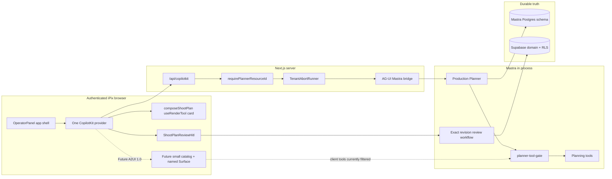
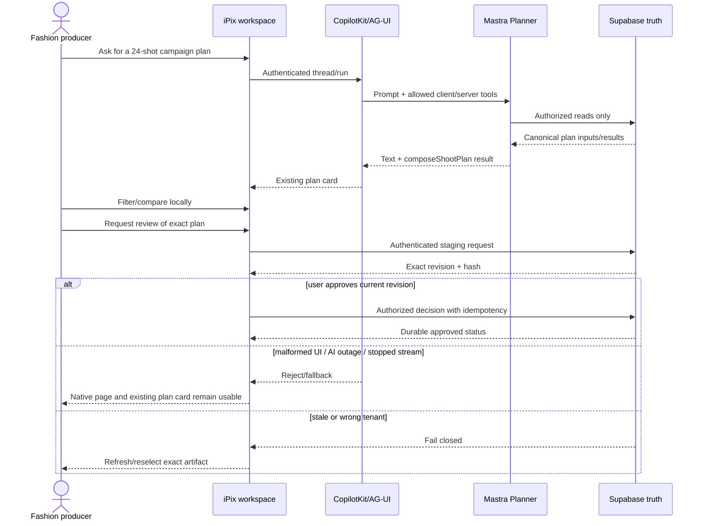
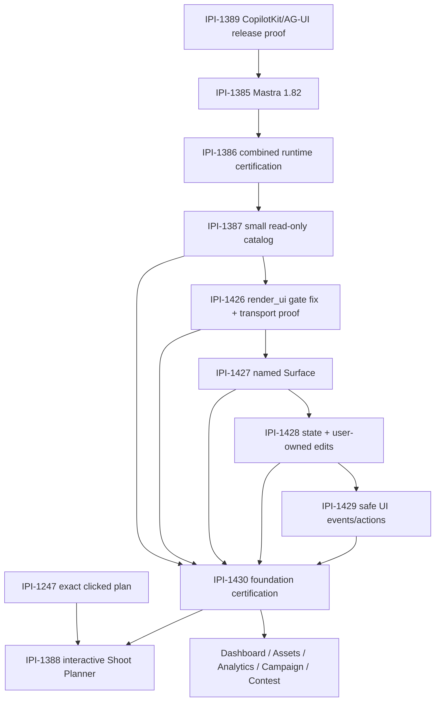

# 09 — iPix CopilotKit GenUI foundation audit and corrected execution plan

- **Audit date:** 2026-11-10
- **Repository:** `amoai-tech/ipixai`
- **Source SHA:** `d55f4c2a6ff82b06626632c60e54dd7d7d8cecaa` (`origin/main`)
- **Audit branch:** `audit/ipi-1425-genui-foundation`
- **Clean worktree:** `/home/sk/worktrees/ipixai-ipi-1425-genui-audit`
- **Foundation epic:** [IPI-1425](https://linear.app/amo100/issue/IPI-1425)
**Canonical Linear plan:** [iPix GenUI Foundation](https://linear.app/amo100/document/ipix-genui-foundation-official-copilotkit-implementation-plan-4cc40bb54dcd)

> This is an evidence record and corrected implementation plan. It does not claim that native GenUI is shipped. It preserves the existing Planner, one authenticated CopilotKit provider, `composeShootPlan` renderer, Mastra runtime, durable memory, and exact-revision HITL.

## Executive summary

iPix already has the hard parts that should be reused: one authenticated CopilotKit provider, an in-process Mastra Production Planner, server-derived tenant identity, durable Postgres memory, exact-run Stop controls, a canonical `composeShootPlan` result, a stable React tool renderer, and server-revalidated Shoot Plan approval. The current architecture is coherent and must not be replaced.

Native CopilotKit Components and Surfaces are **not implemented** on current `main`. The installed CopilotKit 1.85 packages do expose the intended A2UI 1.0 APIs: `createGenerativeUI`, `standardUI`, `GenerativeUISurface`, `useGenerativeUIState`, and `useGenerativeUIFunction`. The official standard catalog contains 69 components. This establishes API availability, not runtime readiness.

The audit found one concrete client-tool compatibility gap: CopilotKit injects `render_ui` as an AG-UI client tool, `@ag-ui/mastra` forwards it as `clientTools`, and installed Mastra filters against `activeTools`. iPix's `planner-tool-gate.ts` always supplies a fixed five/seven-server-tool list, so it also filters the existing `reviewShootPlan` HITL client tool. Existing gate tests lack client-tool cases. IPI-1426 owns the smallest fix, after IPI-1386.

Implementation must nevertheless **stop before changing product code**. IPI-1386, the combined-runtime release gate, is Backlog and blocked by IPI-1385 (Mastra 1.82) and IPI-1389. Current `main` still has Mastra Core 1.71.0. The user-requested rule says not to force a downstream feature through an upstream blocker. Therefore this delivery updates the audit/plan and Linear evidence only; it does not add a catalog, Surface, database object, provider, renderer, or transport.

### Current disposition

| Area | Disposition |
| --- | --- |
| Existing `useRenderTool` Shoot Plan card | **KEEP** |
| Existing `ShootPlanReviewHitl` + workflow | **KEEP**, but do not expose historical clicked-card review until IPI-1247 |
| One authenticated CopilotKit provider | **KEEP** |
| Native A2UI 1.0 catalog/surfaces | **SUPPORTED BY INSTALLED API, NOT IMPLEMENTED** |
| Legacy `@copilotkit/a2ui-renderer` v0.9 | **DO NOT ADD OR ENABLE** |
| Dynamic-schema/fixed-schema A2UI demos | **REFERENCE ONLY / DEFER** |
| Mastra tool gate | **SMALLEST REQUIRED FIX AFTER IPI-1386** |
| New database tables or persistence | **NOT REQUIRED** |
| OpenBot | **REFERENCE ONLY** for governance; not a GenUI dependency |
| OpenMuse / OpenDot | **NOT APPLICABLE**; absent from code and dependencies |

## 1. Source of truth and verification method

### 1.1 Repository state

- The primary checkout `/home/sk/ipixai` was dirty and contained untracked planning files. It was not modified.
- Audit work used a fresh worktree from current `origin/main` at `d55f4c2a6ff82b06626632c60e54dd7d7d8cecaa`.
- The source commit is `IPI-1424 · SPEC — Guide iPix Agents to Use Plans Only When Needed (#327)`, dated `2026-11-10T01:05:06-05:00`.
- Graphify was run before broad inspection. Its semantic backend could not load because the local Python environment lacks `openai`; the AST-only `GRAPHIFY_BACKEND=none` build succeeded with 5,834 nodes and 11,516 edges. No dependency was installed to make the optional semantic backend work.
- `npm ci` completed. The audit host ran Node `22.23.3`, while `package.json` requires Node `24.x`; all local results below carry that environment limitation.

### 1.2 Installed runtime family

| Package | Installed version |
| --- | ---: |
| `@copilotkit/react-core` | 1.85.0 |
| `@copilotkit/runtime` | 1.85.0 |
| `@ag-ui/client` / `@ag-ui/core` | 1.0.2 |
| `@ag-ui/mastra` | 2.0.2 |
| `@mastra/core` | 1.71.0 |
| `@mastra/memory` | 1.32.1 |
| `@mastra/pg` | 1.27.1 |
| `@mastra/client-js` | 1.50.0 |
| `@mastra/observability` | 1.18.1 |
| `mastra` | 1.31.3 |
| Next.js | 16.4.5 |
| React | 19.2.7 resolved |
| Supabase JS / SSR | 2.112.4 / 0.12.5 |

### 1.3 Upstream evidence pins

- CopilotKit 1.85.0 annotated tag resolves to commit [`814af9b33ff8a76c340d78c6bf2b80f5efca0fd8`](https://github.com/CopilotKit/CopilotKit/commit/814af9b33ff8a76c340d78c6bf2b80f5efca0fd8).
- Maintained catalog example pinned at that commit: [`examples/v2/generative-ui-shop/app/generative-ui/catalog.tsx`](https://github.com/CopilotKit/CopilotKit/blob/814af9b33ff8a76c340d78c6bf2b80f5efca0fd8/examples/v2/generative-ui-shop/app/generative-ui/catalog.tsx).
- Maintained runtime example pinned at that commit: [`examples/v2/generative-ui-shop/app/routes/api.copilotkit.$.tsx`](https://github.com/CopilotKit/CopilotKit/blob/814af9b33ff8a76c340d78c6bf2b80f5efca0fd8/examples/v2/generative-ui-shop/app/routes/api.copilotkit.$.tsx).
- Mastra Core 1.71.0 tag resolves to [`6721bffd7eb2ab00df5494817d870db3b540698d`](https://github.com/mastra-ai/mastra/commit/6721bffd7eb2ab00df5494817d870db3b540698d).
- Planned Mastra Core 1.82.0 tag resolves to [`6e8dfcb83facb0861ebefa4fee384429a113acf4`](https://github.com/mastra-ai/mastra/commit/6e8dfcb83facb0861ebefa4fee384429a113acf4).
- CopilotKit/Mastra integration reference used by the repository skill is pinned to [`c14e2270f2dc2b63589d0e84110ef174b2853f91`](https://github.com/CopilotKit/CopilotKit/commit/c14e2270f2dc2b63589d0e84110ef174b2853f91). It is a pattern reference, not a package-version authority.

### 1.4 Evidence actually executed

| Proof | Result |
| --- | --- |
| Clean current `origin/main` SHA | PASS |
| AST Graphify build | PASS, semantic embeddings unavailable |
| Installed export/version probe | PASS |
| Planner gate contract probe | PASS: reproduced `render_ui` excluded from `activeTools` |
| Focused Vitest baseline | **194/194 tests passed in 12 files** |
| Existing planner gate suites | **40/40 passed**; no client-tool regression case |
| TypeScript `tsc --noEmit` | PASS |
| Playwright discovery | PASS: 10 relevant tests discovered |
| Authenticated browser execution | **NOT VERIFIED**: clean worktree has no `.env.test` or `.env.local` |
| Build under supported Node 24 | **NOT VERIFIED**: audit host is Node 22.23.3 |
| Current-main exact-SHA GitHub workflow status | **NOT VERIFIED**: GitHub returned no workflow runs/status contexts for the merge SHA |
| PR #319 exact-head CI | Historical evidence says PASS on `067e99e`; production certification remains open |

Measured focused-test success rate: **194 passed / 194 executed = 100%**. This is not a production success rate and does not cover native GenUI, Node 24 build, hosted streaming, or browser acceptance.

## 2. Current and target architecture



### 2.1 Frontend truth

| Subsystem | Exists and works | Missing / unverified | Reuse decision |
| --- | --- | --- | --- |
| Provider | One `CopilotKit` provider in `operator-panel.tsx:862-869`; no duplicate provider found | No `generativeUI={{ ui }}` config | Add config to this provider only after gates pass |
| Shoot Plan rendering | `useRenderTool` for `composeShootPlan`; pending, invalid-result fallback, stable renderer identity | Historical clicked card is prompt-disambiguated rather than server-bound | Keep renderer; fix IPI-1247 separately |
| HITL | `useHumanInTheLoop`, exact staged identity, server review route, durable workflow validation | Browser model arguments are not clicked-card provenance | Keep; never turn UI click into authorization |
| App shell | 14rem nav, 400–520px desktop Copilot panel, full-screen compact sheet, focus restoration and `inert` behavior | Native named Surface absent; responsive render not re-run in this audit | Reuse shell and tokens |
| UI primitives | Button, Card, Alert, EmptyState, ErrorState, Skeleton, StatusChip | Plan card still uses raw gray/green/amber utilities rather than product tokens/primitives | Adapt existing primitives; no new design system |

### 2.2 Backend, agent, workflow, and data ownership

- `src/app/api/copilotkit/[[...slug]]/route.ts` authenticates before creating local agents and derives the resource ID server-side.
- `src/agent.ts` exposes the one local Production Planner under the `default` key.
- `src/mastra/agents/production-planner.ts` registers five compute/planning tools plus two Brand Intelligence tools and wraps both `stream` and `resumeStream` with the same tool policy.
- `src/mastra/workflows/shoot-plan-review.ts` limits the plan payload, reauthorizes the actor and Brand before service-role staging, suspends on `{approvalId, brandId, revision, planHash}`, and re-reads durable truth on resume.
- Supabase remains business truth. Mastra Postgres owns agent memory and workflow snapshots. Generated UI must consume canonical tool/read-model output and must not become another database or tenant boundary.

### 2.3 Real user journey with failure and recovery



## 3. Official CopilotKit API verification

### 3.1 Installed native GenUI exports

`@copilotkit/react-core/v2/generative-ui` exports:

`createGenerativeUI`, `standardUI`, `GenerativeUISurface`, `useGenerativeUIState`, `useGenerativeUIFunction`, `useGenerativeUIRuntime`, `useGenerativeUIAccessibility`, `exportA2UICatalog`, `MarkdownSurfaces`, `DefaultGenerativeUIChatCard`, `GenerativeUIError`, `child`, and `childList`.

The installed standard catalog ID is `copilotkit/standard@1`. Installed shared code declares `A2UI_VERSION = "1.0"` and `GENERATIVE_UI_RENDER_TOOL = "render_ui"`.

`CopilotRuntime` accepts `generativeUI?: boolean | { agents?: string[] }`. The normal provider catalog envelope can inject `render_ui` for that run; `generativeUI: true` is needed only if every server run should receive the tool independently of a provider catalog. iPix should begin with the provider envelope and should not change the route unless an integration test proves it necessary.

### 3.2 Catalog API decision

- `createGenerativeUI` supplies typed component props, slots, events/functions, descriptions, schema validation, `extends`, `omit`, and `overrides`.
- `standardUI` is a reusable catalog, not a mandate to expose every component.
- A custom component receives typed data props, rendered slots, event callbacks, and setters for `writable` keys.
- When a writable prop is bound to a data-model path, a user edit owns that path and later model updates must not silently replace it.
- `GenerativeUISurface` has a stable target `id`, description, native `fallback`, optional `autoScroll`, and a per-surface component allowlist. The target ID is presentation, never authorization.

### 3.3 Installed limitation: agent-called functions

Installed shared code sets `GENERATIVE_UI_AGENT_FUNCTION_CALLS = false` and rejects `callRendererFunction` with the reason that results cannot yet be returned to the agent reliably. `allowedCallers` types exist, but they do not make agent-direct calls work in this version.

Decision: use renderer/user-gesture events through `useGenerativeUIFunction`; route consequential effects to existing server-authorized and idempotent handlers. Do not claim agent-direct UI functions work.

### 3.4 Native A2UI 1.0 versus older A2UI

| Engine | API | iPix decision |
| --- | --- | --- |
| Native Components and Surfaces / A2UI 1.0 | `createGenerativeUI`, `standardUI`, `generativeUI={{ ui }}`, `GenerativeUISurface`, `render_ui` | Use after runtime gates |
| Legacy A2UI v0.9 | `@copilotkit/a2ui-renderer`, `createCatalog`, provider `a2ui={{ catalog }}` | Do not add or mix |
| Fixed-schema A2UI demo | authored schema + agent data | Reference only; current custom React card is simpler for Shoot Plan |
| Dynamic-schema A2UI demo | second model creates schema/layout | Defer; larger validation, privacy, cost, and recovery surface |

Official references:

- [Components](https://docs.copilotkit.ai/generative-ui/components)
- [Catalogs](https://docs.copilotkit.ai/generative-ui/components/catalogs)
- [Standard catalog](https://docs.copilotkit.ai/generative-ui/components/standard-catalog)
- [Surfaces](https://docs.copilotkit.ai/generative-ui/components/surfaces)
- [State and actions](https://docs.copilotkit.ai/generative-ui/components/state-and-actions)
- [Transports](https://docs.copilotkit.ai/generative-ui/components/transports)
- [Adopt from A2UI](https://docs.copilotkit.ai/generative-ui/components/from-a2ui)

## 4. Standard component inventory and iPix policy

The installed catalog has 69 components:

`AudioPlayer`, `Badge`, `Blockquote`, `Bold`, `Box`, `Button`, `Caption`, `Card`, `Carousel`, `CarouselItem`, `CarouselMediaItem`, `Chart`, `CheckBox`, `ChoicePicker`, `Citation`, `Code`, `Column`, `DateTimeInput`, `Divider`, `EntityCard`, `Favicon`, `FlashcardFlip`, `Flow`, `FlowItem`, `FollowUp`, `Form`, `Grid`, `GridItem`, `HtmlView`, `Icon`, `Image`, `ImageGrid`, `Italic`, `Label`, `Link`, `LinkCard`, `List`, `ListItem`, `Map`, `Markdown`, `Math`, `Modal`, `Popover`, `PopoverContent`, `PopoverTrigger`, `Pressable`, `PulseIndicator`, `Radio`, `RadioGroup`, `Row`, `SegmentedControl`, `Select`, `ShimmerText`, `Slider`, `Spacer`, `Strikethrough`, `Svg`, `Table`, `TableCell`, `TableRow`, `TableSection`, `Tabs`, `Text`, `TextArea`, `TextField`, `Title`, `Tooltip`, `Underline`, `Video`.

### First read-only catalog policy

| Policy | Components | Reason |
| --- | --- | --- |
| Enable immediately | `Box`, `Card`, `Column`, `Row`, `Grid`, `GridItem`, `Spacer`, `Divider`, `Text`, `Title`, `Caption`, `Bold`, `Italic`, `Blockquote`, `Badge`, `List`, `ListItem`, `Table`, `TableSection`, `TableRow`, `TableCell`, `Citation`, `PulseIndicator`, `ShimmerText` | Read-only layout, evidence, status, comparison |
| Enable with iPix adapter/verified data | `Image`, `ImageGrid`, `Carousel`, `CarouselItem`, `CarouselMediaItem`, `Chart`, `EntityCard`, `Link`, `LinkCard`, `Tabs`, `Tooltip`, `Icon`, `Markdown` | Signed media, source allowlist, chart bounds, token/theme and accessibility checks |
| Keep disabled in first pilot | `AudioPlayer`, `Video`, `Map`, `HtmlView`, `Svg`, `Code`, `Math`, `Form`, `Button`, `Pressable`, `CheckBox`, `ChoicePicker`, `DateTimeInput`, `Radio`, `RadioGroup`, `SegmentedControl`, `Select`, `Slider`, `TextArea`, `TextField`, `Label`, `Modal`, `Popover`, `PopoverContent`, `PopoverTrigger`, `Flow`, `FlowItem`, `FlashcardFlip`, `FollowUp`, `Favicon`, `Underline`, `Strikethrough` | Unneeded dependencies, arbitrary content, modal/focus risk, or interactive behavior not required for the read-only transport proof |

Verify that all **69 installed standard components** appear **exactly once** in the three-way policy table: `Blockquote` is read-only; `Label` is deferred with form controls. Do not install Chart/Map/media dependencies until a selected product use case requires them. The first proof needs only layout/text/table/status plus one small iPix-specific comparison component if the standard catalog cannot express provenance clearly.

## 5. Feature-by-feature implementation decisions

| Use case | Simplest supported solution | Do not do |
| --- | --- | --- |
| Existing structured Shoot Plan result | Existing `useRenderTool` + `ComposeShootPlanCard` | Replace it with free-form A2UI |
| Exact Shoot Plan approval | Existing `ShootPlanReviewHitl` + review workflow | Create a GenUI approval engine |
| Read-only option comparison in chat | Small `createGenerativeUI` catalog based on selected `standardUI` components | Enable all 69 components |
| Persistent page-side comparison | Named `GenerativeUISurface` with per-surface allowlist and native fallback | Add another provider or route |
| Page facts visible to generated UI | `useGenerativeUIState` over already-authorized page state | Fetch by browser-supplied org/Brand IDs |
| Editable filters/selections | `bind` + `writable`, local/draft-only ownership | Persist model changes automatically |
| Safe buttons | Renderer event → `useGenerativeUIFunction` → existing authenticated server handler | Trust component name, payload, or surface ID as permission |
| Historical plan review | IPI-1247 server resolution of `threadId + toolCallId` | Ask the model to infer the clicked card |
| Canonical data | Existing tools/read models/Supabase | Let the UI invent business values |

## 6. Mastra and AG-UI audit

### 6.1 Confirmed `render_ui` incompatibility

Evidence chain:

1. Installed CopilotKit runtime middleware removes any duplicate and appends a client tool named `render_ui` (`node_modules/@copilotkit/runtime/dist/v2/runtime/generative-ui/generative-ui-middleware.mjs:27-29`).
2. Installed `@ag-ui/mastra` builds `clientTools` from incoming AG-UI tools and calls `agent.stream(..., { clientTools, ... })` (`node_modules/@ag-ui/mastra/dist/mastra-BKfp6I8O.mjs`, offset 59,730 in the installed minified distribution).
3. `wrapPlannerStreamWithToolGate` computes and forwards `activeTools` at `src/mastra/planner-tool-gate.ts:308-325` and reapplies it from `prepareStep` at lines 286-300.
4. Installed Mastra combines the tools and then filters by `activeTools.includes(name)` (`node_modules/@mastra/core/dist/agent-BOxKOk3n.js`, `prepareToolsAndToolChoice`, offset 12,243).
5. The live iPix allowlists contain only the five planning tools or the seven server tools (`planner-tool-gate.ts:27-43`).
6. Reproduction output:

```json
{
  "clientToolForwarded": true,
  "activeTools": [
    "recommendShootType",
    "planDeliverables",
    "generateShotListDraft",
    "estimateShootBudget",
    "composeShootPlan"
  ],
  "renderUiActive": false
}
```

**Root cause:** a security allowlist designed for server tools also filters known client tools (`render_ui` and the already-registered `reviewShootPlan` HITL hook); no explicit client-tool policy exists.

**Smallest supported fix after IPI-1386:** explicitly admit **only** `render_ui` and `reviewShootPlan`, **each only when present in the current run's `options.clientTools`**. Preserve the existing five/seven-server-tool decision and `RequestContext` persisted policy; reapply only present, explicitly trusted client-tool names on `prepareStep` and resume when the adapter presents them. Never admit arbitrary browser-provided client tool names or revive stale client tools from persisted history. The known HITL tool only requests human review; existing server authorization and exact revision/hash validation still own any write, and IPI-1247 continues to gate historical clicked-card review.

**Required regression:** both `clientTools.render_ui` and `clientTools.reviewShootPlan` become active only when supplied, including resume; an arbitrary client tool remains blocked; `approveDraft` remains blocked in planning; the original 40 gate tests stay green; malformed A2UI falls back; `composeShootPlan` still renders. **End-to-end after IPI-1386:** invoke the registered `reviewShootPlan` tool, verify the operator's exact staged revision/authorization and duplicate-decision denial, and keep historical clicked-card review gated by IPI-1247.

### 6.2 Streaming, Stop, replay, and retry

- Existing focused tests cover streaming, reconnect/history, exact Stop, and thread persistence; the audit's relevant subset passed.
- Mastra abort is cooperative. Closing a stream does not prove an already-running external side effect stopped. GenUI `render_ui` is read-only and safe to discard; consequential tools must remain idempotent and independently authorized.
- Native GenUI replay/reconnect behavior is **NOT VERIFIED** because no catalog exists and no authenticated browser run was executed.
- The provider's `messageFilter` and no-remount shell should remain unchanged during the first catalog/transport slice.

## 7. Supabase, tenant security, and provenance

Read-only inspection used live project `nvdlhrodvevgwdsneplk` (`ipix`), status `ACTIVE_HEALTHY`, Postgres 17.

- Relevant tables have RLS enabled, including `public.org_members`, `shoot.shoot_plan_approvals`, `mastra.mastra_threads`, `mastra.mastra_messages`, `mastra.mastra_resources`, and `mastra.mastra_workflow_snapshot`.
- `shoot_plan_approvals_select_org` restricts reads to Brands whose organization passes `is_org_member`.
- Mastra persistence tables are available only to the `hyperdrive_mastra_runtime` role under explicit `ALL` policies; browser JWT access is not the memory boundary.
- `public.stage_shoot_plan_revision` and `public.decide_shoot_plan_revision` are `SECURITY DEFINER` functions with an empty `search_path`; the application still reauthorizes the user before service-role staging.
- pgvector `0.8.0` and `pg_trgm 1.6` are installed. Their presence does not create a GenUI requirement.
- `agent_context_snapshots`, `brand_graph_*`, plan approvals, and existing read models already cover current data/provenance needs. No new table, vector index, RPC, or draft store is justified for the foundation.

Generated UI rules:

1. A browser `orgId`, Brand ID, thread ID, surface ID, or model value is a claim.
2. Every displayed **business fact** must come from authorized bound server/tool data **or pass server-side validation against its source and tenant scope**. A schema-valid but invented price, shot count, Brand ID or performance metric must not render; show the safe missing-data fallback instead. UI must not fetch tenant data from model-authored identifiers.
3. Media components require an existing authorized/signed preview URL, not a raw private Cloudinary identifier or transformation URL.
4. A generated action can start an authenticated workflow, but cannot approve, publish, pay, delete, or save by itself.
5. Human review must bind actor, organization, exact artifact, revision/hash, and current state.

## 8. OpenBot, OpenMuse, and OpenDot

| System | Repository truth | Decision |
| --- | --- | --- |
| OpenBot | Referenced in architecture documents only; not installed. Existing docs classify it as a governance/permission/audit model and explicitly say not to copy it as a runner fix. | **REFERENCE ONLY**: permission/audit ideas may inform future governance, not this foundation |
| OpenMuse | No code, package, lockfile, or active-document reference found | **NOT APPLICABLE** |
| OpenDot | No code, package, lockfile, or active-document reference found | **NOT APPLICABLE** |

## 9. Top confirmed findings

| # | Severity | Finding and evidence | Root cause / real failure | Smallest fix | Regression / blocker |
| ---: | --- | --- | --- | --- | --- |
| 1 | **High** | `render_ui` and the existing `reviewShootPlan` client hook are absent from the server-only `activeTools` allowlist; installed Mastra filters the client tools. See section 6.1. | A valid GenUI request cannot render; HITL invocation may not reach the model. | Allow only present `render_ui` / `reviewShootPlan` client tools after IPI-1386, preserving server and persisted policy. | Client-tool allowlist and end-to-end HITL regression. **Blocker: Yes for native GenUI.** |
| 2 | **High** | Historical card review is prompt-selected (`compose-shoot-plan-renderer.tsx:13-45,109-131`) rather than bound to `toolCallId`. | The model may stage a different authorized plan/Brand than the clicked card. | Implement IPI-1247 server resolution; keep current workflow. | Plan A → Plan B → reload → click A. **Blocker: Yes for IPI-1388 review action.** |
| 3 | **High** | IPI-1386 is Backlog and blocked; current Mastra remains 1.71.0 rather than the planned 1.82 family. | Downstream feature assumptions have not passed combined-runtime release proof. | Finish 1389/1385/1386 in order. | Exact-SHA runtime matrix. **Blocker: Yes for implementation start.** |
| 4 | **Medium** | No `generativeUI` provider config, catalog, named Surface, state binding, or GenUI action is present on `main`. | Work is planned but not built. | One small versioned catalog, then transport proof. | Import/type, schema rejection, render/fallback. **Blocker: Yes for GenUI capability, not current Planner.** |
| 5 | **Medium** | Installed 1.85 rejects `callRendererFunction`; shared code sets agent function calls false. | Type declarations can be mistaken for working behavior. | Use user events and registered renderer functions only. | Assert rejected operation/fallback. **Blocker: No if design follows supported path.** |
| 6 | **High** | Production dependency audit reports 59 advisories: 33 high, 14 moderate, 12 low, 0 critical; direct runtime chains include AG-UI/CopilotKit/Zod. | Current upstream graph includes vulnerable ranges; npm's suggested downgrade is not a safe fix. | Triage under IPI-1421/related dependency owners; do not run force fix. | Exact lockfile audit + exploitability review. **Blocker: Unverified until highs are triaged.** |
| 7 | **Medium** | Audit host is Node 22.23.3 while repo requires Node 24.x. | Local environment does not match supported engine. | Re-run build/browser proof on Node 24. | `node --version`, clean `npm ci`, build. **Blocker: Yes for this audit claiming release proof.** |
| 8 | **Medium** | Current merge SHA returned no GitHub workflow runs or combined statuses. | A merged commit is not itself evidence of exact-head/current-main CI. | Trigger/use the existing authorized CI path and record exact SHA. | GitHub run URLs. **Blocker: Yes for certification, not static audit.** |
| 9 | **Low** | Root app metadata still says “Mastra + CopilotKit Starter” (`src/app/layout.tsx:44-47`). | Starter identity survived product migration. | Replace with iPix title/description in its own tiny product polish change. | Metadata unit/browser assertion. **Blocker: No.** |
| 10 | **Low** | Plan card maps all shots/deliverables with no channel filter or compact grouping (`compose-shoot-plan-card.tsx:87-121`) and uses raw color utilities instead of product tokens/primitives. | The original card proves structured output but is dense for a 24-shot fashion plan. | Keep the renderer; add local grouping/filtering and token/primitives in IPI-1388 after exact-card binding. | 24-shot desktop/mobile keyboard test. **Blocker: No for foundation; usability issue for pilot.** |

### Confirmed strengths to preserve

- No duplicate CopilotKit provider was found.
- The plan card never fetches, fabricates, or mutates business data.
- Unexpected tool output fails to a visible card rather than crashing chat.
- Review staging reauthorizes the actor/Brand and binds revision/hash.
- The workflow re-reads durable state and rejects pending, stale, superseded, or mismatched decisions.
- The shell preserves the chat instance across open/close and restores focus.
- All inspected Supabase domain and Mastra tables have RLS enabled.

### Unverified risks, not confirmed failures

- GenUI Stop/reconnect/history replay and partial-stream recovery.
- Actual cross-instance Stop and membership-revocation behavior on the current deployed SHA.
- Bundle cost after catalog import.
- Accessibility/spacing at 390, 768, 1440, and 1728 from rendered DOM.
- Exploitability of each npm high advisory in the deployed server/client bundles.
- Private media URL behavior in future standard media components.

## 10. Linear task-by-task corrections

| Task | Current truth | Missing gap / correction | Exact next action |
| --- | --- | --- | --- |
| [IPI-1386](https://linear.app/amo100/issue/IPI-1386) | Backlog; blocks catalog/transport/certification; blocked by IPI-1389 and IPI-1385 | Must include the now-confirmed client-tool/`activeTools` compatibility check, but must not implement the catalog | Finish prerequisites and certify exact combined runtime |
| [IPI-1387](https://linear.app/amo100/issue/IPI-1387) | Backlog; no catalog code exists; blocked by 1386 | Start with selected standard components, not all 69; avoid interactive/media set | After 1386, add one versioned read-only catalog and tests |
| [IPI-1426](https://linear.app/amo100/issue/IPI-1426) | Todo; transport was described as unknown | Confirmed: gate filters both `render_ui` and registered `reviewShootPlan` client tools | Add failing client-tool tests, minimal gate fix, read-only render and end-to-end HITL proof; preserve IPI-1247 |
| [IPI-1427](https://linear.app/amo100/issue/IPI-1427) | Todo; no Surface exists; blocked by 1426 | Surface should follow active thread/Brand and clear stale state; target is not auth | Add one bounded named target with native fallback |
| [IPI-1428](https://linear.app/amo100/issue/IPI-1428) | Todo; no state/writable binding exists | User-owned edits and source provenance need explicit tests | Bind authorized page state; keep edits local/draft-only |
| [IPI-1429](https://linear.app/amo100/issue/IPI-1429) | Todo; existing authenticated actions/HITL are reusable | `callRendererFunction` agent calls are unsupported; clicked-plan action also needs IPI-1247 | Use renderer events; route to existing server handlers; keep exact-review disabled until 1247 |
| [IPI-1430](https://linear.app/amo100/issue/IPI-1430) | Todo; dependencies are correctly explicit | Must add dependency advisory triage and exact-main CI evidence to release record | Run exact-SHA tests/browser matrix and rollback proof |
| [IPI-1388](https://linear.app/amo100/issue/IPI-1388) | Backlog; blocked by 1430 and 1247 | Correctly a product pilot, not foundation infrastructure | Reuse canonical plan/card; add comparison/filter Surface only after both blockers |
| [IPI-1391](https://linear.app/amo100/issue/IPI-1391) | Dashboard task correctly blocked by 1430 + domain owner | No second provider/query layer | Reuse loaded dashboard facts after foundation certification |
| [IPI-1392](https://linear.app/amo100/issue/IPI-1392) | Assets task correctly blocked by 1430 + Assets owner | Signed media and exact asset-version provenance are mandatory | Reuse secure preview/read models; no raw media URLs |
| [IPI-1153](https://linear.app/amo100/issue/IPI-1153) | Analytics remains domain-blocked | Charts must show source/time range/missing status; no generated truth | Reuse deterministic analytics payload and native fallback |
| [IPI-158](https://linear.app/amo100/issue/IPI-158) | Campaign task correctly blocked by 1430 + strategy owner | Old `useRenderToolCall`/registry references must stay historical | Reuse shared catalog and existing campaign media only |
| [IPI-1396](https://linear.app/amo100/issue/IPI-1396) | Contest task correctly blocked by 1430 + verified reads | Current description contains a malformed GitHub link rendering and an outdated “1.73.3 → 1.85” note | Clean documentation when task activates; do not create a contest catalog now |

No task was marked Done. The current dependency order is mostly correct. The only material factual correction is IPI-1426's transport status: it is no longer “unknown”; the gate incompatibility is reproduced.

**Status update 2026-11-12 (this table is the 2026-11-10 audit snapshot):** IPI-1426 is merged on `main` as PR #334, and PR #338 now implements one read-only `ConceptComparison` catalog plus one named `planner-comparison` surface with allowlisted components and an accessible recovery fallback. The catalog is a bespoke read-only component rather than a `standardUI.omit(...)` derivation, so all 69 standard components remain deferred by policy (`ipix-standard-catalog-policy.ts`) and IPI-1427/IPI-1428/IPI-1429/IPI-1430 still own mounting breadth, trusted state, safe actions and certification. The "no catalog code exists" and "no Surface exists" cells above are therefore superseded; the gaps and next actions in the table still stand.

## 11. Premium UI/UX audit

The product already has a restrained iPix system: white/near-black/gray surfaces, hairline borders, 6/10/16/20px radius tiers, Inter, a 14rem navigation rail, and an adaptive Copilot panel. Preserve it. The first GenUI components should use the existing tokens and shadcn-style primitives; do not import demo-shop styling or MDE brand/auth assets.

The Better Design MCP functions named in repository instructions were not available in this session (`find-design-system`, UI/UX principles, review rules, comprehension, and DOM spacing inspection were absent). No new UI page was built or presented. The review below is source-based; rendered spacing and the dashboard capture gate remain **NOT VERIFIED**.

### Desktop — 1440px

```text
┌──────────────┬───────────────────────────────────────────────┬──────────────────────┐
│ iPix nav     │ SHOOT / Campaign 24                           │ Production Copilot   │
│              │                                               │ Context · Brand A    │
│ Dashboard    │ [24 shots] [6 deliverables] [3 channels]      ├──────────────────────┤
│ Brands       │                                               │ user / assistant     │
│ Shoots       │ ┌───────────────────────────────────────────┐ │ messages             │
│ Assets       │ │ Shot plan workspace                       │ │                      │
│ Campaigns    │ │ [All] [Instagram] [Shopify] [Campaign]    │ │ structured Plan card│
│ Analytics    │ │ 01 Hero front  • Instagram • approved ref │ │ + source status      │
│              │ │ 02 Hero detail • Shopify   • assumption   │ │                      │
│              │ │ …                                         │ │ [Stop]               │
│              │ └───────────────────────────────────────────┘ │ [Ask iPix…]          │
│              │ Native page remains truth/fallback            │                      │
└──────────────┴───────────────────────────────────────────────┴──────────────────────┘
```

### Tablet — approximately 768px

```text
┌────────────┬─────────────────────────────────────────────────┐
│ iPix nav   │ SHOOT / Campaign 24                             │
│            │ [All] [Instagram] [Shopify]                     │
│            │ ┌─────────────────────────────────────────────┐ │
│            │ │ Native plan + generated comparison panel   │ │
│            │ │ stacked; never covers approval identity    │ │
│            │ └─────────────────────────────────────────────┘ │
└────────────┴─────────────────────────────────────────────────┘
┌──────────────────────────────────────────────────────────────┐
│ Copilot full-screen sheet when opened                        │
│ Context / messages / structured card / composer              │
└──────────────────────────────────────────────────────────────┘
```

### Mobile — 390px

```text
┌──────────────────────────────────────┐
│ [Menu] iPix             [Copilot]    │
├──────────────────────────────────────┤
│ Campaign 24                           │
│ 24 shots · 6 deliverables            │
│ [All] [IG] [Shopify]  ← scroll       │
│ ┌──────────────────────────────────┐ │
│ │ 01 Hero front                   │ │
│ │ Canonical source · status       │ │
│ ├──────────────────────────────────┤ │
│ │ 02 Hero detail                  │ │
│ └──────────────────────────────────┘ │
│ Native fallback always reachable     │
└──────────────────────────────────────┘

Copilot opens as a full-screen sheet:
┌──────────────────────────────────────┐
│ Production Copilot   Brand A    [×] │
│ context / streamed card / errors     │
│                                      │
│ [Stop]                               │
│ [Ask iPix…                    ][→]    │
└──────────────────────────────────────┘
```

### Top 10 UI/UX improvements

| Priority | Score | Problem / user impact | Proposed fix | Reuse | Complexity |
| --- | ---: | --- | --- | --- | --- |
| P0 | 98 | Historical card click can review the wrong plan/Brand | Bind click to persisted `threadId + toolCallId`; show Brand/revision/hash summary | Existing card, route, workflow | M |
| P0 | 96 | A 24-shot plan is a long undifferentiated list | Add local channel filters, shot grouping and counts; keep canonical plan unchanged | Button/Badge/Card, current view model | S |
| P0 | 95 | Generated content can be confused with durable truth | Show “Generated view” plus source/status; keep native fallback visible | StatusChip/Alert | S |
| P1 | 92 | Dense panel width makes tables/media hard to compare | Render comparisons in page Surface; keep chat for conversation | Existing shell + named Surface | M |
| P1 | 90 | Raw plan-card utilities drift from iPix theme | Replace raw grays/radii with tokens and current primitives during IPI-1388 | Card/StatusChip/tokens | S |
| P1 | 89 | Loading/error states are inconsistent between plan, review, and future surfaces | Use existing Skeleton/ErrorState/EmptyState with precise retry/fallback copy | Existing UI states | S |
| P1 | 88 | Approval identity is not prominent enough for multi-version review | Pin Brand, plan revision, staged time, and “current” status above decision controls | Existing review identity | S |
| P1 | 87 | Mobile AI sheet can hide the native artifact being discussed | Add an explicit “View plan” return action and preserve focus/scroll | Existing full-screen sheet/focus code | S |
| P2 | 83 | Future images may crop or leak inconsistently | Use canonical aspect-ratio slots and authorized named previews only | Existing asset delivery owners | M |
| P2 | 81 | Root metadata exposes starter identity | Set iPix product metadata | Next metadata | XS |

Accessibility acceptance for each generated component: semantic heading order, named controls, visible focus, `aria-live` only for concise stream/status updates, keyboard-equivalent actions, no color-only status, reduced motion, no focus trap outside deliberate modal primitives, and usable 44px mobile targets where the surrounding product standard requires them.

## 12. Corrected implementation plan

### Task dependency and execution order



### Step 1 — Certify one supported combined runtime

**Destination:** IPI-1385/1386 owners; `package.json`, lockfile, existing runtime tests only as those tasks specify.

**Current truth:** CopilotKit 1.85/AG-UI 1.0.2 is installed; Mastra is still 1.71; IPI-1386 is blocked.

**Reference — REFERENCE ONLY**

- URL: [Mastra Core 1.82 release commit](https://github.com/mastra-ai/mastra/commit/6e8dfcb83facb0861ebefa4fee384429a113acf4)
- Source: installed/release types and the existing IPI-1385 plan.
- Use: certify the package family already selected by the owner task.
- Do not copy: optional durable/background/knowledge features or runtime DDL.
- Apply to: existing in-process Planner, memory, PG, workflows, Stop, HITL.
- Change: none in this audit.
- Verify: exact package family, focused tests, Node 24 build, authenticated two-org runtime matrix.

**Success checklist:**

- [ ] Correct package family installed once
- [ ] Existing Planner/Stop/replay/HITL preserved
- [ ] Tenant authorization and exact approval proven
- [ ] No runtime-created schema
- [ ] Exact-SHA CI and hosted proof recorded

**Checkpoint:** STOP until IPI-1386 passes.

### Step 2 — Add one versioned, read-only iPix catalog

**Destination:** `src/lib/copilotkit/ipix-generative-ui.tsx`; provider config in `src/components/operator-panel/operator-panel.tsx`.

**Current truth:** APIs exist; no catalog exists.

**Reference — ADAPT**

- URL: [pinned `generative-ui-shop` catalog](https://github.com/CopilotKit/CopilotKit/blob/814af9b33ff8a76c340d78c6bf2b80f5efca0fd8/examples/v2/generative-ui-shop/app/generative-ui/catalog.tsx)
- Source: `createGenerativeUI`, `extends: [standardUI]`, typed Zod props/descriptions.
- Use: one catalog ID and selective standard catalog inheritance/omission.
- Do not copy: shop data, cart actions, provider/auth, theme, or full component set.
- Apply to: one existing provider.
- Change: selected layout/text/table/status components; at most one iPix-specific comparison component.
- Verify: typecheck, schema bounds, unknown component rejection, no network/write behavior.

**Success checklist:**

- [ ] Correct 1.85 import path
- [ ] One provider only
- [ ] Selected component policy encoded
- [ ] Every displayed business fact has **verifiable provenance**: authorized bound data or independently server-validated source/tenant scope; UI schema validity is insufficient
- [ ] **Negative provenance test:** pass a schema-valid but invented shot count/budget/metric that differs from all authorized bound values; assert it is rejected or hidden and the missing-data fallback appears
- [ ] Existing chat/card/HITL tests pass

**Checkpoint:** PASS only after IPI-1386; STOP on extra provider/renderer/dependency.

### Step 3 — Fix the shared tool gate and prove native transport

**Destination:** `src/mastra/planner-tool-gate.ts` and its tests; route only if a failing installed contract proves necessary.

**Current truth:** reproduced filtering of `render_ui`; the existing `reviewShootPlan` HITL hook is registered but also absent from the server-only active tool list. Runtime middleware supplies `render_ui`; no client-tool allowance has been implemented.

**Reference — ADAPT**

- URL: [CopilotKit transports](https://docs.copilotkit.ai/generative-ui/components/transports)
- Source: default `render_ui` tool transport.
- Use: preserve existing AG-UI/Mastra bridge.
- Do not copy: custom transport, separate agent, markdown transport, or legacy A2UI route.
- Apply to: shared active-tool policy.
- Change: admit only `render_ui` and `reviewShootPlan` when each exists in `clientTools` for the current run/resume; keep server-tool decisions and persisted policy unchanged, never arbitrary client names.
- Verify: valid/malformed render, present/absent cases for both known client tools, arbitrary names denied, server writes denied, Stop/replay and end-to-end HITL exact-stage authorization, while IPI-1247 still blocks historical clicked-card review.

**Success checklist:**

- [ ] Failing regression written first
- [ ] `render_ui` and `reviewShootPlan` active only when supplied in current client tools, including resume; server policy remains unchanged
- [ ] Arbitrary client tools remain inactive
- [ ] `approveDraft` remains blocked in planning
- [ ] Existing 40 gate tests and broader focused suite pass

**Checkpoint:** PASS on a real streamed read-only UI; STOP on authorization or replay regression.

### Step 4 — Add one bounded named Surface with native fallback

**Destination:** smallest existing page owner plus a reusable component such as `src/components/copilotkit/ipix-generative-surface.tsx` only if multiple pages need the wrapper.

**Current truth:** shell exists; no Surface exists.

**Reference — ADAPT**

- URL: [pinned shop Surface usage](https://github.com/CopilotKit/CopilotKit/blob/814af9b33ff8a76c340d78c6bf2b80f5efca0fd8/examples/v2/generative-ui-shop/app/routes/_landing/%2B/index/featured-products.section.tsx)
- Source: stable target ID, catalog link, component allowlist, fallback.
- Use: one page region for read-only shoot-option comparison.
- Do not copy: product-grid UI, auto-scroll assumptions, or target IDs as authorization.
- Apply to: existing authenticated Shoot page/app shell.
- Change: native fallback remains useful before, during, and after GenUI failure.
- Verify: create/update/clear, unsupported component, Brand/thread switch, 390/768/1440 keyboard/focus.

**Checkpoint:** STOP on stale cross-Brand/thread surface or hidden native content.

### Step 5 — Bind authorized state and preserve user edits

**Destination:** existing Planner/page context plus the selected component definitions.

**Current truth:** canonical page/tool state exists; no GenUI state binding exists.

**Reference — ADAPT**

- URL: [State and actions](https://docs.copilotkit.ai/generative-ui/components/state-and-actions)
- Source: `useGenerativeUIState`, `bind`, `writable`, user-owned value precedence.
- Use: read-only Brand/Shoot facts and local channel/shot selections.
- Do not copy: browser-owned authorization, silent persistence, or second draft store.
- Apply to: local comparison filters/selections.
- Change: explicit provenance and missing-data states; user edits win.
- Verify: model update cannot overwrite a manual edit; reset is explicit; wrong tenant never appears.

**Checkpoint:** STOP on silent overwrite or generated fetch identifier.

### Step 6 — Connect only safe user events to existing handlers

**Destination:** catalog event/function definitions and existing authenticated route/action owners.

**Current truth:** supported renderer functions exist; agent-direct function calls do not.

**Reference — ADAPT**

- URL: [State and actions](https://docs.copilotkit.ai/generative-ui/components/state-and-actions)
- Source: `useGenerativeUIFunction` and UI event binding.
- Use: navigation, local filtering, opening an existing review flow.
- Do not copy: autonomous save/publish/pay/delete/approve.
- Apply to: existing authenticated server actions and HITL.
- Change: validate args again server-side; use idempotency for consequential endpoints.
- Verify: forged org/Brand/artifact denied; double click/retry has one effect; IPI-1247 gates historical review.

**Checkpoint:** STOP if a generated component can cross the approval boundary.

### Step 7 — Certify and roll out one realistic Shoot Planner pilot

**Destination:** IPI-1430 then IPI-1388; existing CI/Playwright/Sentry owners.

**Current truth:** static/focused baseline is green; GenUI runtime/browser evidence does not exist.

**Reference — MODEL**

- URL: [CopilotKit components](https://docs.copilotkit.ai/generative-ui/components)
- Source: validation, fallback, surfaces, state/actions as one supported engine.
- Use: test the full shared foundation before domain rollout.
- Do not copy: demo acceptance, invented production percentages, or automatic deployment.
- Apply to: exact authenticated Plan A/Plan B fashion-production journey.
- Change: no new infrastructure; record rollback and exact SHA.
- Verify: Node 24 install/build, targeted/full tests by risk, exact-head CI, authenticated desktop/tablet/mobile, Org A/B, Stop/replay/reconnect, AI outage, malformed operations, accessibility, bundle.

**Checkpoint:** only a human-approved, exact-SHA proof can unblock downstream rollout.

## 13. Production readiness grading

### Scoring method

Each static readiness score is the sum of five equally weighted evidence dimensions: installed/API contract, implementation, deterministic tests, security/authorization proof, and real runtime/browser proof. Each dimension is scored 0–20. Missing evidence receives 0 rather than an assumed pass. “Production verification” remains **NOT VERIFIED** unless a real exact-SHA browser/runtime test was executed.

| Subsystem | Static readiness /100 | Design quality | Implementation completeness | Production verification |
| --- | ---: | --- | --- | --- |
| Component Catalog | 20 | Sound official approach | 0: no catalog | **NOT VERIFIED** |
| Native A2UI compatibility | 25 | Correct engine chosen | API installed; transport blocked by gate | **NOT VERIFIED** |
| AG-UI streaming | 60 | Existing bridge/Stop design is strong | Text/tools implemented; native UI unproved | **NOT VERIFIED for GenUI** |
| Mastra integration | 65 | One in-process agent/runtime | Strong current 1.71 implementation; 1.82 gate open | **NOT VERIFIED on target family** |
| Surfaces | 15 | Correct bounded/fallback design | 0 | **NOT VERIFIED** |
| State and editable inputs | 15 | Correct user-owned precedence | 0 | **NOT VERIFIED** |
| Interactive actions | 45 | Existing HITL/server boundaries strong | GenUI events absent; clicked-card bug open | **NOT VERIFIED** |
| Authentication and tenant security | 75 | Server-derived identity and RLS are strong | Implemented for current Planner | Hosted/current-SHA matrix **NOT VERIFIED** |
| Supabase/data provenance | 75 | Existing owners are sufficient | RLS/RPC/workflow truth implemented | Live catalog inspected read-only; journey **NOT VERIFIED** |
| UI/UX quality | 58 | Existing shell/tokens are coherent | Structured card and responsive shell implemented | Rendered viewport review **NOT VERIFIED** |
| Accessibility/responsiveness | 55 | Good focus/inert/reduced-motion intent | Static responsive rules exist | Browser/AT proof **NOT VERIFIED** |
| Reliability/error recovery | 58 | Existing fallback/replay design is sound | Current Planner paths tested; GenUI absent | Hosted partial-stream/reconnect **NOT VERIFIED** |
| Testing/deployment readiness | 55 | Existing Vitest/Playwright/CI owners are reusable | 194 focused tests pass; current-SHA CI/browser missing | **NOT VERIFIED** |

These numbers measure current evidence coverage, not a forecast and not a production success rate.

### Production success checklist

- [x] One authenticated CopilotKit provider and current Mastra runtime
- [ ] Official component catalog and native GenUI rendering verified
- [x] Current Planner derives tenant/user identity server-side
- [x] Existing consequential review uses server authorization and exact revision/hash
- [ ] Generated component schemas/data provenance verified end to end
- [ ] Stable streamed UI, Stop, replay, reconnect verified
- [ ] Typed state/actions and preserved manual edits verified
- [ ] Native fallback on AI failure verified in browser
- [ ] Desktop, tablet, and 390px mobile verified
- [ ] GenUI accessibility and performance verified
- [x] Existing Planner/card/HITL focused regression passed
- [x] Targeted tests and typecheck passed on audit host
- [ ] Supported Node 24 build, exact-head CI, and authenticated browser proof passed
- [ ] Exact deployed SHA and authorized release evidence recorded

## 14. Changes made, blockers, and next recommended task

### Changes made by this audit

- Added this evidence-based report and corrected plan.
- Reproduced and documented the planner gate/`render_ui` incompatibility without changing runtime code.
- Ran Graphify AST analysis, installed-source/API checks, focused tests, typecheck, Playwright discovery, GitHub/Linear inspection, and read-only Supabase inspection.
- Did not create a catalog, provider, Surface, migration, table, RPC, vector index, renderer, or alternate transport.
- Did not deploy, promote, merge, pay for services, mutate Supabase data, or mark Linear tasks Done.

### Blocking conditions

1. IPI-1385 and IPI-1386 have not passed.
2. The clean audit environment lacks QA env files and supported Node 24.
3. Native GenUI has no real runtime/browser evidence.
4. Dependency high advisories need owner/applicability triage.
5. IPI-1247 blocks historical Shoot Plan review in the first product pilot.

### Next recommended task

**Do not start IPI-1426 implementation yet.** First complete the current release chain through IPI-1385 and IPI-1386. Once IPI-1386 passes, the smallest safe implementation slice is:

> Add failing planner-gate tests for supplied `clientTools.render_ui` and `clientTools.reviewShootPlan`; minimally admit only those known, present client tools without changing the five/seven-server-tool policy or persistence/resume semantics. Verify a read-only catalog fixture and a real HITL review, while arbitrary client tools/writes remain blocked and IPI-1247 still gates historical clicked-card review.

Measurable success:

- one provider, agent, transport, and persistence stack;
- valid `render_ui` reaches the model and displays a schema-validated read-only card containing only authorized bound/server-validated business facts;
- `reviewShootPlan` is available only when registered and an end-to-end test confirms exact staged-review authorization; a schema-valid invented business fact does not render; arbitrary client tools remain unavailable;
- `approveDraft` remains unavailable in planning turns;
- malformed/unsupported UI falls back without losing chat;
- existing 194-test focused baseline plus the new tests pass;
- Node 24 typecheck/build passes;
- authenticated Stop/replay/Org A-B browser proof passes on the exact SHA.

## 15. Audit limitations

- Better Design MCP tools were not installed/exposed, so design-system extraction, principle calls, automated comprehension review, DOM spacing inspection, and dashboard finalization were not run.
- No authenticated Playwright journey, supported-Node production build, exact-current-main CI run, Vercel Preview, or production smoke was executed.
- No advisory was labeled exploitable without an applicability test; npm severity alone is not proof of a reachable vulnerability.
- The dirty primary checkout's untracked `08-copilotkit-genui-plan.md` remains a **local working copy**. This PR tracks `docs/copilotkit-mastra/09-copilotkit-audit-plan.md` as the accessible audit/implementation evidence; the full product plan is attached to [IPI-1425](https://linear.app/amo100/issue/IPI-1425). Do not present the local `08` file as a GitHub-browseable reference.
