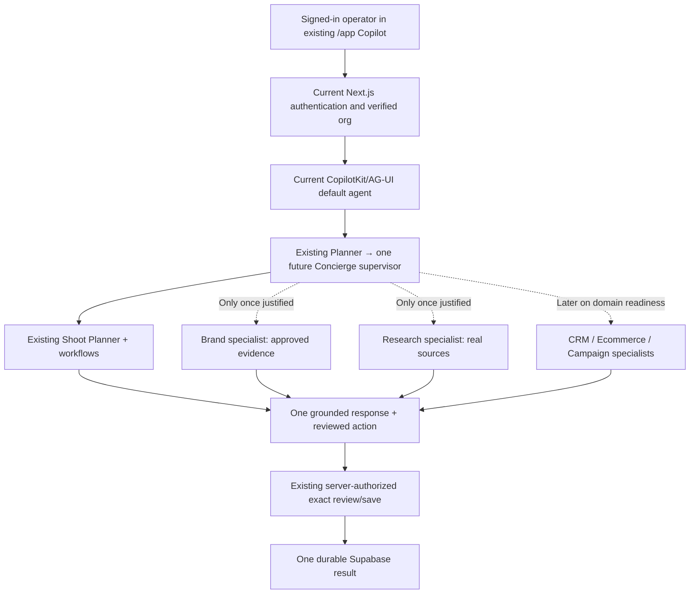

# 01 — Main iPix Agent and AI Platform Tasks

**Task:** Examine → Verify → Validate → Measure → Identify. Build one correct, source-backed task tracker for the existing iPix Production Copilot and the new specialist agent roles. **Reviewed:** November 22, 2026; current main at 07829181. **Parent:** [IPI-1473 — MASTRA-AGENTS-EPIC — Build and Verify iPix Concierge and Specialist Agents on One Secure Runtime](https://linear.app/amo100/issue/IPI-1473).

## Top Task Snapshot

**What changes:** Keep the working iPix Production Planner and extend it into one Concierge with specialized Brand, Research, CRM, Ecommerce and Campaign capabilities, only as real product needs justify them.

**Real-world use case:** “Plan a summer fashion collection shoot, use my Brand DNA, research competitors and create a campaign brief.” A future Concierge consults the correct specialists inside one CopilotKit conversation. The existing Planner produces a grounded Shoot proposal; an actual Shoot is saved only through the existing authenticated, reviewed server action and yields one durable database record.

**Faster/better approach:** Reuse one registered Planner, its five planning tools and two guarded Brand actions, two native Mastra workflows, CopilotKit/AG-UI, Supabase domain records and existing Postgres Memory. First prove one native Mastra supervisor/subagent delegation. Do not create a second runtime, chat provider, tool registry, memory store, workflow engine, MCP server or approval subsystem.

**Current status:** Planner is implemented; the **new Concierge/specialist delivery tasks remain Todo or Backlog with 0% verified implementation**. This is a plan, not shipped multi-agent functionality.

**Tech stack:** Next.js, CopilotKit v2 / AG-UI, Mastra Core 1.84.0, Memory and PostgreSQL/Supabase, existing domain tools and optional scoped external providers.

**Production-ready when:** In authenticated /app, the right agent answers from real authorized facts, a reviewed action persists once, and wrong-tenant, forged IDs, restart, retry, Stop and 390px mobile paths all pass.

## 1. Current truth from source

| Existing piece | Exact current code owner | What is actually working / limitation |
| --- | --- | --- |
| Product Planner | `src/mastra/agents/production-planner.ts`; [IPI-1048](https://linear.app/amo100/issue/IPI-1048) Done | One Planner agent constructor; not a network of role agents |
| Mastra runtime | `src/mastra/runtime.ts` | Registers `agents: { default: getProductionPlannerAgent() }` and two existing Brand/Shoot workflows |
| CopilotKit bridge | `src/agent.ts` and `src/app/api/copilotkit/[[...slug]]/route.ts` | Server-derived org/user resourceId, in-process Mastra, exactly one exposed `default` agent |
| Planning tools | `src/mastra/tools/`, `src/mastra/planner-tool-gate.ts` | Five compute tools, two conditionally selected Brand actions; domain writes require server authorization |
| Mastra storage | `src/mastra/pg-store.ts` | Reuse existing approved Postgres storage; no extra per-agent database |
| Specialist agents | No registration in inspected `src/mastra/runtime.ts` | Concierge, Brand, Research, CRM, Ecommerce and Campaign roles are **not yet implemented** |

**Critical integration risk:** `withPlannerAgentId()` in `src/agent.ts` rejects zero or multiple top-level agents. Registering many new agents at the top level would break the existing CopilotKit bridge. Prefer one supervisor as the existing `default` with **nested native Mastra subagents**, verify the 1.84 API and actual AG-UI stream events first, and expand the registry only when a real product consumer requires it.

**Version caveat:** Current `package.json` and lockfile pin Mastra Core **1.84.0** / @mastra/pg **1.37.0**. The original dirty checkout's existing node_modules was observed at **1.71.0/1.27.1**; it is not reliable evidence of 1.84 API availability. Verify package exports/types in a clean matching installation.

## 2. Existing Linear Agents epic — exact task tracker

**Dots:** 🟢 scope proved · 🟡 partial · 🔴 observed failure · 🔵 not started. **Progress** is task-specific implementation evidence, not overall product readiness.

| Task | User-visible benefit | Status · progress | PR / next proof |
| --- | --- | --- | --- |
| [IPI-1473 · MASTRA-AGENTS-EPIC — Build and Verify iPix Concierge and Specialist Agents on One Secure Runtime](https://linear.app/amo100/issue/IPI-1473) | One shared Concierge + specialists | 🔵 Todo · **0%** new roles | Existing epic; no implementation PR verified |
| [IPI-1474 · AGENTS-001 — Prove Safe Concierge Delegation Before Changing the Agent Registry](https://linear.app/amo100/issue/IPI-1474) | Preserve current chat while delegating | 🔵 Backlog · **0%** | Prove nested delegation via the same `default` |
| [IPI-1475 · AGENTS-002 — Add One iPix Concierge That Delegates Safely to Specialists](https://linear.app/amo100/issue/IPI-1475) | One multi-domain response | 🔵 Backlog · **0%** | Authenticated /app routing, grounded summary |
| [IPI-1476 · AGENTS-003 — Add Brand Expert Using Existing Brand Intelligence and Knowledge](https://linear.app/amo100/issue/IPI-1476) | “Why is this off-brand?” | 🔵 Backlog · **0%** | Real approved Brand evidence and provenance |
| [IPI-1477 · AGENTS-004 — Add Research Expert for Cited Competitor and Website Research](https://linear.app/amo100/issue/IPI-1477) | “Compare three fashion retailers.” | 🔵 Backlog · **0%** | One bounded cited research path; no invented access |
| [IPI-1478 · AGENTS-005 — Add CRM Expert With Authorized Contact and Deal Context](https://linear.app/amo100/issue/IPI-1478) | “Who needs a follow-up?” | 🔵 Backlog · **0%** | Org-scoped real contacts; drafts only initially |
| [IPI-1479 · AGENTS-006 — Add Ecommerce Expert for Grounded Product and Variant Questions](https://linear.app/amo100/issue/IPI-1479) | “Which actual SKU is in my shoot?” | 🔵 Backlog · **0%** | Existing ProductRef/variant, unknowns explicit |
| [IPI-1480 · AGENTS-007 — Add Campaign Expert for Brand-Safe Campaign Planning](https://linear.app/amo100/issue/IPI-1480) | “Create a reviewable campaign brief.” | 🔵 Backlog · **0%** | Real Brand/asset context, no invented publish |
| [IPI-1481 · AGENTS-008 — Verify Agent Delegation, Tenant Isolation, Recovery and Real Journeys](https://linear.app/amo100/issue/IPI-1481) | Trustworthy complete journey | 🔵 Backlog · **0%** | E2E /app, API/DB, Stop, retry, 390px mobile |

**Other canonical owners (do not duplicate):** [IPI-1144 CopilotKit](https://linear.app/amo100/issue/IPI-1144), [IPI-1241 Production Copilot](https://linear.app/amo100/issue/IPI-1241), [IPI-1128 Brand evidence](https://linear.app/amo100/issue/IPI-1128), [IPI-1466 Knowledge](https://linear.app/amo100/issue/IPI-1466), [IPI-1318 Brand workflow](https://linear.app/amo100/issue/IPI-1318), [IPI-1151 Shoot saving](https://linear.app/amo100/issue/IPI-1151), [IPI-1251 URL research](https://linear.app/amo100/issue/IPI-1251), [IPI-1485 optional MCP provider](https://linear.app/amo100/issue/IPI-1485), and [IPI-1484 AI Platform progress](https://linear.app/amo100/issue/IPI-1484).

## 3. Correct target architecture

**Authentication:** Every specialist must use server-verified actor/org and permitted domain records. RequestContext, browser-provided IDs, an MCP tool name or an agent instruction are never authorization. Subagent memory and derived resource IDs must be explicitly tested; never infer isolation from a name alone.

**Tool selection:** Planning turns remain read-only/compute. A specialist does not get all tools merely because it is part of the network. For consequential actions, keep the existing exact-artifact review, server-side authorization and idempotent transaction/readback. No new development paperwork or business approval gate is needed.

## 4. Correct implementation order

1. **IPI-1474 (Core):** Confirm native Mastra 1.84 subagent `agents` API in installed types. Delegate one test specialist while the top-level registry still has only `default`. Verify stream events, abort, tool set, identity and actual resourceId.
2. **IPI-1475 (Core):** Turn that proven pattern into one useful Concierge that routes a real operator question and summarizes grounded results without breaking existing Planner history or UI.
3. **IPI-1476 (Core):** Add a Brand Expert that calls the canonical approved Brand evidence reader ([IPI-1128](https://linear.app/amo100/issue/IPI-1128)), with the read-only Knowledge pilot ([IPI-1466](https://linear.app/amo100/issue/IPI-1466)) as optional general runbook context. Do not duplicate Brand DNA in memory/vector data.
4. **IPI-1477 (Advanced):** Use existing research SDK/provider tools first; select an MCPClient only if [IPI-1485](https://linear.app/amo100/issue/IPI-1485) proves a real cross-process/provider benefit.
5. **IPI-1478–1480 (Advanced):** One CRM, Product or Campaign specialist at a time after its authorized domain read API and a user journey exist.
6. **IPI-1481 (Final):** Authenticated /app → accurate specialist results → exact reviewed persisted action → cross-tenant negative → idempotent retry → process restart/reconnect → Stop → 390px mobile → exact deployed SHA.

**Parallel work:** Fix existing [IPI-1318](https://linear.app/amo100/issue/IPI-1318) Brand resume, [IPI-1151](https://linear.app/amo100/issue/IPI-1151) Shoot saving and [IPI-1250](https://linear.app/amo100/issue/IPI-1250) budget correctness without waiting for all specialist agents.

## 5. Files touched only when a task requires them

| Concern | Existing implementation owner | Smallest modification |
| --- | --- | --- |
| Agent creation, model, tools and Memory | `src/mastra/agents/production-planner.ts` | First delegate one native specialist behind current Planner |
| Planner business instructions | `src/mastra/agents/production-planner-instructions.ts` | Explicit source provenance and handoff rules |
| Agent registration | `src/mastra/runtime.ts`, `src/agent.ts` | Preserve one `default` binding; only change registry intentionally with tests |
| Authentication and streaming | `src/app/api/copilotkit/[[...slug]]/route.ts` | Reuse current user/org + AbortRunner; never add a second assistant provider |
| Tool gate | `src/mastra/planner-tool-gate.ts` | Narrow allowlists for delegated roles; no blanket actions |
| Domain knowledge and data | Existing Supabase services, Brand profile, read-only tools | Reuse records, IDs and citations; no new source of truth |
| Persistence | `src/mastra/pg-store.ts` and existing Memory | Verify delegated resourceId/restart; no per-request duplicate storage |

## 6. Tests and success criteria

| Gate | Proof required | Catches |
| --- | --- | --- |
| Source and version | Exact current main/PR SHA and matched Mastra 1.84 installed types | Copying latest docs or old checkout APIs |
| Correct routing | Simple Shoot question stays Planner; cited Brand question uses Brand | Wrong role or unnecessary expensive delegation |
| AG-UI and Stop | Current `default` chat, transcript, stream + abort propagate into child | Multi-agent work breaks chat or ignores Stop |
| Tenant and tool safety | Org A gets authorized Brand; wrong Org B/forged ID/unknown tool denied | Prompt injection or cross-org leak |
| Accurate sources | Brand revision and real source URL; missing facts explicitly unknown | Hallucinated marketing facts |
| Reviewed action | Approve exact revision → **one** persisted Shoot; retry/double-click no duplicate | Repeat side effects or unsupervised writes |
| Recovery | Suspend/restart/resume and failed provider produce truthful state | Ghost progress and false completion |
| Real product QA | Playwright /app, database readback, 390px and refresh | Backend-only fake pass |
| Release | Focused tests, typecheck, exact-head CI/review and post-merge deployed SHA | Premature Linear Done |

**Evidence scoring:** 0% no agent-role implementation; 25% only design/prototype; 50% code and focused proof; 75% authenticated positive journey without all negative/deployment proof; 100% exact acceptance demonstrated and signed off. Do not add percentages into a fake platform-wide readiness score.

## 7. Official API references (version check mandatory)

[Agents overview](https://mastra.ai/docs/agents/overview) · [Supervisor/subagents](https://mastra.ai/docs/agents/supervisor-agents) · [Agent tools](https://mastra.ai/docs/agents/tools) · [Agent memory](https://mastra.ai/docs/agents/agent-memory) · [Approval](https://mastra.ai/docs/agents/agent-approval) · [Optional MCP](https://mastra.ai/docs/connections/mcp).

Current official Mastra documentation recommends the parent agent's `agents` object for native supervisor delegation. That is **a reference**, not proof it works with iPix's pinned versions and AG-UI bridge: verify installed SDK and actual delegation stream before implementation.

**Scope:** This Agents PR creates documentation only. No agent, auth change, workflow, database migration, third-party MCP dependency or deployment is claimed.