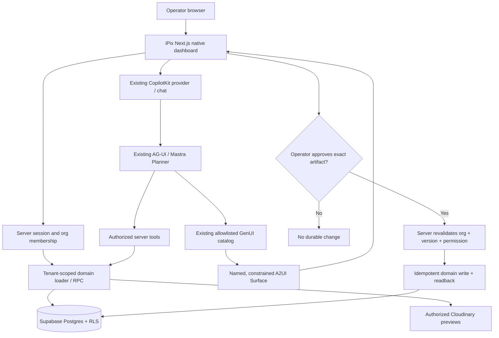
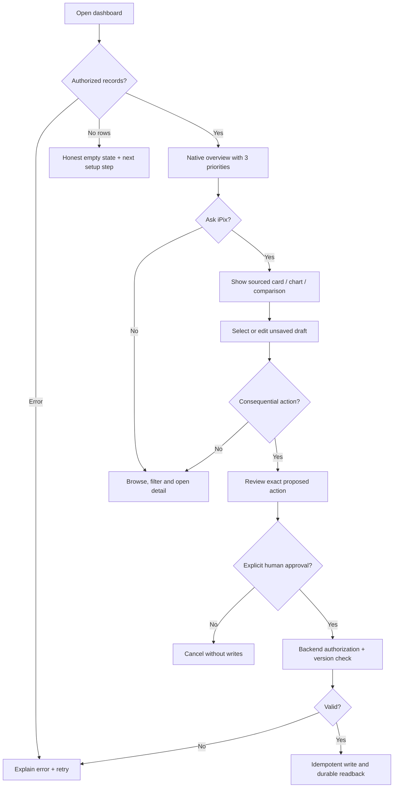
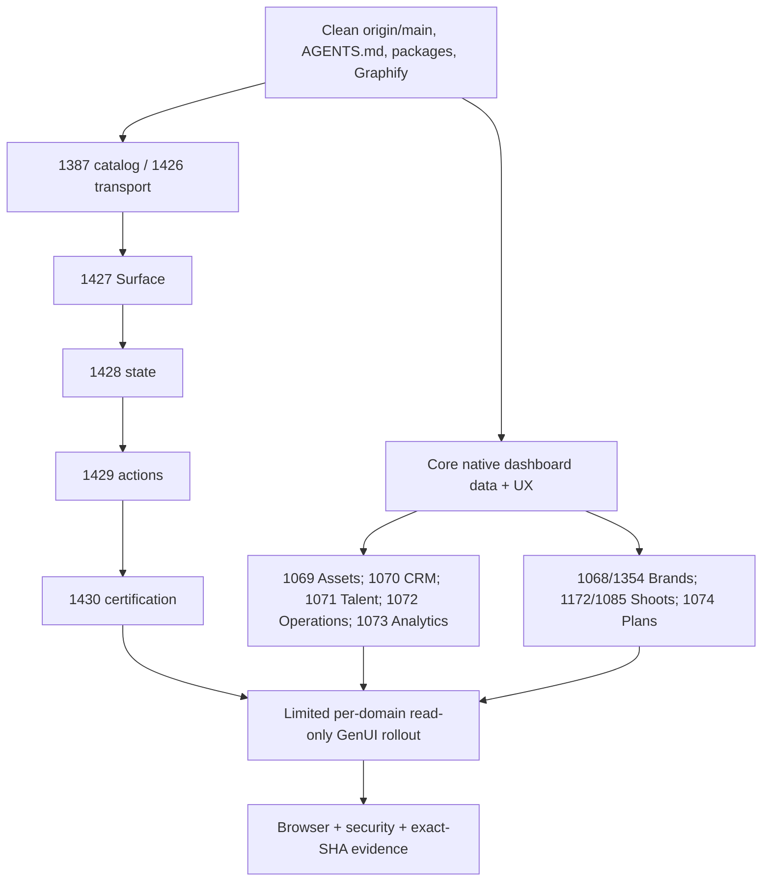

# iPix V2 — Dashboard-by-Dashboard CopilotKit A2UI / Generative UI Implementation Plan

**Audit:** 2026-11-16 · **Scope:** nine authenticated routes, shared AI layer and existing Linear tasks · **Status:** PLANNING ONLY; no product code, data or Linear statuses changed.
**iPix:** https://github.com/amoai-tech/ipixai · **Backlog:** https://linear.app/amo100/project/v2-ipix-cd2f90b58cd2/issues · **Shared GenUI tracker:** https://linear.app/amo100/view/genui-ipix-2250e5c85457
**Prior detailed GenUI plan:** `docs/copilotkit-mastra/improve/24-ipix-genu-ui-task-plan.md` (do not duplicate its foundation tests).
**Source priority:** clean `origin/main` → matching installed lockfile/packages → runtime/Supabase/tests → version-matched official documentation → official example source → current Linear requirements → Lumina design reference.

## Summary and fastest path

**Business result:** an operator can understand *what is happening, what needs attention and what to do next* on each page. Where AI adds value, it produces small, truthful, interactive views from **authorized** data, never invented business numbers or implied writes.

**Faster/better approach:** finish the six shared GenUI tasks once; keep the existing secure native data screens; finish five unfinished dashboards before layering AI; add only the minimum approved `standardUI` subset and page-specific surfaces. Do **not** generate the entire dashboard from an AI response. Reuse existing iPix, then installed APIs, then official examples, then safe presentation from Lumina. Every dashboard works without AI.

**Important version drift observed 2026-11-16:** local `/home/sk/ipixai` is dirty on `ai/skills-copilotkit-mastra-runtime-sync` at `89023908`, with CopilotKit 1.73.3/Mastra core 1.71; inspected `origin/main` is `016e5885`, with CopilotKit 1.85.0, `@ag-ui/mastra` 2.0.2 and Mastra core 1.82.0. `origin/main` contains `src/lib/copilotkit/ipix-generative-ui.tsx` and `src/components/operator-panel/ipix-generative-surface.tsx`; the old local checkout does not. **STOP: never implement or test this plan against the dirty older branch.** Make a clean worktree from the then-current `origin/main`, run `npm ci`, inspect types and `AGENTS.md`, then verify each filename/contract again.

**Actual shared baseline on checked origin/main:** one custom `ConceptComparison` (qualitative-only), one named `planner-comparison` Surface, no catalog functions or writable state. `standardUI` 69 components are **not enabled**. Official A2UI 1.0 components/surfaces are experimental; APIs can change. Use no second CopilotKit provider, Mastra agent, transport, chart engine, global draft store or approval engine.

## 1. Current dashboards and outcome matrix

Status names are live Linear readings on 2026-11-16; code is inspected origin/main/previous authenticated screenshots. A built page is *not* equivalent to fully browser-certified.

| Route / owner | Existing task and status | Core (native, no AI) | Smallest useful GenUI enhancement | Advanced (after evidence) | Primary dependency |
|---|---|---|---|---|---|
| `/app` Home | [IPI-1066](https://linear.app/amo100/issue/IPI-1066) Done | Trusted brand/shoot counts, recent work, next action, honest empty/error | Read-only “Today / needs attention” priority cards from verified sources | Cross-domain brief with evidence and safe deep links | 1430; trustworthy domain loaders |
| `/app/brands`, `/app/brands/[brandId]` | [IPI-1068](https://linear.app/amo100/issue/IPI-1068) In Progress; [IPI-1354](https://linear.app/amo100/issue/IPI-1354) Todo | Browse, status, approved Brand DNA, sources/empty states | 2–3 qualitative concept comparisons; evidence-backed Brand DNA summary | Competitor/trend comparison, explainable recommendation | 1068, 1354, 1093, 1430 |
| `/app/shoots` and detail | [IPI-1067](https://linear.app/amo100/issue/IPI-1067) Done; [IPI-1172](https://linear.app/amo100/issue/IPI-1172) Backlog; [IPI-1085](https://linear.app/amo100/issue/IPI-1085) In Progress | Org-scoped browse/detail; useful status dashboard; reviewable shoot wizard | Read-only shoot readiness comparison + editable *unsaved* choice | Schedule impact/deliverables/budget proposals with exact-revision HITL | 1085, 1428, 1429, 1430 |
| `/app/assets` | [IPI-1069](https://linear.app/amo100/issue/IPI-1069) Backlog; [IPI-1392](https://linear.app/amo100/issue/IPI-1392) Backlog | Authorized asset gallery/detail, filters, exact version/provenance | Compare 2–3 *authorized* versioned previews; local shortlist | Brand-fit and channel-readiness with sourced analysis | 1069, signed preview, 1430 |
| `/app/crm` | [IPI-1070](https://linear.app/amo100/issue/IPI-1070) Backlog | Companies/contacts/deals/activities native UI | Trusted deal comparison table and suggested follow-up *draft* | Prioritized relationship brief with evidence | 1070, 1240, 1430 |
| `/app/talent` | [IPI-1071](https://linear.app/amo100/issue/IPI-1071) Backlog | Actual talent browse/profile/shortlist, known availability | Candidate comparison with “availability unknown” where required | Booking coordination with review and signed-in backend checks | 1071, 1094 booking contract, 1430 |
| `/app/operations` | [IPI-1072](https://linear.app/amo100/issue/IPI-1072) Backlog | Inbox, read state, task coordination and safe navigation | “What needs attention?” summary and verified task grouping | Propose reassignment/rescheduling for approval | 1072, 1240, 1430 |
| `/app/analytics` | [IPI-1073](https://linear.app/amo100/issue/IPI-1073) Backlog; [IPI-1153](https://linear.app/amo100/issue/IPI-1153) Backlog | Deterministic KPIs, explicit source/window, unavailable unsupported metrics | Bound chart/table for exact authorized metric payload | Campaign comparison and cited recommendations | 1073, 1139, 1152, 1430 |
| `/app/plans`, detail, dashboard | [IPI-1074](https://linear.app/amo100/issue/IPI-1074) Done | Saved plan list/details, schedule/status/dependencies | Task comparison, select plan, read-only schedule risk explanation | Scenario “if shoot slips two days” before operator approves | 1428, 1429, 1430; planner reads |

**Important data clarification:** on 2026-11-16 Supabase contains project-wide assets, CRM records, shoots and plans, but the screenshot's QA organization has 2 brands/0 shoots and appears to have no connected assets/plans. Do not display project-wide totals as the signed-in org's data; do not transfer Acme Corp sample data between orgs. No production seeding in this task.

## 2.0 Live foundation corrections and ordered release gates — November 16, 2026

**Latest verified truth:** `origin/main` `016e5885`, CopilotKit 1.85.0/Mastra 1.82.0; PR #343 head `36582ece` now has **zero unresolved inline review threads** and passing build/security/Playwright checks, but GitHub still reports `CHANGES_REQUESTED`. PR #350 is documentation only. Older thread counts and commit IDs below are historical audit snapshots, not current merge claims.

**Dependency correction:** 1387 (catalog) → 1426 (transport) and 1427 (named Surface, integrated with transport) → 1428 (live bound state) → 1429 (local-only user action) → 1430 (shared release certification). In particular, 1387 and 1426 must **not** depend on downstream 1430; the certification task consumes their evidence. Native domain pages proceed independently.

### Step G1 — IPI-1387 · Keep the catalog restricted
**Destination:** `src/lib/copilotkit/ipix-generative-ui.tsx`, `src/lib/copilotkit/ipix-standard-catalog-policy.ts`.
**Reference — REFERENCE ONLY:** https://docs.copilotkit.ai/generative-ui/components/catalogs → `createGenerativeUI` and typed props. **Reference — ADAPT LATER:** https://docs.copilotkit.ai/generative-ui/components/standard-catalog → `standardUI.omit([...])` only when a consuming task needs approved standard components. **Use:** existing `ConceptComparison`; **do not copy:** all 69 renderers or demo data. **Verify:** catalog-policy/schema tests, forbidden Map rejection, typecheck. **PASS:** one bounded catalog. **STOP:** unknown component or API mismatch.

### Step G2 — IPI-1426 · Certify the existing Mastra transport
**Destination:** `src/app/api/copilotkit/[[...slug]]/route.ts`, `src/mastra/planner-tool-gate.ts`; PR #343 `e2e/planner-genui-surface.spec.ts`.
**Reference — ADAPT:** https://github.com/CopilotKit/CopilotKit/tree/main/examples/integrations/mastra → existing AG-UI / Mastra pattern. **Reference — REFERENCE ONLY:** https://docs.copilotkit.ai/generative-ui/a2ui → A2UI 1.0 ops. **Use:** current in-process authenticated Planner; **do not copy:** second runtime, browser-tenancy or demo storage. **Verify:** exact-SHA hosted model card, malformed rejection, Stop/replay, Org A/B. **PASS:** trace and screenshot; **STOP:** fixture-only proof.

### Step G3 — IPI-1427 · Keep one named and safe Surface
**Destination:** `src/components/operator-panel/ipix-generative-surface.tsx`; PR #343 `src/lib/copilotkit/genui-activity-persist.ts` and `src/mastra/thread-persistence.ts`.
**Reference — ADAPT:** https://docs.copilotkit.ai/generative-ui/components/surfaces → named target `id`, allowlisted `components`, fallback. **Use:** existing `planner-comparison`; **do not copy:** nine new page Surfaces. **Verify:** current-head 1440/390 lifecycle, scope/thread switching, incorrect Surface ID, exact deletion identity, replay/recovery. **PASS:** approved PR and browser proof; **STOP:** stale card or pending requested review.

### Step G4 — IPI-1428 · Show authorized live Shoot data
**Destination:** `src/lib/copilotkit/ipix-generative-ui.tsx`, `src/components/operator-panel/operator-panel.tsx`.
**Reference — ADAPT:** https://docs.copilotkit.ai/generative-ui/components/state-and-actions → catalog `state`, `bind`, `writable`, `useGenerativeUIState`. **Use:** authorized `PlannerContext.shoot.targetChannels` and one operator-owned unsaved field; **do not copy:** shopping cart or database writes. **Verify:** correct values, preserved user edit on rerender, reset on active thread AND scope change, Cancel=zero writes, Org A/B denied. **PASS:** typed, source-grounded local binding. **STOP:** unverified Shoot scope.

### Step G5 — IPI-1429 · Add only a user-activated local action
**Destination:** `src/lib/copilotkit/ipix-generative-ui.tsx`, existing comparison renderer.
**Reference — ADAPT:** https://docs.copilotkit.ai/generative-ui/components/state-and-actions → `functions`, `allowedCallers: "rendererOnly"`, `requiresUserActivation: true`, `useGenerativeUIFunction` (verify installed types). **Use:** bounded `selectConcept` local selection; **do not copy:** demo checkout, model-triggered side effects or approval controls. **Verify:** click/keyboard, forged/duplicate choice, zero network/DB writes; existing `src/components/shoot/shoot-plan-review-hitl.tsx` approvals unchanged. **PASS:** reversible local selection. **STOP:** auto-write.

### Step G6 — IPI-1430 · Evidence-based release gate
**Destination:** PR #343 `e2e/genui-surface-fixture.spec.ts`, `e2e/planner-genui-surface.spec.ts`, existing approval/tenant E2E.
**Reference — REFERENCE ONLY:** https://docs.copilotkit.ai/generative-ui/components and https://docs.copilotkit.ai/generative-ui/components/surfaces → renderer lifecycle/rejection. **Use:** current Playwright/CI only; **do not copy:** alternate test framework. **Verify:** independent approval replacing `CHANGES_REQUESTED`, exact-head green CI, authenticated hosted model, cross-org negative, Stop/replay, 390px, accessibility, rollback, post-merge readback. **PASS:** evidence linked to PR and Linear. **STOP:** no Done or rollout from local unit/fixture proof alone.

**Scope:** PR #350 changes documentation, not production code. State/actions belong in focused implementation branches and require their own test results and approvals.

## 2. Foundation tasks — update/finish existing Linear, do not recreate

| Task | Live status | Correction / smallest remaining outcome | PASS evidence |
|---|---|---|---|
| [IPI-1387 — GENUI-CATALOG-001](https://linear.app/amo100/issue/IPI-1387) | In Review | Keep one `createGenerativeUI` catalog and `ConceptComparison`; classify all 69; add explicit allowlist only as page needs, using `standardUI.omit(...)` + `extends` **only if installed types support**. No blanket exposure or new provider. | Component allowlist test; unknown component rejected; theme/accessibility |
| [IPI-1426 — GENUI-TRANSPORT-001](https://linear.app/amo100/issue/IPI-1426) | In Progress | Local real-model `planner-comparison` rendered after fixing A2UI `version:"1.0"` operation; close remaining exact-head hosted, Stop/replay, Org A/B proofs. No new transport. | Authenticated deployed real-model render with exact commit+trace |
| [IPI-1427 — GENUI-SURFACE-001](https://linear.app/amo100/issue/IPI-1427) | In Review | Reuse current `IpixGenerativeComparisonSurface` and named target; ensure no stale surface after thread/Brand switch, refresh and error recovery. Do not add nine page targets prematurely. | Create/update/delete/invalid, refresh, thread/Brand switch, 390 px |
| [IPI-1428 — GENUI-STATE-001](https://linear.app/amo100/issue/IPI-1428) | Todo | Bind server-authorized `PlannerContext.shoot.targetChannels` and one user-owned *unsaved* draft; reset by both `scopeKey` and active thread; no invented scheduled date. | Correct bound values; user edit preserved; cancel = 0 writes; cross-org denial |
| [IPI-1429 — GENUI-ACTIONS-001](https://linear.app/amo100/issue/IPI-1429) | Todo | Implement one validated renderer-only `selectConcept` action, `requiresUserActivation: true`, only after installed signatures verified; selection local. Keep `ShootPlanReviewHitl` for actual approval. | Keyboard/click/invalid-repeat tests; zero writes; HITL unchanged |
| [IPI-1430 — GENUI-CERT-001](https://linear.app/amo100/issue/IPI-1430) | In Review | **Release gate**, not new suite. Reuse established fixtures + real-model AI smoke; run hosted exact-SHA, tenant-negative, refresh/replay, mobile, keyboard, graceful failure, rollback evidence. | All independent proof classes PASS; otherwise BLOCKED |

**Dependency path:** `1387 + 1426 → 1427 → 1428 → 1429 → 1430 → page-specific generated UI`. Native domain pages can develop in parallel.

See §8.1 for the three canonical diagrams (architecture, operator journey, task dependencies).

### Shared source mappings — exact consumption

**Step S1 — Reuse standard components selectively**
- **Destination:** `src/lib/copilotkit/ipix-generative-ui.tsx`; `src/lib/copilotkit/ipix-standard-catalog-policy.ts` (confirm existing path), corresponding contract tests.
- **Reference — ADAPT:** https://docs.copilotkit.ai/generative-ui/components/standard-catalog → `standardUI`, component omit/extend, exact names/props; use only explicit approved components needed by first route.
- **Reference — ADAPT:** https://github.com/CopilotKit/CopilotKit/tree/main/examples/showcases/a2ui-playground/src/a2ui → A2UI 1.0 declarative component operations and catalog thinking.
- **Do not copy:** playground's 52 custom components, demo fake metrics, open-ended component exposure, or agent backend.
- **Verify:** lockfile/type compatibility; allowlist, schema negatives, malicious/broken operation fallback; do not enable unverified ImageGrid/Chart as a shortcut.
- **Checkpoint:** PASS when exact approved catalog renders, forbidden component rejected; STOP on package/API mismatch.

**Step S2 — Mastra Surface transport and recovery**
- **Destination:** `src/components/operator-panel/ipix-generative-surface.tsx`, existing CopilotKit provider/runtime and `e2e/planner-genui-surface.spec.ts`.
- **Reference — ADAPT:** https://docs.copilotkit.ai/mastra/generative-ui/components → `GenerativeUISurface`, named targets and generated operations.
- **Reference — ADAPT:** https://github.com/CopilotKit/CopilotKit/tree/main/examples/integrations/mastra → app/agent integration pattern, **not** its dev startup, identity, memory or deployment.
- **Reference — ADAPT:** https://github.com/CopilotKit/CopilotKit/tree/main/examples/canvas/mastra/src → interactive canvas placement patterns.
- **Verify:** A2UI `version:"1.0"` and root, malformed/fallback, Stop, replay, active-thread and Brand switch, 390px.
- **Checkpoint:** PASS only with authenticated real-model local + hosted exact-SHA proof; STOP if renderer/model mismatch.

**Step S3 — Live state / safe action bindings**
- **Destination:** existing operator-panel provider plus proposed `src/components/operator-panel/ipix-genui-state.tsx` and `ipix-genui-actions.tsx` only if not already owned by task implementation.
- **Reference — ADAPT:** https://docs.copilotkit.ai/generative-ui/components/state-and-actions → `useGenerativeUIState`, `bind`, writable props, renderer functions; inspect matching installed types before implementing.
- **Reference — MODEL:** https://github.com/CopilotKit/CopilotKit/tree/main/examples/canvas/mastra-pm/src → state-sync/task UI, **not** in-memory working memory as domain truth.
- **Do not copy:** demo writes, arbitrary model actions, browser org as authority, duplicated HITL.
- **Verify:** source-bound facts, edit precedence, thread reset, keyboard, zero writes until explicit human approval.
- **Checkpoint:** PASS only when one actual bound card works; STOP if source provenance cannot be enforced.

## 3. Dashboard task-by-task implementation map

Every implementation below is **a proposed revision to the linked existing Linear task**, not a claim that its current description already includes all proposed features. “Core” means usable traditional UI without AI; “Advanced” is subsequent optional value. For repo examples, pin a commit SHA in the owning PR when execution begins.

### Step D1 — Home: give the operator a clear daily briefing
**Task:** [IPI-1066](https://linear.app/amo100/issue/IPI-1066) is Done: do not reopen or alter its historical acceptance. Add a *subtask under* [IPI-1098 HOME epic](https://linear.app/amo100/issue/IPI-1098) **only if** a focused daily-priority brief is missing from existing Dashboard/Intelligence tasks. First search for overlap.
**Destination:** `src/app/app/page.tsx` → `src/components/dashboard/command-center.tsx`, `src/lib/dashboard/command-center.ts`; shared `operator-panel` for AI.
**Reference — MODEL:** https://github.com/CopilotKit/CopilotKit/tree/main/examples/showcases/deep-agents-finance-erp/src → executive overview composition. Use compact KPI/priority layout, **not** finance agent, seeded numbers or database.
**Reference — ADAPT:** https://docs.copilotkit.ai/generative-ui/components/standard-catalog → approved Card/List/Badge subset (exact names/props verified in installed 1.85).
**Change:** Core: hero, org-scoped brand/shoot totals, recent work and zero states; surface no more than 3 authenticated “needs attention” items. Advanced: “What needs my attention?” summarized with source deep links; do not infer approvals from absent rows.
**Verify / checkpoint:** Org A/B counts, empty QA org, no fake metrics, 390px and navigation. PASS = actionable brief remains correct with AI disabled; STOP if a priority lacks a trusted source.

### Step D2 — Brands: turn approved DNA into a useful profile
**Tasks:** [IPI-1068](https://linear.app/amo100/issue/IPI-1068) In Progress (browse/profile correctness); [IPI-1354](https://linear.app/amo100/issue/IPI-1354) Todo (visual Brand dashboard); [IPI-1093](https://linear.app/amo100/issue/IPI-1093) Todo (Brand intake/approval). Do not combine their scopes.
**Destination:** `src/app/app/brands/page.tsx`, `src/app/app/brands/[brandId]/page.tsx` and existing brand components/loader (confirm exact symbols).
**Reference — MODEL:** https://github.com/CopilotKit/CopilotKit/tree/main/examples/showcases/a2ui-pdf-analyst/src/a2ui → fixed/variable factual report layout; **do not copy** A2UI 0.9 wire format or PDF data pipeline.
**Reference — ADAPT:** https://github.com/CopilotKit/CopilotKit/tree/main/examples/canvas/mastra/src → qualitative concept cards and clarifying HITL, **not** memory as Brand DNA truth.
**Change:** Core: approved versus draft statuses, source citations, DNA sections and missing-image fallback. GenUI: existing `ConceptComparison` for *proposed concepts only*; richer factual cards require authorized Brand DTO and 1428. Advanced: sourced competitor comparison and suggestions, manually approved before updating Brand Brain.
**Verify / checkpoint:** draft not advertised as approved; source freshness, org/Brand switch clears Surface, save/reload uses current approved revision. PASS = truthful profile+optional AI; STOP if uncited competitor claims are presented as fact.

### Step D3 — Shoots: make readiness and approval obvious
**Tasks:** [IPI-1067](https://linear.app/amo100/issue/IPI-1067) Done (preserve); [IPI-1172](https://linear.app/amo100/issue/IPI-1172) Backlog (operational overview); [IPI-1085](https://linear.app/amo100/issue/IPI-1085) In Progress (wizard); [IPI-1360](https://linear.app/amo100/issue/IPI-1360) Todo (completion/readiness); review [IPI-1247](https://linear.app/amo100/issue/IPI-1247) exact clicked-plan approval boundary.
**Destination:** `src/app/app/shoots/page.tsx`, `src/app/app/shoots/[shootId]/page.tsx`, `src/lib/shoot/get-shoot-detail.ts`, existing shoot cards/HITL.
**Reference — ADAPT:** https://github.com/CopilotKit/CopilotKit/tree/main/examples/canvas/mastra/src → project cards, multi-step planning, responsive layout; **do not copy** agent storage/authorization.
**Reference — MODEL:** https://github.com/CopilotKit/CopilotKit/tree/main/examples/showcases/spreadsheet/src → editable budget table UX; **do not copy** legacy v1 hooks or browser-led mutations.
**Change:** Core upcoming/active/needs-review/completed groups; keep native 3-gate shoot plan review. GenUI: filtered deliverable comparison/qualitative concepts, local selection. Advanced: what-if rescheduling as proposed diff, not automatic scheduler write.
**Verify / checkpoint:** org-safe shoot list, exact selected shoot/revision, three-gate approval, retry/double-click idempotency, refresh, 390px. STOP if AI can commit without human review.

### Step D4 — Assets: replace placeholder, then add shortlist
**Tasks:** [IPI-1069](https://linear.app/amo100/issue/IPI-1069) Backlog **first**; [IPI-1392](https://linear.app/amo100/issue/IPI-1392) Backlog only *after* asset DTO and GenUI 1430; reuse [IPI-1138](https://linear.app/amo100/issue/IPI-1138) asset QA and [IPI-1119](https://linear.app/amo100/issue/IPI-1119) versioned human approval.
**Destination:** replace placeholder in `src/app/app/[section]/page.tsx` with dedicated `src/app/app/assets/page.tsx` (route placement verify), reuse `src/lib/cloudinary/get-authorized-asset-preview.ts`; proposed `src/components/assets/asset-generative-surface.tsx`.
**Reference — ADAPT:** https://docs.copilotkit.ai/generative-ui/components/standard-catalog → approved Image/ImageGrid/Card (not assume ImageGrid supported in local older runtime).
**Reference — MODEL:** https://github.com/CopilotKit/CopilotKit/tree/main/examples/showcases/a2ui-playground/src/a2ui → image-first UI/selection, **not** model-supplied image URLs.
**Change:** Core gallery, version/status, filters, broken thumbnail fallback. GenUI choose/compare 2–3 *server-issued* exact-version previews, local shortlist. Advanced: cite Brand DNA and recorded QA scores; promotion/publish remains approval path.
**Verify / checkpoint:** forged asset/version denied, Org B denied, expired preview handling, no preview leakage, local selection makes zero writes. STOP until 1069 secure read model exists.

### Step D5 — CRM: restore relationship hub before AI
**Tasks:** [IPI-1070](https://linear.app/amo100/issue/IPI-1070) Backlog; broader [IPI-1103](https://linear.app/amo100/issue/IPI-1103) Backlog; [IPI-1240](https://linear.app/amo100/issue/IPI-1240) Backlog for Intelligence expansion. **Proposed addition:** small `CRM-GENUI-001` child *only if* beyond the existing 1070/1240 acceptance; first check Linear duplicates.
**Destination:** dedicated `src/app/app/crm/page.tsx` replacing generic placeholder, reuse existing CRM data/RPC/contracts (exact owner/symbol confirm), proposed `src/components/crm/crm-generative-summary.tsx`.
**Reference — MODEL:** https://github.com/CopilotKit/CopilotKit/tree/main/examples/showcases/strands-crm/frontend → pipeline priorities, deal cards, contextual focus; **do not copy** Strands/SQLite/Express/tools/security.
**Reference — ADAPT:** https://docs.copilotkit.ai/generative-ui/components/state-and-actions → server-bound values, writable follow-up *draft* only.
**Change:** Core companies, contacts, deals, activities and trusted mutations. GenUI read-only filtered deal table and one suggested call/email draft. Advanced evidence-ranked follow-ups; sending/moving deal to won requires existing validated action and review.
**Verify / checkpoint:** owner org, private contact fields, terminal-stage guard, no autonomous outreach. PASS = native CRM works with AI disabled.

### Step D6 — Talent: browse profiles and compare known availability
**Tasks:** [IPI-1071](https://linear.app/amo100/issue/IPI-1071) Backlog; booking contract [IPI-1094](https://linear.app/amo100/issue/IPI-1094) Backlog; coordinate [IPI-1356](https://linear.app/amo100/issue/IPI-1356) Todo. **Proposed `TALENT-GENUI-001`** only if distinct approved comparisons warrant own test scope.
**Destination:** dedicated `src/app/app/talent/page.tsx`; existing talent data access/contracts, scoped comparison component after core exists.
**Reference — ADAPT:** https://docs.copilotkit.ai/generative-ui/components/standard-catalog → Card/Table/Image/DateTimeInput subset only if allowlisted.
**Reference — MODEL:** https://github.com/CopilotKit/CopilotKit/tree/main/examples/canvas/mastra/src → compare editable entity cards, **not** agent-owned availability as business truth.
**Change:** Core actual talent profiles, portfolios and status; unknown availability clearly unknown. GenUI 2–3 candidate comparison using verified skills/location and *explicit* availability. Advanced availability checks and booking proposal; no reservation/confirmation until server-validated human action.
**Verify / checkpoint:** permission, dates/timezones, unavailable versus unknown, booking conflict/duplicate protection. STOP on absent booking contract.

### Step D7 — Operations: make the inbox actionable
**Tasks:** [IPI-1072](https://linear.app/amo100/issue/IPI-1072) Backlog; [IPI-1104](https://linear.app/amo100/issue/IPI-1104) Backlog; domain AI via [IPI-1240](https://linear.app/amo100/issue/IPI-1240). **Proposed `OPERATIONS-GENUI-001`** only when a unique interactive approval/triage UX cannot fit domain task.
**Destination:** dedicated `src/app/app/operations/page.tsx`; reuse existing `list_notifications`/`mark_notifications_read` and planner task read paths. No duplicate inbox store.
**Reference — ADAPT:** https://github.com/CopilotKit/CopilotKit/tree/main/examples/canvas/mastra-pm/src → task cards/grouping and state display; **do not copy** ephemeral task persistence.
**Reference — MODEL:** https://github.com/CopilotKit/CopilotKit/tree/main/examples/showcases/microsoft-kanban → Kanban UX only; **do not copy** retired demo C# runtime.
**Change:** Core unread/assigned/due item grouping, per-user read state, target deep links. GenUI “urgent today” source-linked list. Advanced suggested reassign/reschedule diff → existing authorization/HITL.
**Verify / checkpoint:** no cross-user notification leak, mark-read persists, stale target graceful, no fabricated urgency. PASS = inbox usable independently of model.

### Step D8 — Analytics: source provenance first, AI charts second
**Tasks:** [IPI-1073](https://linear.app/amo100/issue/IPI-1073) Backlog, [IPI-1139](https://linear.app/amo100/issue/IPI-1139) Backlog measured facts, [IPI-1152](https://linear.app/amo100/issue/IPI-1152) Backlog trusted queries, [IPI-1153](https://linear.app/amo100/issue/IPI-1153) Backlog GenUI. Do not move 1153 ahead of real metrics.
**Destination:** dedicated `src/app/app/analytics/page.tsx`, tenant-safe query/metric DTO (determine existing owner), approved chart Surface under analytics components.
**Reference — MODEL:** https://github.com/CopilotKit/CopilotKit/tree/main/examples/showcases/deep-agents-finance-erp/src → executive widgets, **not** synthetic metric or external finance schema.
**Reference — MODEL:** https://github.com/CopilotKit/CopilotKit/tree/main/examples/showcases/a2ui-pdf-analyst/src/a2ui → fixed vs dynamic chart choice, **do not copy** 0.9 protocol.
**Reference — ADAPT:** https://docs.copilotkit.ai/generative-ui/components/standard-catalog → allowlisted Chart/Table/Select only with exact verified props and bindings.
**Change:** Core trustworthy counts and filters, supported dimensions/window/provenance; show Unavailable for missing reach/CTR/conversion. GenUI render only typed server aggregate; Advanced campaign trend/cross-channel recommendations cite source and date.
**Verify / checkpoint:** SQL-to-chart exact equality, empty vs unavailable, date boundaries, Org A/B, no made-up denominators. STOP if requested metric lacks data lineage.

### Step D9 — Plans: enhance the existing saved plan, not a second planner
**Tasks:** [IPI-1074](https://linear.app/amo100/issue/IPI-1074) Done (preserve), [IPI-1107](https://linear.app/amo100/issue/IPI-1107) Backlog epic; existing structured plan [IPI-1233](https://linear.app/amo100/issue/IPI-1233) Done and [IPI-1084](https://linear.app/amo100/issue/IPI-1084) Done. **Proposed `PLANS-GENUI-001`** only after searching for duplicate planning-card tasks, especially [IPI-1388](https://linear.app/amo100/issue/IPI-1388).
**Destination:** `src/app/app/plans/page.tsx`, `src/app/app/plans/[instanceId]/page.tsx`, `src/app/app/plans/dashboard/page.tsx`, `src/lib/plans/get-plans.ts`, existing `ComposeShootPlanCard`.
**Reference — ADAPT:** https://github.com/CopilotKit/CopilotKit/tree/main/examples/canvas/mastra-pm/src → Kanban/shared task view; **do not copy** transient in-memory store.
**Reference — ADAPT:** https://docs.copilotkit.ai/mastra/generative-ui/components → only add named page surface if better than current structured plan card.
**Change:** Core list, filters, progress, dependency/phase and approval states. GenUI read-only plan comparison/table (same canonical plan DTO). Advanced simulate changed date and show affected tasks as unsaved diff; commit only through approved planner RPC.
**Verify / checkpoint:** same exact plan clicked, no duplicate planner records, phase gate respected, refresh/permissions. STOP if model-chosen plan substitutes for operator selection.

## 4. Task correction and addition decisions

**Update existing tasks before creating new ones:**
1. Append **GenUI optional enhancement (post-1430)** section to IPI-1172, IPI-1354, IPI-1070, IPI-1071 and IPI-1072; do not expand core native milestones or reclassify accepted Done issues.
2. Keep IPI-1069 → IPI-1392, and IPI-1073 + IPI-1139 + IPI-1152 → IPI-1153 as explicit blockers. Avoid GenUI-only placeholder demos in production.
3. Extend IPI-1240 with source-bound per-domain intelligence adapters, not separate assistant agents; its delivery order is Plans → Assets → CRM → Talent → Operations → Analytics **after** available domain data.
4. Existing `IPI-1387` owns the component allowlist/theme only; domain tasks own DTO/interaction logic. Existing `IPI-1430` certifies the shared platform once. Never replicate E2E suites in each page.
5. If Linear has no overlap, propose **one optional task** for Home priority briefing (under 1098) and **at most one small GenUI child** per CRM/Talent/Operations/Plans where a separate acceptance deliverable is truly needed. No new tickets created by this document. Use approved Linear templates and full `IPI-XXX · TASK-ID — Outcome` title once assigned.

**Suggested title candidates (NOT created):**
- `DASH-TODAY-001 — Help Operators See Today's Three Most Important Actions`
- `CRM-GENUI-001 — Compare Trusted Deals and Draft Follow-ups Without Sending Them`
- `TALENT-GENUI-001 — Compare Verified Talent Without Inventing Availability`
- `OPERATIONS-GENUI-001 — Summarize Today's Source-Linked Tasks and Approvals`
- `PLANS-GENUI-001 — Explain Schedule Changes Without Modifying Saved Plans`

## 5. Core versus advanced feature prioritization

| Domain | Core required for usable MVP | AI enhancement (post-certification) | Advanced only with domain truth |
|---|---|---|---|
| Home | trusted overview and nav | 3 grounded next actions | cross-domain prioritization |
| Brand | approved DNA profile | qualitative concept comparisons | sourced competitor research |
| Shoots | browse/detail/wizard/HITL | shot/deliverable comparison | schedule scenarios |
| Assets | photo gallery/status/secure preview | select exact approved images | channel fit analysis |
| CRM | companies/contacts/deals/activity | explain deals / unsent draft | scored relationship opportunities |
| Talent | profile/shortlist/known availability | compare 2–3 candidates | booking proposal with conflicts |
| Operations | inbox/tasks/read state | grounded priority grouping | reviewable routing suggestions |
| Analytics | measured figures/provenance | interactive charts from typed payload | sourced cross-campaign recommendations |
| Plans | actual saved plans/dependencies | explain blocked tasks | schedule what-if and approved change |

**Visual UX contract:** within three seconds: what happened, needs attention, next action. Native layout owns headers/nav/cards; AI is a bounded inline explanation/visualization. Never fill the page with 69 dynamic widgets. Desktop ≥1280 and mobile 390, appropriate font/contrast, keyboard/focus/ARIA, no streaming live-region spam, no UI shifting.

## 6. Implement/test/release checkpoints

1. **Preflight:** read live Linear full description/dependencies; `AGENTS.md`; clean `origin/main`; exact lockfile; Graphify load-bearing paths; read-only Supabase queries/policies/views/RPC grants; official docs/version source. STOP if truth conflicts.
2. **Core native route:** render data/errors/empty states with server-resolved org membership, RLS defense and safe pagination. Prove with AI unavailable. Do not import old app's auth/runtime.
3. **Smallest GenUI feature:** expose *only* required catalog components; bind an approved typed DTO; surface in one named target or existing chat; keep user edits ephemeral until approval.
4. **Safety:** model can't create real prices, measured performance, permissions or media URLs; cross-org/Brand/thread replay denied; no unknown actions; original HITL exact artifact/revision rechecked on server.
5. **Cheapest proof first:** static + unit/schema, focused tests, targeted DB/RLS/RPC contract, typecheck, then browser and hosted exact-SHA; real-model smoke in `chromium-ai-smoke` only. Use existing fixtures; test 390px/keyboard/empty and failure/retry.
6. **Release:** record PR/head/test traces/screenshots/rollback; obtain human exact-head approval; **human merges**; post-merge production browse and authorized readback; update Linear status/evidence only when demonstrated. No production DB writes/seeding from an audit.

### Acceptance checklist for EACH dashboard
- [ ] Authenticated page loads with current org's real data, or honest empty/error.
- [ ] No cross-tenant rows/preview/AI Surface; model output cannot choose org.
- [ ] Basic browse/filter/navigation works without AI.
- [ ] Generated UI supports the prompt it advertises and does not invent metrics, approved states or URLs.
- [ ] Generated UI selection is local, writable field preserves operator input, on Cancel no DB mutation.
- [ ] Durable change uses exact artifact human approval, server authz and idempotent write/readback.
- [ ] Works at 1440 and 390 widths with keyboard, focus and appropriate accessible labels.
- [ ] Refresh/reconnect/Stop/thread/Brand switching clears stale generated content.
- [ ] Regression suite, targeted RLS tests, exact-SHA hosted journey and screenshot evidence recorded.
- [ ] Production release and rollback proof; owner approves merge.

## 7. Official documentation and example mapping index (only sources used above)

The URLs are repeated within their **consuming implementation steps**; this is an index for convenient navigation, not a substitute for step-local mapping.

- https://docs.copilotkit.ai/generative-ui/components/standard-catalog — S1; D1/D4/D6/D8 component selection. Use selectively.
- https://docs.copilotkit.ai/mastra/generative-ui/components — S2; D9 named surfaces. Experimental A2UI candidate; verify installed.
- https://docs.copilotkit.ai/generative-ui/components/state-and-actions — S3; D5 state/renderer-only actions.
- https://github.com/CopilotKit/CopilotKit/tree/main/examples/integrations/mastra — S2 transport pattern only.
- https://github.com/CopilotKit/CopilotKit/tree/main/examples/showcases/a2ui-playground/src/a2ui — S1/D4 A2UI rendering patterns; no demo metrics/backend.
- https://github.com/CopilotKit/CopilotKit/tree/main/examples/canvas/mastra/src — S2/D2/D3/D6 visual canvas, no demo data storage.
- https://github.com/CopilotKit/CopilotKit/tree/main/examples/canvas/mastra-pm/src — S3/D7/D9 project UI, no in-memory truth.
- https://github.com/CopilotKit/CopilotKit/tree/main/examples/showcases/strands-crm/frontend — D5 CRM visual pattern; no Strands stack.
- https://github.com/CopilotKit/CopilotKit/tree/main/examples/showcases/deep-agents-finance-erp/src — D1/D8 widgets; no generated KPIs.
- https://github.com/CopilotKit/CopilotKit/tree/main/examples/showcases/a2ui-pdf-analyst/src/a2ui — D2/D8 report layout only; A2UI 0.9 is incompatible with 1.0.
- https://github.com/CopilotKit/CopilotKit/tree/main/examples/showcases/microsoft-kanban — D7 visual-only retired showcase.
- https://github.com/CopilotKit/CopilotKit/tree/main/examples/showcases/spreadsheet/src — D3 editing concept; inspect version compatibility.
- https://supabase.com/docs/guides/database/postgres/row-level-security — native loaders in D1–D9; current org authorization and RLS required.
- https://supabase.com/docs/guides/auth/server-side — authenticated server-side loaders in D1–D9.
- https://github.com/amoai-tech/luminaai — only copy/clean proven visual/pure logic after precise file review; never old auth, runtime or tenancy.

**Final execution decision:** Do shared 1430 certification; ship missing native dashboards; add *one* sourced, useful, user-triggered GenUI enhancement per domain; measure acceptance. Do not make all nine pages AI-generated, duplicate already-Done work, or report success without real browser proof.

---

## 8. Automated Linear execution handoff — 2026-11-16

**Role:** Senior CopilotKit Engineer · Systems Architect · Premium UI/UX Designer.
**Priority:** Verify → Reuse → Simplify → Update existing Linear → Implement → Test → Prove.
**Execution policy:** Treat every linked issue's newly prepended 2026-11-16 correction as its next-action supplement, not evidence of completion. Historical descriptions are preserved. No new Linear issues were created during this pass; do not invent duplicates without a proven independent deliverable. Core UI can be implemented independently of GenUI release certification, while **new** A2UI product surfaces wait for IPI-1430.

**Current cross-repository context:** MDE styles/components can inspire the UX only; iPix has its own tokens, Tailwind and shadcn. Never import MDE tokens, tenant data, Google Maps, client assumptions, or alternative CopilotKit providers automatically. Google Maps adds no value to most of these pages; only use map/location integrations after an actual verified business requirement (e.g. shoot location), licensed API, privacy check, and iPix authorization.

**Official setup choice:** Predictable, durable screens = server-rendered/react domain UI; known agent tool result = existing `useRenderTool` / `useHumanInTheLoop`; changeable visual explanation = `GenerativeUISurface` with constrained component allowlist; simple two-option concept comparison = existing `ConceptComparison`; **no dynamic-schema second LLM** until a specific problem cannot use existing fixed components. A2UI 1.0 candidate is not identical to older 0.9 A2UI instructions; do not mix operation formats.

### 8.1 Three required engineering diagrams

#### Architecture — who owns state, auth, UI and writes



**Defect-prevention checks:** AI text is neither org authority nor metric truth; Cloudinary URL must be server issued; local selection cannot mutate Postgres; never copy demo agent runtime. State after cancel is ephemeral and discarded.

#### User journey — useful without AI, human-owned decisions



#### Dependencies — native domain and shared GenUI in parallel



Dependency correction: IPI-1430 is a **gate** after 1387, 1426, 1427, 1428 and 1429, not something to mark complete in parallel while state/actions are unimplemented. Native Assets/CRM/Talent/Operations/Analytics work may proceed now. A completed Linear issue stays completed; new substantive scope needs a separate child only when clearly not covered by another live task.

### 8.2 ASCII wireframes — simple premium, responsive, informative

#### Home / Dashboard · Desktop

```text
┌─ iPix ─ Sidebar ────┬─ Production overview ──────────────────────────────────────┬─ Ask iPix ─────┐
│ Dashboard           │ Good morning — what needs attention today?                │ Production     │
│ Brands              │ [Active shoots] [Needs review] [Approved assets] [Tasks]    │ Copilot        │
│ Shoots              │                                                               │                │
│ Assets              │ NEEDS ATTENTION (max 3 real source-linked items)           │ What should I  │
│ CRM                 │ [Review assets >] [Confirm shoot >] [View blocked tasks >] │ do next?       │
│ Talent              │                                                               │                │
│ Operations          │ UPCOMING WORK                     RECENT ASSETS             │ [Ask...]       │
│ Analytics           │ [Shoot photo][date][status]      [real photo thumbnails]    │                │
│ Plans               │ [View shoot]                      [Open library]             │                │
└─────────────────────┴───────────────────────────────────────────────────────────────┴────────────────┘
```

#### Detail areas — shared screen grammar by page

```text
┌─ [Page name] ───────────────── [Search] [Filter] [Sort] ────────────────────┐
│ [Top summary: verified records ONLY] [Status / provenance]                 │
│                                                                           │
│ [Primary grid / image gallery / table / Kanban with genuine records]      │
│                                                                           │
│ [Selected item detail: evidence, links, relevant status and next step]    │
│                                                                           │
│ [OPTIONAL AI view: sourced summary or 2–3 item comparison]                │
│ [Select locally] [Open native detail] [Review draft — never auto commit]   │
└───────────────────────────────────────────────────────────────────────────┘
```

**Applied per page:** Brands = DNA sections/source citations; Shoots = active/coming/blocked/completed + approved wizard; Assets = large authorized previews and exact versions; CRM = pipeline/companies/deals with follow-up draft; Talent = portfolio/verified availability/unknown; Operations = unread inbox/task list; Analytics = source/date-labelled trusted charts; Plans = saved plan/dependencies/approval status.

#### Mobile 390px

```text
┌────────────────────────────┐
│ ☰ iPix        [Ask iPix]   │
│ Dashboard title            │
│ Short description          │
│ [KPI A]     [KPI B]        │
│ [Next action >]            │
│ [Second action >]          │
│                            │
│ [Image / card full width]  │
│ [Status + details]         │
│ [Open detail >]            │
│                            │
│ [AI comparison: collapsed] │
│ [Expand]                   │
│                            │
│ Safe bottom sheet for Ask  │
└────────────────────────────┘
```

UX rules: 1440/1024/768/390 widths; no horizontal overflow; 44px+ tap targets where practical; focus order and accessible names; 2-line card summaries, progressively disclosed details, skeleton/loading/error/empty states; no invented imagery, charts or status colors; avoid dense small text and synthetic AI-looking mock dashboards. Use current iPix design tokens, not MDE stylesheets transplanted wholesale.

### 8.3 Exact official documentation decision mapping, by implementation step

**Step 8.3.1 — Choose native, tool-rendered or Surface, not everything at once.** Destination: `src/components/operator-panel/operator-panel.tsx` and existing native feature owner. **Reference — REFERENCE ONLY:** https://docs.copilotkit.ai/generative-ui/components → sections *Components and surfaces / When something does not render*. Use Inspector to identify provider/catalog/tool/Surface failures. **Do not copy:** another provider/runtime. **Verify:** a stable known Shoot Plan remains on existing `useRenderTool`, variable comparison enters existing Surface, AI-off native route passes. **Checkpoint:** same tool result cannot accidentally produce duplicate durable UI owners.

**Step 8.3.2 — Select component catalog and typed schemas.** Destination: `src/lib/copilotkit/ipix-generative-ui.tsx`. **Reference — ADAPT:** https://docs.copilotkit.ai/generative-ui/components/catalogs → `createGenerativeUI`, Zod props, `extends`; https://docs.copilotkit.ai/generative-ui/components/standard-catalog → `standardUI.omit(...)` and explicit components, versioned catalog. **Do not copy:** complete unbounded standard catalog, irrelevant Map/Video/HtmlView. **Verify:** installed types + allowlist export contract tests. **Checkpoint:** test rejects unknown components and unsupported schema properties.

**Step 8.3.3 — Fixed vs dynamic A2UI.** Destination: existing `ipix-generative-ui.tsx` and `ipix-generative-surface.tsx`. **Reference — REFERENCE ONLY:** https://docs.copilotkit.ai/generative-ui/a2ui → approach comparison; https://docs.copilotkit.ai/generative-ui/a2ui/fixed-schema → fixed shaped cards for known records; https://docs.copilotkit.ai/generative-ui/a2ui/dynamic-schema → choose only when UI structure is truly unknown and certified; A2UI v0.9 code examples are not portable directly to 1.0. **Do not copy:** a second LLM/schema generator or old operation names. **Verify:** exact installed AG-UI/Mastra middleware + `version:"1.0"` semantics; test malformed stream and fallback. **Checkpoint:** simplest existing component works before introducing new A2UI schemas.

**Step 8.3.4 — Mount bounded named page Surface.** Destination: `src/components/operator-panel/ipix-generative-surface.tsx` first; per-domain destination only after 1430. **Reference — ADAPT:** https://docs.copilotkit.ai/generative-ui/components/surfaces → `GenerativeUISurface` `id`/`ui`/`components`/`fallback` and `autoScroll`. **Do not copy:** full-page model replacement, unbounded allowlist or wrong-thread reuse. **Verify:** create/update/delete/failure, refresh, active Brand/Thread and 390px. **Checkpoint:** no foreign/stale UI after scope switches.

**Step 8.3.5 — Bind real records and safe local actions.** Destination: `src/components/operator-panel/operator-panel.tsx` and proposed tiny state/actions adapters only when needed. **Reference — ADAPT:** https://docs.copilotkit.ai/generative-ui/components/state-and-actions → `useGenerativeUIState`, writable bindings, `useGenerativeUIFunction`. **Do not copy:** demo checkout, agent-initiated approval or model-authored metrics. **Verify:** exact server-provided values; user edit wins, Cancel=zero writes; validated renderer-only activation. **Checkpoint:** human must review a real authenticated operation before any write.

**Step 8.3.6 — Compare current official GitHub source examples in *owning* domains.** Destinations: `src/app/app/shoots/*`, `src/app/app/crm/page.tsx`, `src/app/app/analytics/page.tsx` (only create after owner check). **References — ADAPT/MODEL:** https://github.com/CopilotKit/CopilotKit/tree/main/examples/integrations/mastra for current agent transport; https://github.com/CopilotKit/CopilotKit/tree/main/examples/canvas/mastra/src for visual project cards; https://github.com/CopilotKit/CopilotKit/tree/main/examples/canvas/mastra-pm/src for task states; https://github.com/CopilotKit/CopilotKit/tree/main/examples/showcases/strands-crm/frontend for CRM design only; https://github.com/CopilotKit/CopilotKit/tree/main/examples/showcases/deep-agents-finance-erp/src for analytics layout only. **Do not copy:** alternative agent frameworks, memory databases, fake business data, unsupported A2UI 0.9 or old auth. **Verify:** pinned upstream SHA + exact file/symbol in each implementing PR and package compatibility. **Checkpoint:** one safe component per page with proven data source.

**Step 8.3.7 — Responsive wireframe and diagrams.** Destination: `docs/copilotkit-mastra/improve/25-dashboard-plan.md` and page task. **Reference — MODEL:** https://github.com/amoai-tech/mdeai/tree/main/.claude/skills/wireframe → `SKILL.md`, *Prove → Journey → Wireframe → Contract → Implement → Verify*; **Reference — ADAPT:** https://github.com/amoai-tech/mdeai/tree/main/.claude/skills/mermaid-diagrams → `SKILL.md`, diagram-first trust/approval/ownership checks. **Do not copy:** MDE-specific routes, Maps/API, tokens or tenant logic. **Verify:** three diagram parse checks, 1440/1024/768/390 screenshots and keyboard/focus. **Checkpoint:** another engineer can implement from the wireframe with no invented data fields.

### 8.4 Agent execution instruction / safer automation

**Do not run a blind all-issues script.** Take one task at a time on a clean isolated worktree. Start with exact live Linear ID, read `AGENTS.md` and `.claude/skills/tasks/SKILL.md` + relevant CopilotKit/Mastra/Supabase/domain skills; run Graphify targeted call graph; verify actual versions/types, current GitHub PRs and CI; compare code against official example symbol and pin upstream SHA. Record `Current truth → smallest gap → owner file → reference + no-copy boundary → test → checkpoint`. If the scope is already covered, update task with the proof and skip code. Use `npm ci` in clean worktree, not dirty checkout.

For each independent task: implement smallest code change, targeted test first; then typecheck and the existing GitHub CI floor checks (there is no `npm run floor` script); run Playwright authenticated journeys and mobile. Browser proof with real data must show Org A/B negative, current Brand/thread, failure recovery, AI disabled behavior, and exact approval/write readback when appropriate. Commit/push to a **new task branch**, open a draft PR with proof and pinned references, get independent review, correct actionable comments, then request **human approval before merge**. Certify exact deployed SHA and update Linear status only when evidence supports it.

**Build order with strongest return on effort:** (A) shared GenUI proof and certification in parallel with (B) five native empty dashboards; then (C) targeted native improvements in Shoots/Brands/Plans; then (D) per-page GenUI cards. Keep existing IPI-1066/1067/1074 Done issues Done and create no replacement for them. Use IPI-1076 existing Dashboard Design epic as the umbrella, not a new duplicate epic.

**Acceptance for task updates:** clear plain-English benefit and example; concise opening 150–250 words; links *inside* consuming steps; exact destination and CODE owner; upstream version and no-copy boundary; dependencies; PASS/STOP; clear evidence status; no fake % readiness. Do not merge separate tasks into a giant implementation PR. This parent document is roadmap not certification.


---

## 9. Forensic verification of the 18 Linear tasks — 2026-11-16

**Audit boundary:** clean origin/main 016e5885, PR #343 head 123b9e68, docs PR #350. Read-only live iPix Supabase advisor/policy inspection. No production changes, migrations, payments, uploads, new agents or data seeding. Authenticated production user journeys were not run. All 18 issues received an evidence-specific forensic comment, without changing their statuses or overwriting historical requirements.

### 9.1 Actual local verification

- Clean main: npm ci --ignore-scripts PASS; GenUI/catalog/HITL 31 of 31 targeted tests PASS; Brand/Shoot/Plans/Dashboard/Cloudinary/auth-scoped tests 160 of 160 PASS; TypeScript typecheck PASS.
- PR #343: GenUI persistence, scope, history and Surface unit tests 60 of 60 PASS; TypeScript typecheck PASS.
- PR #343: deterministic Playwright Fixture 2/2 PASS on installed system Chrome at desktop 1440 and mobile 390. Only the temporary audit Playwright config changed the executable and removed irrelevant auth storageState for the fixture; it was deleted after the run. The fixture exercises rendering, update, deletion, rejected operations, recovery, interrupt, thread/scope switching and reload. Expected malformed Map components were intentionally rejected.
- No real-model authenticated hosted Preview / Org A vs B / paid AI-smoke / actual backend mutation was executed here. PR #343 GitHub CI also showed passing build, full Playwright and security jobs at audit, but hosted certification must still target the exact merge candidate.
- The initially attempted Playwright run failed because the clean worktree lacked bundled Chromium and the ignored auth storageState file. Retrying with system Chrome and no auth fixture dependency passed. Missing .env.test/.env.local warnings remain environment setup warnings, not proof of production failure.
- No npm run floor script exists in current package.json. The floor is a GitHub CI job; do not invent an npm script or equate its result with authenticated live proof.

### 9.2 Task verdicts — actual owner, blocker, smallest fix

1. **IPI-1387, Component Catalog — implemented pilot / acceptance pending.** Main src/lib/copilotkit/ipix-generative-ui.tsx contains one qualitative ConceptComparison; src/lib/copilotkit/ipix-standard-catalog-policy.ts intentionally defers all 69 standard components. Do not enable them wholesale. Official https://docs.copilotkit.ai/generative-ui/components/standard-catalog ; verify Zod allowlist and unsupported component rejection.
2. **IPI-1426, A2UI Transport — partial / PR-only advanced proof.** Main src/app/api/copilotkit/[[...slug]]/route.ts and planner-tool-gate.ts provide existing runtime. PR #343 adds A2UI capture/persistence, not yet merged. Verify exact-SHA hosted model rendering and stream Stop.
3. **IPI-1427, Generative UI Surface — review blocked.** Main ipix-generative-surface.tsx has one planner-comparison target, not certified availability across all pages. Previously six threads were unresolved; on current PR #343 head `36582ece` **zero** are unresolved. The `CHANGES_REQUESTED` review still requires an approving reviewer decision; confirm latest-head safety tests before merge.
4. **IPI-1428, Live State — missing.** Main src has no useGenerativeUIState. Add one authorized shoot targetChannels binding, one user-owned unsaved field, and reset on both scopeKey and active thread. Prove cancel causes zero writes.
5. **IPI-1429, Safe Actions — missing.** Main catalog has zero GenUI functions. Implement only a renderer-only, user-activated selectConcept with exact argument validation. Reuse shoot-plan-review-hitl.tsx for consequential human approval; never grant A2UI buttons direct commit powers.
6. **IPI-1430, Production Certification — blocked.** PR #343 E2E files do not exist on main; they must be merged and reviewed before calling them shipped. Require exact-head authenticated preview, Org A/B, Stop/replay/reconnect, errors, 390px, HITL and rollback evidence.
7. **IPI-1068, Brands — native foundation exists; incomplete user proof.** Actual /app/brands and brand detail routes and tests exist. Keep tenant-safe loaders; verify approved versus draft DNA, sources, mobile and authenticated end-to-end.
8. **IPI-1354, Brand DNA visual dashboard — Todo still valid.** Build a fact-checked visual Brand profile before AI. External report example https://github.com/CopilotKit/CopilotKit/tree/main/examples/showcases/a2ui-pdf-analyst/src/a2ui is MODEL only; its A2UI 0.9 wire protocol is not portable to current 1.0.
9. **IPI-1172, Shoots operational dashboard — backlog still valid.** Existing Shoot list/detail works but needs meaningful upcoming/active/needs-review/completed groups. Modify current route and DAL, no parallel shoot store.
10. **IPI-1085, Shoot Wizard — partial; stale PR #257 not suitable.** Existing ComposeShootPlanCard + useRenderTool and ShootPlanReviewHitl + useHumanInTheLoop are genuine reusable implementation. Complete native six-step create/approve/save/reopen with exact artifact, revision, server authorization and idempotent readback.
11. **IPI-1069, Assets — native page missing.** src/app/app/[section]/page.tsx shows ASSETS-001 placeholder. Use dedicated /app/assets route and src/lib/cloudinary/get-authorized-asset-preview.ts with exact version + signed tenant-safe preview.
12. **IPI-1392, Asset GenUI — blocked on 1069 and 1430.** Local shortlist of two or three approved, authorized asset versions; no model-issued preview URL or implicit approval/publishing.
13. **IPI-1070, CRM — native page missing.** Generic route shows CRM placeholder despite CRM tables with RLS policies. Reuse existing DAL/RPC before read-only sourced deal card and unsent follow-up draft.
14. **IPI-1071, Talent — native page missing.** Generic route shows Talent placeholder. Browse actual profiles first; missing availability remains Unknown. Booking requires explicit, conflict-safe review/authorization.
15. **IPI-1072, Operations — native page missing.** Generic route shows Operations placeholder. Reuse notifications/read-state contracts; source-backed inbox and task linking before AI priorities.
16. **IPI-1073, Analytics — native page missing.** Generic route shows Analytics placeholder. Build measured metric DTOs with source/time range first; unsupported reach, CTR, ROI and conversions display Unavailable, not zero.
17. **IPI-1153, Analytics GenUI — blocked by 1073, metric owners and 1430.** Chart values must match authorized typed DTO exactly, independent of model text.
18. **IPI-1240, Cross-domain Intelligence — backlog needs sequencing.** Extend canonical Planner after each domain loader exists. No second Mastra agent, pgvector search for simple KPI screens, model-authored tenant or Stripe billing tasks.

### 9.3 Exact review-blocking source paths on PR #343

- **HIGH review question, surface identity:** src/lib/copilotkit/genui-activity-persist.ts lines 237–238 prioritizes mapped/inferred Surface ID before event.surfaceId. Verify conflicting IDs cannot associate patches with another Surface; prefer explicit trusted match + reject conflicts; targeted regression first.
- **HIGH review question, deletion identity:** src/mastra/thread-persistence.ts lines 266–276 allows null activity without required surfaceId; current collector normally supplies ID, but helper is exported. Reject missing/foreign/stale ID on deletion/rejection unless a proven safe migration requires it. Add negative tests.
- **MEDIUM observability:** genui-activity-persist.ts lines 116–122 silently disables collector after 256 KB. Keep bound but add privacy-safe diagnostic, no model contents or secrets in logs.
- **REVIEW, not automatically a defect:** thread-persistence.ts lines 250–258 uses JSON.stringify tail dedupe; test reordered object keys and replay before replacing. genui-activity-persist.ts line 116 handles CRLF/newline but not bare CR; prove the actual transport expectation before changing. Missing old scopeKey is intentionally fail-closed, so do not default missing Brand history to workspace.
- Those were six previously unresolved reviewer-thread areas; they are now resolved, not six proven security exploits. Track actionable resolutions, exact fix commits and tests in https://github.com/amoai-tech/ipixai/pull/343 .

### 9.4 Services and settings: only change when task consumes them

- **Supabase:** read-only advisor reports 44 authenticated-callable SECURITY DEFINER findings, six RLS-enabled tables without policies, and public-schema extension warnings. Audit function body/grants/exposure individually. Do not blindly grant permissive policies or relocate vector extension as part of GenUI. https://supabase.com/docs/guides/database/database-linter?lint=0029_authenticated_security_definer_function_executable
- **CopilotKit/Mastra:** main versions CopilotKit react-core/runtime 1.85.0, AG-UI Mastra 2.0.2, Mastra core 1.82.0. Keep one existing session-bound runtime, agent, provider, tool gate and HITL. https://docs.copilotkit.ai/generative-ui/components and https://mastra.ai/docs/agents/human-in-the-loop
- **Vercel keys:** operator-panel.tsx reads NEXT_PUBLIC_COPILOTKIT_PUBLIC_LICENSE_KEY; API route reads server-only COPILOTKIT_LICENSE_TOKEN. Verify set in correct environment during actual preview/deployment failure; no need to add optional managed Intelligence or MASTRA_BASE_URL for in-process Planner.
- **Cloudinary:** relevant for Assets and image previews. CLOUDINARY_API_SECRET stays server only. Signed exact-version preview and foreign-org denial tests first. https://cloudinary.com/documentation/control_access_to_media
- **pgvector:** may serve Brand research/retrieval, not ordinary dashboard browse/analytics fact queries. https://supabase.com/docs/guides/ai/vector-columns
- **Stripe:** none of these 18 tasks adds billing or payment UI; no Stripe keys, SDK or webhook modifications needed. https://docs.stripe.com/webhooks

### 9.5 Production acceptance / release gate

- [ ] Exact main/PR SHA and task owner verified; PR-only feature never described as merged.
- [ ] Core page works with AI off, real org data, honest loading/error/empty states.
- [ ] Tenant A/B and forged Brand/Shoot/Asset/Thread negatives; no cross-org preview or replay.
- [ ] AI-generated comparisons use allowlisted components and trusted measured payloads, not prose-based status, prices or ratios.
- [ ] Local selection/Cancel causes zero writes. Consequential operations use existing HITL with exact operator-selected artifact, server revalidation, idempotency and readback.
- [ ] Desktop/tablet/390px, keyboard/focus, refresh, Stop, reconnect and error recovery demonstrated.
- [ ] Targeted tests and typecheck pass; GitHub checks pass; no unresolved actionable threads; hosted authenticated exact-SHA production/preview journey recorded; human-approved merge and rollback.
- [ ] Linear status/evidence updated only after actual proof, not because an audit report or PR was created.

**Final audit decision:** Native dashboards can proceed in parallel. Shared GenUI enhancements cannot claim production certification while PR #343 still has an active `CHANGES_REQUESTED` review or IPI-1428/1429 are unimplemented. Prioritize solving the smallest real code/authorization gaps, not creating more architectural layers.
