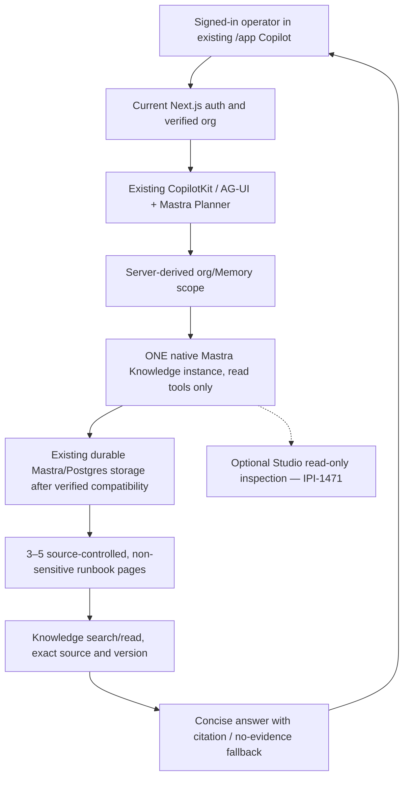

# 01 — Implement iPix Knowledge Using the Existing Mastra Runtime

**Canonical issue order:** [IPI-1467](https://linear.app/amo100/issue/IPI-1467) → [IPI-1468](https://linear.app/amo100/issue/IPI-1468) → [IPI-1469](https://linear.app/amo100/issue/IPI-1469) → [IPI-1470](https://linear.app/amo100/issue/IPI-1470); [IPI-1471](https://linear.app/amo100/issue/IPI-1471) after pilot only. **No duplicate tickets.**

**Operator success:** In the existing iPix Copilot, “What is our pre-shoot checklist?” returns a useful answer whose statements come from a current real source document. Another organization's runbooks are invisible; errors are honest; refresh does not lose the thread.

## 1. Current facts and known risks

| Item | Evidence | Verdict / next action |
| --- | --- | --- |
| Mastra Core in current main | package.json pins Core 1.84.0; supports Knowledge family | 🟢 Version baseline. Check exact installed exports/types in implementation worktree |
| Current native Knowledge registration | src/mastra/runtime.ts has agents, workflows, storage and run-control routes, **no knowledge registration** | 🔵 IPI-1468 implementation missing |
| Studio server 4211 | November 22 curl connection refused on every tested endpoint | 🔴 Local server not running; starting it is separate from enabling Knowledge |
| Historical Studio Knowledge API | Earlier authenticated /api/knowledge returned 404 | 🔵 Routes not mounted at that time; not the same as today's TCP refusal |
| Mastra PG Knowledge table compatibility | IPI-1467 notes prior missing Knowledge tables; **live DB not re-inspected in this review** | 🟡 Unknown: inspect current DB/version and migration ownership before writing |
| Scope isolation | Official Mastra Knowledge alpha scope/access semantics | 🟡 Never place sensitive customer/private cross-org content in pilot; isolate scopes and test wrong-org queries |

## 2. Architecture

### The important boundaries

- **Knowledge is not chat Memory.** Memory continues thread history; Knowledge holds curated shared runbooks.
- **Knowledge is not Brand DNA.** The verified Brand profile remains in canonical Supabase/domain records. [IPI-1128](https://linear.app/amo100/issue/IPI-1128) owns accurate Brand claims/citations; do not seed random Brand profile copies into Knowledge.
- **Knowledge is not an import service.** Seed a handful of source-reviewed pages through an idempotent script; no general crawler/vector store.
- **Knowledge Studio is diagnostic.** A 200 HTML page is not proof /app can answer from docs. Do not enable broad routes just to remove “browsing isn't enabled.”

## 3. Exact tasks with file owners and acceptance

| Step | Existing Linear task | Minimal files and decision | Required proof |
| --- | --- | --- | --- |
| **1 — Verify** | [IPI-1467 · iPix Knowledge 1 — Verify Native API, Tenant Scopes, and Postgres Compatibility](https://linear.app/amo100/issue/IPI-1467) | src/mastra/runtime.ts; src/mastra/pg-store.ts; src/mastra/server-auth.ts; src/app/api/copilotkit/[[...slug]]/route.ts; inspect installed @mastra/core, @mastra/pg types, present migrations and current DB | Real versioned scope-path test, existing in-process Copilot adapter passes trusted scopes, PG can store/read/restart. Wrong-org scoped request denied |
| **2 — Register** | [IPI-1468 · iPix Knowledge 2 — Add One Tenant-Scoped, Read-Only Mastra Knowledge Instance](https://linear.app/amo100/issue/IPI-1468) | Proposed src/mastra/knowledge.ts, update existing src/mastra/runtime.ts and authenticated agent invocation; no second runtime | One read-only knowledge_search/read/list capability; no create/edit/delete note/page tool in model catalog; tenant derived from verified server |
| **3 — Seed and answer** | [IPI-1469 · iPix Knowledge 3 — Seed Real Runbooks and Show Sources in Existing Copilot](https://linear.app/amo100/issue/IPI-1469) | Proposed scripts/seed-knowledge.ts and a few validated existing docs; current Planner instructions/UI for citations | Seed twice = one record per source slug; edits update same page; operator sees accurate source path and version; missing docs = honest unknown |
| **4 — Certify** | [IPI-1470 · iPix Knowledge 4 — Prove Retrieval, Security, Persistence, and Mobile End-to-End](https://linear.app/amo100/issue/IPI-1470) | Existing Vitest, Playwright, 390px and hosted staging; no duplicate testing framework | Org A/B, auth revoked, bad scope, zero results, hostile doc, offline PG, restart, refresh, real /app UI and DB readback |
| **5 — Advanced optional** | [IPI-1471 · iPix Knowledge 5 — Optional Pinned Context and Secure Studio After Pilot Proof](https://linear.app/amo100/issue/IPI-1471) | Conditional KNOWLEDGE_ROUTES and MASTRA_KNOWLEDGE_PRINCIPALS_KEY mapping in canonical runtime/auth only after pilot | Authenticated Studio tree/search/graph/notes, wrong-org 404/no results, no cross-scope leak, pinned context token budget measured |

**Important version detail:** Current official Studio docs show importing KNOWLEDGE_ROUTES from @mastra/server/server-adapter, registering the Knowledge instance on Mastra and setting request principals under auth. Verify actual installed SDK and any required server adapter package before coding. The historical local route 404 does not justify bypassing authorization.

## 4. Production-grade tests by gate

1. **Focused unit:** valid scope vs encoded/invalid scope, current org vs org B, viewer only, accepted source IDs, bounded search text.
2. **Database/storage:** exact schema/version, additive migrations only if needed, no accidental automatic reset/init; persist page, restart service, same page/version readback, repeat seed no duplicate.
3. **Retrieval:** “What is the pre-shoot checklist?” sourced from validated doc; no document means “I could not find that in the current runbooks”; outdated docs marked stale; never invent policies.
4. **Security and negative:** anonymous/expired/wrong-org request, forged resourceId, prompt injection in doc, agent trying to write/reassign a shared page, cross-scope copy, accidental private content in model output. Every denied read must return no protected content.
5. **UI and agents:** one Production Copilot; exact selected Brand/org, read-only Knowledge calls, citations visible, no secondary chat provider; 390px and refresh.
6. **Failure/recovery:** lost DB, rate limits, timeouts, no text match and process restart report truthful failure; no silent in-memory fallback as durability proof.
7. **GitHub:** focused tests → typecheck/lint → risk-matched Playwright → exact-head CI → review → merge with owner approval → exact deployed SHA + authorized positive/negative smoke → update existing Linear children.

## 5. Error diagnosis / how to avoid false positives

| Observed result | Meaning | Smallest next step |
| --- | --- | --- |
| TCP refused / status 000 | Studio process is not serving that port | Start correct current Mastra dev server; check listener and logs |
| UI /knowledge HTTP 200 | Studio frontend exists | Does **not** mean Knowledge instance/routes loaded |
| /api/knowledge HTTP 404 | Routes unregistered (or no matching API in current setup) | Check opt-in instance/KNOWLEDGE_ROUTES on exact runtime |
| HTTP 401 | Authentication missing/invalid | Use authorized signed-in local QA user; never weaken server auth |
| HTTP 403 on a Knowledge child route | Authenticated but no allowed Knowledge principals or permission | Set server-derived principals in the **correct active auth or middleware path**, not a client field |
| HTTP 500 on malformed principals | Host mapping/config error | Strict principal type/schema and test missing/wrong mapping |
| HTTP 501 on link index/storage | Installed storage/schema version missing capability | Verify pinned @mastra/pg + additive migration; never fake the result |
| Empty search | No readable matching content | Answer “not documented”; verify seed/source or scope mismatch |
| Correct doc appears for wrong org | **Security failure** | Stop pilot with private content; fix server scope and data separation; add regression |

**Special caution:** Mastra Knowledge alpha scope checks do not stop an agent with multiple legitimate scopes from copying content between them. Use non-sensitive shared runbooks for Phase 1, and never describe scope labels alone as hard tenant isolation.

## 6. Non-goals

No ownership/approval paperwork prerequisites for development, no second knowledge DB or vector engine, no autonomous knowledge edits, no public unsecured Studio, no copied Brand DNA as free-form docs, no fake citations or made-up company process.

**Sources:** [Knowledge overview](https://mastra.ai/docs/knowledge/overview) · [Scopes and access](https://mastra.ai/docs/knowledge/scopes-and-access) · [Load your content](https://mastra.ai/docs/knowledge/load-your-content) · [Studio Knowledge](https://mastra.ai/docs/studio/knowledge) · [Server routes](https://mastra.ai/reference/server/routes#knowledge).

**Next task:** IPI-1467. Verify installed SDK/types and actual PG schema/scope delivery; only then implement IPI-1468.
