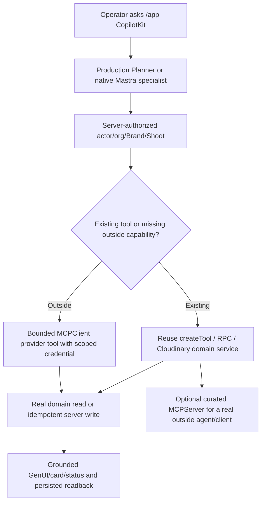

# 01 — MCP for iPix Product Agents: Core → Advanced Roadmap

**Goal:** Equip the real iPix Production Planner and future Brand, Research, Ecommerce, Creative and CRM agents with **reusable, authorized tool capabilities**. **Not** a developer-only MCP Inspector/Studio integration. **Source:** iPix `origin/main` 07829181; Mastra Core 1.84.0. The [README](./README.md) contains feature scores and user-facing use cases.

## Target design — reuse → MCP where justified

**One canonical business owner:** The current iPix services/RPCs and `src/mastra/tools` keep each domain operation. A tool can be used *directly* by the in-process Mastra agent, exported through an optional **curated MCPServer** to another process/client, or composed with one **MCPClient** that uses an external vendor's functionality. Do not create a second database-backed tool engine, proxying the same in-process call through HTTP, or a broad MCP registry.

**Implementation detail:** [04 — Full Product-Agent Delivery Plan](./04-product-agent-delivery-plan.md) maps all 16 features to contracts, exact code owners, PR slices and realistic tests.

## Phase A — Core: Make existing tools usable across product agents

| Priority | Tool family and existing ownership | Minimum useful capability | Operator journey + proof |
| --- | --- | --- | --- |
| P0 | **Brand DNA / Brand evidence:** [IPI-1476](https://linear.app/amo100/issue/IPI-1476), [IPI-1128](https://linear.app/amo100/issue/IPI-1128) | Read the authorized Brand profile, citations, and explicit unknown facts from existing service; do not auto-start paid crawl | “Create a campaign using my Brand DNA” → accurate Brand specifics, no other org records |
| P0 | **Shoot plan, deliverables, shot list:** [IPI-1049](https://linear.app/amo100/issue/IPI-1049) Done and [IPI-1151](https://linear.app/amo100/issue/IPI-1151) In Progress | Reuse current five planning tools and exactly reviewed Shoot save; no duplicate tool class | “Plan 10 photos” → structured brief and exact deliverables; review → save once → reopen |
| P0 | **Budget correctness:** [IPI-1250](https://linear.app/amo100/issue/IPI-1250), [IPI-1223](https://linear.app/amo100/issue/IPI-1223) | Use actual deliverable count in `composeShootPlan`, verify model/AG-UI streaming and persistence | “Cost for 10 assets” → no contradictory 12-item estimate, same answer after refresh |
| P1 | **Asset discovery:** [IPI-1069](https://linear.app/amo100/issue/IPI-1069), [IPI-1392](https://linear.app/amo100/issue/IPI-1392) | Server-scoped read of existing asset metadata/Cloudinary versions; return stable IDs and safe previews; avoid parallel asset index | “Find 2026 summer campaign images” → correct org, asset/version IDs, no made-up URLs |
| P1 | **Website research:** [IPI-1251](https://linear.app/amo100/issue/IPI-1251), [IPI-1477](https://linear.app/amo100/issue/IPI-1477) | Compare existing Gemini URL Context/Google Search path to native Mastra fetch/search or one vetted provider MCP, then use **one** | “Research this fashion website” → cited real facts, SSRF-safe, honest inaccessible pages, no draft approval |
| P1 | **Shoot/campaign read status:** [IPI-1355](https://linear.app/amo100/issue/IPI-1355), [IPI-1480](https://linear.app/amo100/issue/IPI-1480) | Expose bounded truthful domain status via existing routes instead of new MCP task DB | “Which shoots are due this week?” → actual status and time zone, trusted IDs |
| P1 | **Products and variants:** [IPI-1165](https://linear.app/amo100/issue/IPI-1165) Done, [IPI-1301](https://linear.app/amo100/issue/IPI-1301) In Progress | Return canonical `ProductRef`/variant IDs from current catalog; optional Shopify SDK, MCP only if superior | “Use this exact black jacket” → authentic SKU/variant, not hallucinated inventory |
| P1 | **Reviewed actions:** [IPI-1151](https://linear.app/amo100/issue/IPI-1151), [IPI-1208](https://linear.app/amo100/issue/IPI-1208) Done | Existing approved revision/hash + server-derived actor and idempotent RPC, not a generic MCP write endpoint | “Save the reviewed plan” → one durable Shoot after duplicate click, unauthorized denied |

**Current source files (inspect before editing):** `src/mastra/agents/production-planner.ts`, `src/mastra/tools/planning.ts`, `src/mastra/tools/compose-shoot-plan.ts`, `src/mastra/tools/brand-intelligence.ts`, `src/mastra/planner-tool-gate.ts`, `src/mastra/runtime.ts`, existing Supabase/Cloudinary services and CopilotKit route. Preserve the existing five-compute/two-Brand tool gate.

**Do not expose an unbounded `tools/list` catalog:** For in-process agents, call existing typed tools directly. If interoperability is needed, create one *curated* MCPServer that registers the **same underlying tool definitions** with operation-level permissions (not cloned implementations). For external provider features, use an MCPClient with a scoped provider connection.

## Phase B — Advanced: Agent capabilities for richer workflows

| Priority | Capabilities and existing Linear owner | Operator result | Integration choice |
| --- | --- | --- | --- |
| A1 | Semantic asset suggestions — [IPI-1136](https://linear.app/amo100/issue/IPI-1136), [IPI-1392](https://linear.app/amo100/issue/IPI-1392) | “Find visually similar lookbook shots” | Existing canonical assets / embeddings; MCP only for another consumer |
| A1 | Research and trends — [IPI-1477](https://linear.app/amo100/issue/IPI-1477), [IPI-36](https://linear.app/amo100/issue/IPI-36) | Source-backed competitor comparison | One bounded read-only research provider; no broad web crawler exposed |
| A1 | Multi-agent delegation — [IPI-1474](https://linear.app/amo100/issue/IPI-1474), [IPI-1475](https://linear.app/amo100/issue/IPI-1475) | Planner coordinates Brand and Research specialists | Native Mastra supervisor first, MCP only for genuinely external agent |
| A2 | Creative QA — [IPI-1138](https://linear.app/amo100/issue/IPI-1138) Done, [IPI-1136](https://linear.app/amo100/issue/IPI-1136) | “Check if images match the shot list and Brand DNA” | Reuse native QA metadata/logic |
| A2 | CRM read/draft — [IPI-1478](https://linear.app/amo100/issue/IPI-1478) | “Which clients need follow-up?” | Existing CRM API; outside CRM MCP only with per-org credentials |
| A2 | Talent suggestions — existing talent/matching domain | “Shortlist models for this shoot” | Verify actual availability and permitted profile data; no invented bookings |
| A2 | Campaign copy and publishing — [IPI-1480](https://linear.app/amo100/issue/IPI-1480), [IPI-77](https://linear.app/amo100/issue/IPI-77) | “Draft Instagram captions using approved images” | Use domain review/action; no automatic external publish from tool metadata |
| A2 | User-scoped Shopify/CRM MCP — [IPI-1302](https://linear.app/amo100/issue/IPI-1302), [IPI-1002](https://linear.app/amo100/issue/IPI-1002) | “Connect my store, then plan from actual variants” | Compare SDK vs provider MCP; per-org OAuth where supported, tokens stay outside model |

## Phase C — MCP interoperability only once a real agent needs it

**Product-first suggested new test:** [03-task-proposals.md](./03-task-proposals.md) tracks **[IPI-1485 · IPI-1485 — Prove One Useful External MCP Capability in iPix Production Copilot](https://linear.app/amo100/issue/IPI-1485)**. The user journey should be one of the Phase A capabilities, not merely developer tools/list. Keep a real MCP Inspector smoke as **one verification method**, not the deliverable.

1. Select existing Product Planner/Brand/Asset tool, and demonstrate where MCP adds cross-process/provider interoperability. If it does **not**, retain direct native tool call and record the no-MCP decision.
2. Verify `@mastra/mcp` is actually needed, inspect installed Mastra 1.84 types, and choose a **pinned version compatible with the named client**. Use MCP 2.x for a client supporting protocol 2026-07-28. For a client limited to pre-2026 revisions, follow the [official migration guidance](https://mastra.ai/reference/migrations/mcp-v2): consider supported 1.x or the documented 2.x `legacy: 'stateless'` compatibility mode for basic calls; test tool calling and unsupported suspend/resume explicitly. Never assume all clients accept 2.x.
3. Reuse existing `createTool` and domain services; optional **curated MCPServer** exposes a safe read-only subset, or **MCPClient** connects one real outside provider. Do not register every tool just to populate Studio.
4. Validate `/api/mcp` plus per-server transport/REST permissions; anon/invalid/wrong-org denied at execution even when a tool name is guessed.
5. Test one authenticated **/app conversation** → AI agent chooses correct capability → real data → grounded answer, with refresh/retry and negative cross-tenant proof.
6. Focused Vitest → typecheck → Playwright 390px → database truth → exact-head CI → post-merge smoke.

**Observability and costs:** Record real provider errors and durations via existing Sentry/Mastra traces; refuse unsafe credentials, responses, arbitrary shell tools, implicit writes and unverified external prices. Do not add MCP ToolSearchProcessor unless numerous validated capabilities and measured routing benefit justify it.

## Built-in MCP endpoint status — developer QA, not the product goal

The current Studio `/mcps` responds 200, anonymous `/api/mcp` and `/api/mcp/builtin` return 401, `@mastra/mcp` is not declared in inspected iPix main and no custom `mcpServers` exist in `src/mastra/runtime.ts`. A green Studio page therefore does **not** certify the product agents can use MCP. Validate an authenticated MCP client only when implementing the selected capability.

**Outcome to seek first:** An iPix operator asks a real fashion-production question and the Product Planner retrieves trustworthy Brand/asset/plan data via the smallest appropriate capability. MCP is useful only if it improves that path without duplicating the existing engine.
