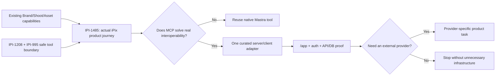

# 03 — Product-Agent MCP Tasks: Reuse Existing Work, Add Only One New Slice

**Owner goal:** MCP capabilities for **iPix customer-facing Mastra agents** in `/app` (Brand, Shoot, Assets, Research, CRM), not mainly developer Studio/Claude Code connectivity. **Planning only** — proposed new task not created.

## Existing verified Linear owners

| Priority | Existing task | Feature / benefit |
| --- | --- | --- |
| Core | [IPI-1476 · AGENTS-003 — Add Brand Expert Using Existing Brand Intelligence and Knowledge](https://linear.app/amo100/issue/IPI-1476) — Backlog | Brand DNA and verified evidence for AI decisions |
| Core | [IPI-1128 · BRAND-KNOWLEDGE-001 — Give AI Decisions Approved Brand Evidence With Citations](https://linear.app/amo100/issue/IPI-1128) — Todo | Grounded Brand data reads |
| Core | [IPI-1049 · TOOL-001 — Let the Planner Build Shoot Type, Deliverables, Shot List, and Budget Safely](https://linear.app/amo100/issue/IPI-1049) — Done | Four existing planning compute tools; reuse directly |
| Core | [IPI-1151 · E2E-PLAYWRIGHT-002 — Certify Brand → Shoot → Planner Critical Journey](https://linear.app/amo100/issue/IPI-1151) — In Progress | Exact reviewed plan/save/reopen; idempotency |
| Core | [IPI-1250 · PLAN-BUDGET-001 — Fix composeShootPlan's Budget Using the Wrong Asset Count](https://linear.app/amo100/issue/IPI-1250) — Backlog | Correct estimate before exposing as shared tool |
| Core | [IPI-1223 · PLANNER-E2E-001 — Fix the Production Planner Budget E2E in /app](https://linear.app/amo100/issue/IPI-1223) — In Progress | Real AI budget response and conversation refresh |
| Core | [IPI-1069 · ASSETS-001 — Let Operators Browse Assets and Manage Asset Records](https://linear.app/amo100/issue/IPI-1069) — Backlog | Canonical asset search and data reuse |
| Core | [IPI-1392 · ASSET-GENUI-001 — Let Production Copilot Compare and Shortlist Trusted Assets Visually](https://linear.app/amo100/issue/IPI-1392) — Backlog | Grounded AI asset cards and shortlists |
| Core | [IPI-1251 · PLANNER-WEB-RESEARCH-001 — Let Production Copilot Inspect a Pasted Brand URL Before Planning a Shoot](https://linear.app/amo100/issue/IPI-1251) — Backlog | Real public-website evidence and citations |
| Core | [IPI-1301 · PRODUCTS-002 — Browse Products and Pick the Exact Variant for a Shoot](https://linear.app/amo100/issue/IPI-1301) — In Progress | Exact ProductRef and variant selection |
| Governance | [IPI-1208 · PLANNER-TOOLGATE-001 — Exclude Consequential Write Tools From the Planner's Tool Set During Plan-Generation Turns](https://linear.app/amo100/issue/IPI-1208) — Done | Keep planning safe as capabilities grow |
| Governance | [IPI-995 · MASTRA-WF-002 — Govern the Real iPix Tool Surface Without a Custom Registry Framework](https://linear.app/amo100/issue/IPI-995) — Backlog | No second tool/permission registry |
| Governance | [IPI-1143 · MASTRA-EPIC — Govern One Current Mastra Runtime Across iPix](https://linear.app/amo100/issue/IPI-1143) — In Progress | One supported Mastra runtime and Studio/auth boundary |
| Advanced | [IPI-1477 · AGENTS-004 — Add Research Expert for Cited Competitor and Website Research](https://linear.app/amo100/issue/IPI-1477) — Backlog | Grounded competitor research |
| Advanced | [IPI-1474 · AGENTS-001 — Prove Safe Concierge Delegation Before Changing the Agent Registry](https://linear.app/amo100/issue/IPI-1474) — Backlog | Native collaboration across agents |
| Advanced | [IPI-1136 · ASSET-DNA-001 — Analyze Uploaded Shoot Assets Against the Approved Brand Brain](https://linear.app/amo100/issue/IPI-1136) — Backlog | Creative intelligence and Brand match |
| Advanced | [IPI-1138 · ASSET-QA-001 — Check Asset Quality and Channel Readiness Before Approval](https://linear.app/amo100/issue/IPI-1138) — Done | Existing QA logic, reuse rather than recreate |
| Advanced | [IPI-1478 · AGENTS-005 — Add CRM Expert With Authorized Contact and Deal Context](https://linear.app/amo100/issue/IPI-1478) — Backlog | Read authorized customer records and draft follow-ups |
| Advanced | [IPI-1302 · PRODUCTS-SHOPIFY-001 — Add Shopify as an Optional Read-Only Catalog Adapter](https://linear.app/amo100/issue/IPI-1302) — Todo | Product integration with exact variants |
| Advanced | [IPI-1002 · MASTRA-WF-009 — Standardize External Integrations Only After Repeated Need](https://linear.app/amo100/issue/IPI-1002) — Backlog | Pattern after two real outside integrations |

## Existing product-centered implementation task — IPI-1485 (created)

### [IPI-1485 · MCP-AGENT-001 — Prove One Useful External MCP Capability in iPix Production Copilot](https://linear.app/amo100/issue/IPI-1485)

**Why distinct:** Existing tickets implement Brand/Asset/Planner business tools; IPI-995 governs their safe selection; IPI-1002 documents repeated external-provider choices. **None directly proves a product-agent request using an actual MCPClient or curated MCPServer tool for a meaningful user journey.** This task should have one deliberately small, measurable feature goal, not create an MCP platform.

**Example:** In authenticated `/app`, “Find five real summer campaign assets and use them in a new shoot brief.” The agent retrieves scoped asset data through a **curated, read-only MCP capability only if another agent/process/provider requires MCP**, then uses existing Planner tools to produce one grounded brief with references. If direct native tools are faster and sufficient, record that evidence and do not add an MCP hop.

**Decision method:**
1. Choose one business capability and its existing product owner: Brand DNA or Asset Search are best candidates.
2. Compare direct in-process tool reuse vs MCP from the actual product agent. Require a **real interoperability benefit** (another agent/process, external provider or separately deployed consumer), not the desire to see a Studio card.
3. If MCP is useful, reuse the **same** underlying Mastra `createTool` and current domain service. Register a narrow MCPServer or read-only MCPClient connection. Do not clone business logic.
4. Prove existing Supabase actor/org authorization, exact data provenance, activeTools policy, and no unapproved consequential writes.
5. Validate real `/app` operator question → tool selection → truthful data → useful card/answer; plus anonymous/wrong-org/forged action denial, refresh and restart.
6. Measure latency, extra provider requests, tokens, errors and maintainability. Keep MCP only if it beats the direct route for the identified consumer.

**Likely files if justified:** `src/mastra/runtime.ts`, existing `src/mastra/tools/*` definitions, a focused `src/mastra/mcp/*` adapter (only if real interop needed), `src/mastra/planner-tool-gate.ts`, `package.json`/lockfile for **pinned compatible** `@mastra/mcp`, existing CopilotKit route and scoped tests. Do not modify all automatically.

**Success criteria:** One actual iPix product conversation uses one **authorized, real** reusable MCP capability with correct Brand/Asset data and no duplicate business logic, secrets or tenant leakage; failing/expired integrations degrade truthfully; real UI/API/DB proof and exact-head CI pass.

**If implementation cannot establish why MCP is necessary:** Resolve by keeping the direct typed tool and documenting why; don't introduce a duplicate network call or separate server merely to satisfy the acronym.

## Conditional future tasks — suggest only after first product proof

| Proposed future work | Trigger | Avoid duplication with |
| --- | --- | --- |
| **MCP-PROVIDER-001 — Connect One Organization-Scoped External Provider to a Real Agent** | Research/CRM/catalog product issue selects a real provider and its SDK/service does not solve the need | IPI-1477, IPI-1478, IPI-1302, IPI-1156 |
| **MCP-EXTERNAL-001 — Publish Selected iPix Tools to One Authorized External Agent** | A named external consumer requires a curated read-only catalog | IPI-995, IPI-1143, canceled IPI-138 |

**Not recommended:** An MCP registry epic, generic connector management database, second agent backend, bulk import of provider MCP catalogs, or a standalone developer MCP Inspector integration as the main product deliverable.

## Task dependency diagram

**Suggested execution priority:** Existing Brand/Shoot/Asset functionality first → IPI-1485 scoped provider proof only if interop is demonstrated → one external provider if needed → advanced agents. The implementation owner was created separately as [IPI-1485](https://linear.app/amo100/issue/IPI-1485); this PR remains documentation-only.
