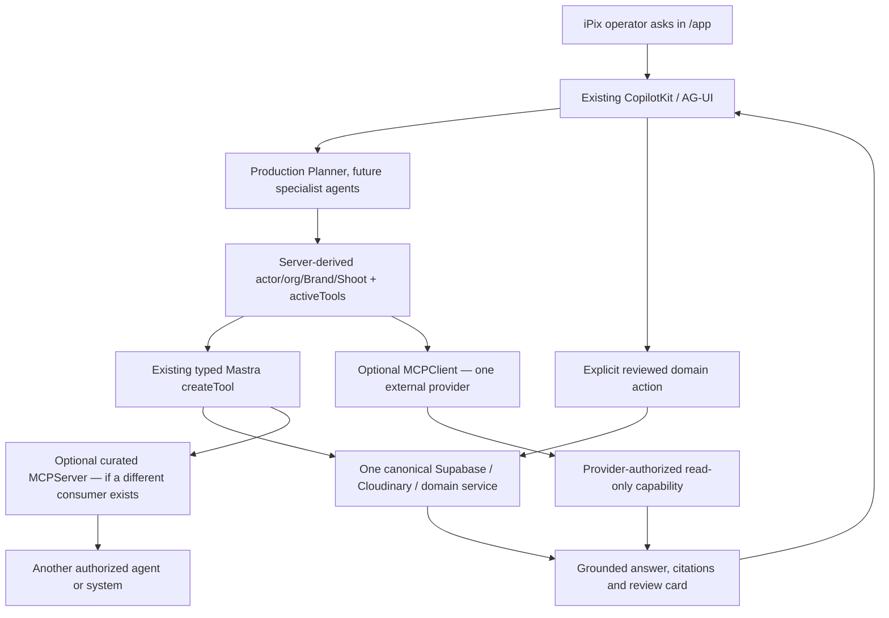

# 04 — Product-Agent MCP Delivery Plan: 16 Features, Exact Steps and Tests

**Prepared:** 2026-11-20 | **Repository:** `amoai-tech/ipixai` | **Plan authority:** the owner's 8 Core + 8 Advanced features and scores, plus inspected `origin/main` `07829181`, official Mastra MCP docs and existing Linear owners. **Scores below are implementation priority /100, not completion percentages.**

## Goal and success definition

An iPix operator can ask the **one existing CopilotKit assistant** about the current Brand, a real Shoot, real products and owned assets. Mastra retrieves only authorized data, uses native tools for calculations and planning, and takes user-requested consequential actions through existing server/domain paths. If a feature genuinely requires another provider/process, **MCPClient** connects to that external MCP server or a curated **MCPServer** reuses existing iPix tools for the external consumer.

**Golden operator request:** “Use my Brand DNA, find five approved summer campaign images, plan 10 new product photos and estimate the budget.”

**Success:** The response identifies the correct Brand and exact assets, gives a consistent 10-photo plan and an estimate with assumptions, and offers the existing exact-review action. The answer survives refresh; unauthorized Brand/asset access fails; a repeated authorized save does not create a second Shoot. No external provider or invented data is needed to prove the first slice.

**Current status:** Planning only. Existing native Mastra tools are present; 16 integrated product-agent journeys have **not** been certified as working. No new MCP client, server, public endpoint, provider account or generic tool registry should be created without proving need.

## 1. Architecture — one business owner, two optional MCP adapters

**Selection rule:**

| Actual need | Implementation | Avoid |
| --- | --- | --- |
| One Mastra agent inside iPix uses its own data/tool | Reuse existing `createTool`, service and RPC | Loopback MCP round trip to itself |
| Two iPix specialists need the same computation | Reuse the same imported typed tool or service, with contextual authorization | Copying logic into one tool per agent |
| iPix needs a third-party MCP capability | `MCPClient` with scoped per-org/provider credentials, allowlisted tool IDs and lifecycle handling | Mounting all vendor tools with a shared superuser token |
| A separate assistant/process must consume iPix capabilities | Explicit allowlisted `MCPServer`, reusing canonical tool implementations and HTTP/domain auth | Publishing every registered workflow or write action |
| No cross-process/provider need | **No MCP dependency** | Installing `@mastra/mcp` merely to populate Studio |

**Trust boundary:** Agent prompts, incoming tool arguments, client-selected IDs and provider MCP results are untrusted until the server checks actor, org, current record, input schema, tool effect type and applicable transaction authority. Supabase RLS, private media delivery, truthful provenance, idempotency and audit evidence remain in canonical owners.

## 2. Delivery sequence — build vertical slices, not 16 disconnected MCP servers

| Slice | Feature targets | Existing Linear owners | What to deliver and prove | Dependency |
| --- | --- | --- | --- | --- |
| **A — Working foundation** | Core 1 Brand, 2 Planning, 4 Budget | [IPI-1128](https://linear.app/amo100/issue/IPI-1128), [IPI-1049](https://linear.app/amo100/issue/IPI-1049), [IPI-1250](https://linear.app/amo100/issue/IPI-1250), [IPI-1223](https://linear.app/amo100/issue/IPI-1223) | Real current Brand context → typed 10-photo plan → estimate using exactly 10 assets, with valid assumptions and reload | Existing /app and current typed tools |
| **B — Signature iPix experience** | Core 3 Asset search + Core 1/2/4 | [IPI-1069](https://linear.app/amo100/issue/IPI-1069), [IPI-1392](https://linear.app/amo100/issue/IPI-1392) | Grounded owned-asset search with real safe preview IDs; combine asset results with on-brand shoot plan in **one conversation** | A; canonical asset ownership + version lookup |
| **C — Complete the core** | Core 5 Website, 6 Status, 7 Product variants, 8 Reviewed save | [IPI-1251](https://linear.app/amo100/issue/IPI-1251), [IPI-1355](https://linear.app/amo100/issue/IPI-1355), [IPI-1301](https://linear.app/amo100/issue/IPI-1301), [IPI-1151](https://linear.app/amo100/issue/IPI-1151) | Cited public research; real status/product records; approved exact-revision save → persisted Shoot | A/B for context; current RPC and review path |
| **D — Advanced research/creative** | Advanced 1 Asset intelligence, 2 Competitors, 4 QA | [IPI-1136](https://linear.app/amo100/issue/IPI-1136), [IPI-1477](https://linear.app/amo100/issue/IPI-1477), [IPI-1138](https://linear.app/amo100/issue/IPI-1138) | Real citations, version-bound visual suggestions and existing QA outputs | Reliable Core data / sources |
| **E — Advanced agent operations** | Advanced 3 Delegation, 5 CRM, 6 Talent, 7 Campaigns | [IPI-1474](https://linear.app/amo100/issue/IPI-1474), [IPI-1478](https://linear.app/amo100/issue/IPI-1478), [IPI-1480](https://linear.app/amo100/issue/IPI-1480) | One safe specialist chain; real org-scoped contacts/model records; reviewed campaign draft | C and concrete domain availability |
| **F — External interoperability** | Advanced 8 Provider MCP and optional curated iPix server | [IPI-1002](https://linear.app/amo100/issue/IPI-1002), [IPI-1302](https://linear.app/amo100/issue/IPI-1302), [IPI-995](https://linear.app/amo100/issue/IPI-995) | One authorized read-only external provider via native MCPClient **if better than SDK**, no cross-org leakage | Named provider + proven interoperability need |

**Parallelizable work:** Correct deterministic budget math (A), audit asset-data read contracts (B), and read current product/CRM source contracts (C/E) independently. **Do not parallelize consequential saves or use advanced agents before the core data contract is truthful.**

## 3. Core features — exact contracts, owners and acceptance

Every suggested tool name prefixed **Proposed** is a *planning label*, not a claim that code exists. Inputs shown are logical fields, **not** permission-bearing client IDs. Derive trusted identity at the server boundary.

| # / priority | Capability and implementation contract | Existing owner / source | Pass criteria (must be observable) |
| --- | --- | --- | --- |
| **C1 · 98** | **Brand Intelligence. Proposed read tool `getAuthorizedBrandEvidence`:** current/selected Brand → approved Brand DNA facts, evidence citations, updated timestamp and unknowns. Reuse `src/lib/brand/get-brand-detail.ts` and existing Brand Intelligence reads; do not silently trigger `startBrandAnalysis`. | [IPI-1128](https://linear.app/amo100/issue/IPI-1128) Todo; [IPI-1476](https://linear.app/amo100/issue/IPI-1476) Backlog; current `src/mastra/tools/brand-intelligence.ts` handles separate actions | “Make a campaign like my Brand” cites real Brand facts; unknown fields marked unknown; wrong org/Brand denied; no new Brand or crawl |
| **C2 · 97** | **Photoshoot planning. Existing tools:** `recommendShootType`, `planDeliverables`, `generateShotListDraft`, `composeShootPlan`. Keep current typed input/output and trusted references. | [IPI-1049](https://linear.app/amo100/issue/IPI-1049) Done; `src/mastra/tools/planning.ts`, `compose-shoot-plan.ts` | A 10-product brief yields correct deliverables, shot list and repeatable complete plan; unsupported facts remain assumptions |
| **C3 · 95** | **Creative asset search. Proposed `searchAuthorizedAssets`:** query, authorized Brand/Shoot filters, limit → actual asset ID, version, metadata, approval/review status, safe preview. Reuse Cloudinary and existing asset read/ownership services, **not** a raw cross-org Cloudinary list. | [IPI-1069](https://linear.app/amo100/issue/IPI-1069) Backlog; [IPI-1392](https://linear.app/amo100/issue/IPI-1392) Backlog; `src/lib/auth/asset-access.ts`, `src/lib/cloudinary/get-authorized-asset-preview.ts` | “Find approved summer images” returns actual owned assets only; no invented URLs, no stale/version-mismatched previews; 390px cards usable |
| **C4 · 94** | **Shoot budget. Existing `estimateShootBudget`:** exact computed deliverables, bounded prices and explicit currency/assumptions → itemized estimate. Fix `composeShootPlan` input first. | [IPI-1250](https://linear.app/amo100/issue/IPI-1250) Backlog; [IPI-1223](https://linear.app/amo100/issue/IPI-1223) In Progress | 20 images + 5 videos priced from 25 actual deliverables, totals consistent; no invented vendor quote; /app response persists/replays |
| **C5 · 93** | **Brand website research. Proposed `inspectPublicBrandUrl`:** HTTP(S) URL → evidence summary, source URLs, retrieved time, access errors. Choose current URL Context/search or a narrow safe external provider; **MCPClient only when it adds external capability**. | [IPI-1251](https://linear.app/amo100/issue/IPI-1251) Backlog; [IPI-1477](https://linear.app/amo100/issue/IPI-1477) Backlog | Public site facts cited; timeout/private-IP/redirect/hostile prompt blocked; no fake access, paid crawl or approval |
| **C6 · 92** | **Shoot/campaign status. Proposed `listAuthorizedProductionStatuses`:** authorized project filters → real Shoot/Campaign IDs, actual status and relevant dates, correct timezone. Use existing domain reads, no second task-state database. | [IPI-1355](https://linear.app/amo100/issue/IPI-1355) Todo; [IPI-1480](https://linear.app/amo100/issue/IPI-1480) Backlog; `src/lib/shoot/get-shoot-detail.ts` | “What is pending this week?” agrees with UI/DB; canceled/unknown items labeled correctly; cross-org reads rejected |
| **C7 · 90** | **Product/catalog lookup. Proposed `findAuthorizedProductVariants`:** authorized catalog query → canonical ProductRef, exact Product/Variant IDs and source, known/unknown availability. Prefer current canonical reference and provider adapter. | [IPI-1165](https://linear.app/amo100/issue/IPI-1165) Done; [IPI-1301](https://linear.app/amo100/issue/IPI-1301) In Progress; `src/lib/commerce/product-ref.ts` | “Select black size M” resolves exact source variant; no invented stock/price; wrong-org or removed product denied |
| **C8 · 89** | **Review/save actions:** existing Shoot review → authorized exact approval ID, immutable revision + hash → existing `save_approved_shoot` domain path. Do not expose a generic unrestricted `saveShoot` MCP tool. | [IPI-1151](https://linear.app/amo100/issue/IPI-1151) In Progress; [IPI-1208](https://linear.app/amo100/issue/IPI-1208) Done; `src/lib/shoot/decide-shoot-plan-revision.ts`, `src/app/api/shoots/save/route.ts` | Approval/rejection/changed revision tested; one persisted Shoot after retries/double click; non-operator and wrong-org calls denied |

**Read-only tools** can be added without inventing ownership paperwork or business eligibility gates. They must still enforce real authentication, org-private data isolation, safe media delivery, meaningful tool input bounds and truthful records.

## 4. Advanced features — exact activation criteria

| # / priority | Proposed capability | Reuse and existing owner | When to activate / acceptance |
| --- | --- | --- | --- |
| **A1 · 94** | **Creative asset intelligence:** `findSimilarAuthorizedAssets` returns actual version-bound asset IDs and similarity evidence | [IPI-1136](https://linear.app/amo100/issue/IPI-1136); [IPI-1392](https://linear.app/amo100/issue/IPI-1392); current canonical asset metadata | Activate after C3. One uploaded/reference image → real owned similar items; no fake rankings, wrong-org result or duplicate vector store |
| **A2 · 92** | **Competitor/trend research:** `researchCompetitorSources` composes the same safe URL research mechanism and real citations | [IPI-1477](https://linear.app/amo100/issue/IPI-1477); [IPI-36](https://linear.app/amo100/issue/IPI-36) | After C5. Three sites compared using sourced evidence; missing data explicitly unknown; prompt injection blocked |
| **A3 · 91** | **Multi-agent coordination:** native Mastra supervisor delegates to Brand/Research/Creative specialists, sharing **authorized** evidence; MCP only for an external specialist | [IPI-1474](https://linear.app/amo100/issue/IPI-1474), [IPI-1475](https://linear.app/amo100/issue/IPI-1475) | After C1/C2/C5. One user thread and one answer, identical org scope across agents, no duplicated tools/agents or hidden writes |
| **A4 · 90** | **Creative quality checks:** `getAssetReadiness` reuses existing QA and compares verified asset version with shot list/Brand facts | [IPI-1138](https://linear.app/amo100/issue/IPI-1138) Done, [IPI-1136](https://linear.app/amo100/issue/IPI-1136); `src/lib/asset-qa/run-checks.ts` | After C3/C1. Explain mismatch and supported channel specs; advisory result cannot quietly approve/reject asset |
| **A5 · 88** | **CRM intelligence:** `listAuthorizedFollowups` summarizes existing contacts/deals, creates optional drafts only | [IPI-1478](https://linear.app/amo100/issue/IPI-1478) Backlog | After CRM read contracts. Correct org records, no guessed email/phone, no unsolicited send, explicit consent for any actual action |
| **A6 · 87** | **Model/talent matching:** `searchAuthorizedTalent` returns grounded profiles and verified *known* availability if present | Existing talent/shortlist workflow; [IPI-308](https://linear.app/amo100/issue/IPI-308) | After talent-source audit. No invented availability, contracts or bookings; accessible shortlist; no private contact leakage |
| **A7 · 85** | **Campaign publishing preparation:** `draftCampaignFromApprovedAssets` prepares platform-specific caption/media bundle; actual publish uses existing authorized integration if present | [IPI-1480](https://linear.app/amo100/issue/IPI-1480), [IPI-77](https://linear.app/amo100/issue/IPI-77) | After C3/C8. Correct asset version, destination/account, accurate preview; no false “published” without provider acknowledgement |
| **A8 · 84** | **External provider MCP:** one `MCPClient` connection to selected Shopify/CRM/marketing provider, org-scoped credentials, small read-only allowlist | [IPI-1302](https://linear.app/amo100/issue/IPI-1302), [IPI-1478](https://linear.app/amo100/issue/IPI-1478), [IPI-1002](https://linear.app/amo100/issue/IPI-1002) | Only if an actual provider MCP beats native API/SDK. Same user scope across reconnect/revoke, no token/tenant leaks, graceful outages |

## 5. The first implementation PRs (small, independently reviewable)

| PR slice (suggested) | Existing task / exact likely files | Definition of done |
| --- | --- | --- |
| **P1 — Fix trusted foundation** | IPI-1250 / IPI-1223; `src/mastra/tools/compose-shoot-plan.ts`, existing Planner budget tests | 10 deliverables → priced from 10, real /app reply, refresh stable; fix current defect, do not touch unrelated paths |
| **P2 — Brand evidence read** | IPI-1128 / IPI-1476; `src/lib/brand/get-brand-detail.ts`, smallest read-only adapter in `src/mastra/tools/`, targeted auth tests | Authorized Brand returns real cited facts; wrong-tenant read denied; no paid crawl/write |
| **P3 — Asset search** | IPI-1069 / IPI-1392; existing asset ownership, version and safe-preview service + one typed read adapter | Correct owned versions, provenance and functional GenUI cards at 390px; no raw client Cloudinary credentials |
| **P4 — Golden journey** | IPI-1151 plus existing Planner; CopilotKit route, tool gate, existing review/save path, one Playwright spec | One /app request combines Brand + assets + 10-shot plan + budget; exact review → one persisted Shoot, reload works |
| **P5 — Remaining Core lookups** | IPI-1251, IPI-1355, IPI-1301; narrow website/status/ProductRef reads | All three grounded, correctly authorized and error-aware; missing data explicit |
| **P6 — Advanced chosen by demand** | IPI-1136, IPI-1477, IPI-1474, IPI-1478, etc. | One measurable customer journey per PR; only the specific agent/provider involved |
| **P7 — MCP-specific adapter if necessary** | Proposed MCP-AGENT-001, [task decision](./03-task-proposals.md); `@mastra/mcp` compatible pin and `src/mastra/mcp/` only if real cross-boundary need | Same canonical tool contract reused by another client/provider; auth+tools/list+invoke+wrong-org denial; no duplicate business implementation |

**Task policy:** Existing Linear issues remain owners. Do **not** create 16 duplicate MCP issues for features already covered by Product/Agent/Asset/Brand/Shoot tasks. A separate adapter task is justified only if interoperability becomes a product requirement and the current owner cannot absorb it.

## 6. Precise testing and evidence — no green-dashboard shortcuts

| Test class | Minimum scenarios | What constitutes proof |
| --- | --- | --- |
| **Tool contracts** | Valid/invalid schema, empty/large query, missing Brand, exact variant, bounded limits, numeric finiteness, idempotent deterministic output | Focused Vitest and stable output schema |
| **Security / authorization** | Anonymous, expired account, current org vs other org, changed membership, guessed Brand/Asset/Shoot ID, private Cloudinary preview | Server rejects unauthorized before data or action reaches model/UI |
| **Planning correctness** | 10 assets, 20 images + 5 videos, missing rate, changed requirement, mismatched output counts | Line items and totals match exact deliverables, assumptions clearly flagged |
| **Retrieval provenance** | Fresh and stale Brand facts, no results, unknown product variant, invalid public URL, source conflicts | Real database IDs/source URLs; no fabricated prices, assets, dates or citations |
| **External MCP** | Unreachable provider, invalid/revoked scoped token, timeout, overbroad tool manifest, hostile tool response, reconnect | Fail closed, display unavailable, no tool widening or credential leak |
| **Effects** | Double-click review, duplicate callback, expired approval, stale plan hash, network error after DB save | Correct single durable operation, observable result and safe retry |
| **User journey** | Browser close/reload, mobile 390px, partial provider outage, correct agent routing | Actual /app cards + API/database readback, one conversation, truthful states |
| **Deploy** | Exact-head branch, lint/typecheck/build and risk-matched integration/Playwright suites, approved merge, post-deploy version smoke | Evidence attached to existing Linear owner; green CI not a substitute for real workflow success |

**Pass/fail metrics to record rather than invent:** routing success on a fixed prompt corpus; correct Brand/Asset IDs; budget error count; number of duplicated effect rows after retries; per-tool latency and provider costs; unauthorized access successful count (must be zero). Take a baseline before claiming improvements.

## 7. Ready-to-use starter test cases

1. **Brand:** Authorized user asks “What do we know about my Brand?” → current exact approved facts and citation; wrong org must not receive even a snippet.
2. **Plan:** “Create 10 studio product photographs” → 10 deliverables, coherent shot list, correct budget input; no hidden Brand approval.
3. **Assets:** “Find five approved campaign images from our last summer Shoot” → real existing assets/versions with correct previews; zero results reported honestly.
4. **Combined:** “Use those images and my Brand DNA in a new Shoot proposal” → references retained into composed plan and conversation after reload.
5. **Website:** “Analyze this public fashion site” → real URLs/observations, impossible/private URL rejected without network fetch, user-visible failure instead of fabricated research.
6. **Products:** “Use this exact black size-M variant” → exact ProductRef, no invented price or availability.
7. **Review:** Approve a precise saved plan revision and submit twice → one saved Shoot; changed revision rejected.
8. **Advanced:** Ask for similar creative examples, competitors, CRM reminders, talent candidates and publishing draft on real fixtures; unsupported/incomplete integrations explicitly state not available.

## 8. Completion gates and anti-goals

**Core finished only when:** Brand+planning+assets+budget golden journey works in real /app with scoped data, functional GenUI cards, correct count, refresh, known unknowns and authorization; then website/status/products/review paths each pass their own targeted journeys.

**Advanced finished only when:** each feature has a real source and operator use case, not merely registered MCP tool metadata; no fabricated products, availability, metrics or publish success.

**No duplicate engine, tool registry, approval subsystem, storage, vector index or generic MCP server. No unconditional `@mastra/mcp@latest` install.** Keep technical safeguards, accurate domain truth and current iPix product paths. Prefer the smaller direct native path when MCP offers no interoperability gain.

**Documentation references:** [Mastra MCP connection guide](https://mastra.ai/docs/connections/mcp), [MCPClient reference](https://mastra.ai/reference/tools/mcp-client), [MCPServer reference](https://mastra.ai/reference/tools/mcp-server), [built-in MCP server](https://mastra.ai/docs/server/mcp). Upstream current-doc examples may differ from installed iPix 1.84 types; verify exact installed package before coding.
