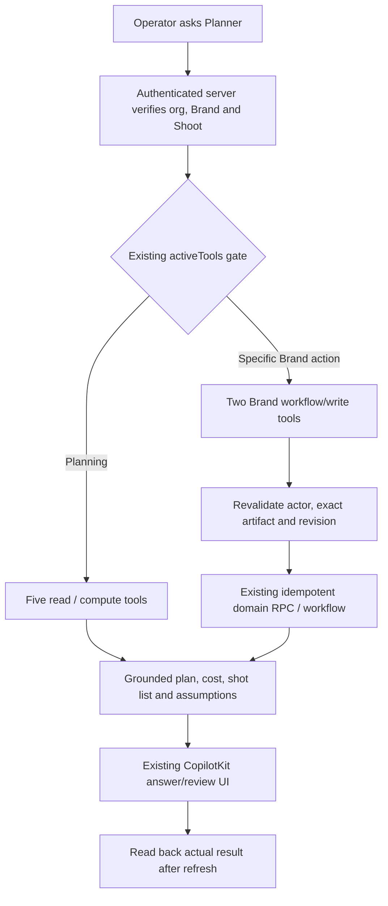
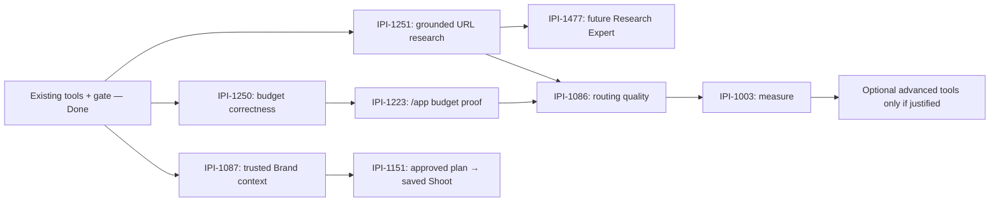

# 01 — iPix Mastra Tools: Core → Advanced Implementation Roadmap

**Baseline (2026-11-20):** origin/main SHA 07829181, Mastra Core 1.84.0, CLI 1.40.0, CopilotKit React 1.88.0 and AG-UI Mastra 2.0.2. Reverify exact version and deployment for every implementation task. This file is a plan, not test certification.

## Stage 0 — Work on the actual application

Use one existing Production Planner with seven registered product tools, the current Next.js/CopilotKit /app interface, server-derived org/Brand/Shoot context, planner-tool-gate.ts, existing Supabase RPCs and current workflows. Avoid a new tool registry, new chat service, extra scheduler or alternative booking/approval process.

## Stage 1 — CORE: Correct existing plan and budget tools

| Priority / verified Linear owner | Outcome | Smallest change | Acceptance tests |
| --- | --- | --- | --- |
| **P0** [IPI-1250 · PLAN-BUDGET-001 — Fix composeShootPlan's Budget Using the Wrong Asset Count](https://linear.app/amo100/issue/IPI-1250) — Backlog | 10 selected images give a budget calculated from 10, never 12 | Pass the existing deliverablesResult.totalAssets to estimateShootBudget | Bounded fixtures, correct quantities, totals, currency assumptions; no new tool |
| **P0** [IPI-1223 · PLANNER-E2E-001 — Fix the Production Planner Budget E2E in /app](https://linear.app/amo100/issue/IPI-1223) — In Progress | “How much will this fashion shoot cost?” yields an actual visible answer and durable conversation after reload | Fix first reproducible boundary only: model/tool execution, AG-UI terminal response, history persist or replay | Authenticated /app journey, saved thread, refresh; API/DB evidence |
| **P1** [IPI-1087 · PLANNER-CONTEXT-001 — Keep the Active Brand and Shoot Brief Available During Planning](https://linear.app/amo100/issue/IPI-1087) — In Progress | “Use my current Brand” uses the correct selected Brand, never a prior org's Brand | Reuse server-verified active context | Switch Brand A → Brand B, wrong-org deny, stale context, repeat chat |
| **Existing** [IPI-1049 · TOOL-001 — Let the Planner Build Shoot Type, Deliverables, Shot List, and Budget Safely](https://linear.app/amo100/issue/IPI-1049) — Done | Four planning tools already exist | Preserve and test, don't rebuild | Unit schemas and business contracts stay green |
| **Existing** [IPI-1208 · PLANNER-TOOLGATE-001 — Exclude Consequential Write Tools From the Planner's Tool Set During Plan-Generation Turns](https://linear.app/amo100/issue/IPI-1208) — Done | Plan requests never unlock Brand approval | Preserve current 5+2 activeTools gating across stream, resume, generate and resumeGenerate | Positive/negative routing, replay, approval bypass |

**Likely file owners:** src/mastra/tools/compose-shoot-plan.ts, src/mastra/tools/planning.ts, src/mastra/planner-tool-gate.ts, src/mastra/agents/active-workspace-context.ts, existing focused tests. Edit only files needed by a proven defect, not all of them.

## Stage 2 — CORE: Inspect a pasted public Brand URL

### P0 — [IPI-1251 · PLANNER-WEB-RESEARCH-001 — Let Production Copilot Inspect a Pasted Brand URL Before Planning a Shoot](https://linear.app/amo100/issue/IPI-1251) — Backlog / Urgent

**Real-world use case:** “Look at this public fashion-brand website and suggest a campaign shoot.” The Planner reads real evidence and provides useful source URLs, not invented facts or a false claim it inspected the site.

**Fastest safe approach:**
1. Prefer already-approved Brand evidence when the user has an existing Brand. Otherwise compare the issue's Gemini URL Context + Google Search approach against native Mastra webFetchTool and webSearchTool for the actual pinned provider/model. Choose one read-only research path, not three.
2. Use bounded HTTP(S) access, block private networks/localhost and unsafe redirects, set timeouts and content limits, redact credentials, record source and freshness, and clearly explain access failures.
3. Treat webpage content as **untrusted facts**, not instructions. Test malicious page text attempting to make the assistant reveal private data or approve a Brand draft.
4. Keep ad-hoc public-URL research separate from Firecrawl → Brand Intelligence → reviewed durable Brand DNA. No automatic paid crawl, new Brand, approval, or publishing.
5. Return concise evidence, source links and assumptions in the existing CopilotKit UI.

**Proof:** working cited answer for one public site; blocked/private URL, redirect to local IP, hostile content, rate-limit, unavailable page, wrong org, canceled request and unsupported claims all handled accurately.

**Advanced reuse owner:** [IPI-1477 · AGENTS-004 — Add Research Expert for Cited Competitor and Website Research](https://linear.app/amo100/issue/IPI-1477) — Backlog. Reuse the proven read-only research tool in Concierge instead of a second web research engine.

## Stage 3 — CORE: Tool governance and human interaction

### [IPI-995 · MASTRA-WF-002 — Govern the Real iPix Tool Surface Without a Custom Registry Framework](https://linear.app/amo100/issue/IPI-995) — Backlog / Post-MVP

- Inventory seven product tools: five planning-only, two Brand actions. A weather starter exists separately in src/mastra/tools/index.ts, not part of the Planner agent. Remove it only if proven unused by references/tests.
- Keep native createTool schemas and planner-tool-gate.ts. Tool descriptions help model choice but **are not authorization**.
- Example: “Create a shot list” can compute; “Approve this Brand DNA” must use an explicit user-reviewed exact hash, trusted server actor/org and current domain state.
- Tests: wrong tool, fake “AI approved it,” altered hash, replayed/expired action, changed membership, duplicate click, correct operator review and resume.

### Actual review and useful buttons

- [IPI-1151 · E2E-PLAYWRIGHT-002 — Certify Brand → Shoot → Planner Critical Journey](https://linear.app/amo100/issue/IPI-1151) — In Progress. Reuse exact plan/revision/hash and existing save_approved_shoot RPC; prove one saved Shoot on retry.
- [IPI-1429 · GENUI-ACTIONS-001 — Make AI Buttons Useful Without Bypassing Human Approval](https://linear.app/amo100/issue/IPI-1429) — Todo. Make UI buttons trigger authenticated, observable existing actions, never model-implied approvals.
- **Possible built-in askUserTool:** “What budget and channels should this shoot target?” Supports suspend/resume but first compare the existing CopilotKit form/HITL UI; verify AG-UI bridge and thread replay on installed 1.84. A simple UI question may be faster.
- **Do not substitute submitPlanTool for product approval.** It is a file-backed plan-review primitive for an agent host, not iPix's hash-bound Shoot/Brand decision.
- **Defer built-in task tracking:** thread Memory and TaskSignalProvider are required; reuse real Brand workflow status/AG-UI events rather than duplicating task state or inventing progress percentages.

## Stage 4 — ADVANCED: Only after measured user value

| Existing Linear task | Feature and use case | Activation condition |
| --- | --- | --- |
| [IPI-1086 · PLANNER-QUALITY-001 — Catch Planner Mistakes Before They Reach Operators](https://linear.app/amo100/issue/IPI-1086) — Backlog | “Estimate budget” correctly chooses estimate tool | Routing corpus includes should-call, should-not, missing input, wrong tool, fake approval |
| [IPI-1003 · MASTRA-WF-010 — Measure One Real Workflow with Native Observability and Evals](https://linear.app/amo100/issue/IPI-1003) — Backlog | Find slow/failing tool calls | Reuse existing Sentry/Mastra traces; add one deterministic metric only if needed |
| [IPI-1474 · AGENTS-001 — Prove Safe Concierge Delegation Before Changing the Agent Registry](https://linear.app/amo100/issue/IPI-1474) — Backlog | Concierge delegates to Brand/Research experts | One native safe delegation, same CopilotKit auth, no second agent engine |
| [IPI-1199 · IPI-MASTRA-VEC-001 — Add Semantic Shot-Type Search with Supabase pgvector and a Mastra Tool](https://linear.app/amo100/issue/IPI-1199) — Backlog / Low | Find relevant shot types by meaning | Only if typed current search misses cases; use existing reference rows/RPC, no second vector store |
| [IPI-1002 · MASTRA-WF-009 — Standardize External Integrations Only After Repeated Need](https://linear.app/amo100/issue/IPI-1002) — Backlog | Add a future vendor integration | Existing service/API/RPC first; maintained MCP only if it removes actual code and preserves auth |
| [IPI-1001 · MASTRA-WF-008 — Prove One Safe Configurable Workflow Only When Product Need Exists](https://linear.app/amo100/issue/IPI-1001) — Backlog | Let operators adjust read-only research flow | Proven product requirement; no generic workflow-builder infrastructure |
| [IPI-877 · PLATFORM-NATIVE-001 — Check Native Platform Features Before Building Custom Tools](https://linear.app/amo100/issue/IPI-877) — Backlog | Vendor-native feature rather than new custom code | Compare official SDK and existing integration before coding |

### ToolSearchProcessor: do NOT add now

iPix has just seven product tools and an effective per-turn activeTools gate. Tool search introduces tool discovery and load calls, which cost an extra model round trip. It does **not** replace trusted server/domain authorization.

Reconsider only when many independently authorized Concierge tools exist and a controlled benchmark shows better routing accuracy, tokens and total latency. Enforce per-request authorization at discovery **and** execution; test multi-tenant/thread switching and restart. Prefer small specialist tool lists first.

### toModelOutput: targeted optimization

When traces show a large composeShootPlan tool result, evaluate native toModelOutput on the existing tool. Give the model a concise safe summary but retain the application's structured UI payload. Check current 1.84 types, AG-UI forwarding, secrets filtering and output equivalence before implementation.

## Dependencies and verification

**Proof checklist:**
1. Tool map and schema: seven expected tools; finite numbers, max input/text/array bounds, current enums and trusted reference IDs.
2. Business math: budget count, unit rates, rounding, currency/assumptions and reproducibility.
3. Routing: natural-language should/shouldn't call, plausible wrong tool, incomplete brief, fake approval. Forced toolChoice does not prove automatic selection.
4. Authority: wrong org, stale Brand, untrusted URL, fake approval/human confirmation, expired/revoked identity; no secrets exposed in model/UI/trace.
5. Failure/retry: external timeout, abort, repeated callback and duplicate write; domain RPC is the idempotency owner.
6. Actual experience: authenticated /app → useful cards/explanations → reviewed action where needed → real API/DB readback, refresh and 390px mobile.
7. Verification order: focused Vitest → lint/typecheck → risk-matched Playwright → exact-head CI → post-merge smoke. A green Studio tool list is not a functional journey.

**No new generic Mastra tool tasks:** Existing IPI-995, IPI-1251, IPI-1250, IPI-1223, IPI-1151 and IPI-1086 already cover the actionable gaps. Start IPI-1250 and IPI-1223, then IPI-1251; do not activate M7 abstractions merely because current Mastra supports them.

**Scope of this document:** planning only. No app code, workflow, backend, Supabase schema/records, payment/provider calls, browser authorization or live tool execution changed.
