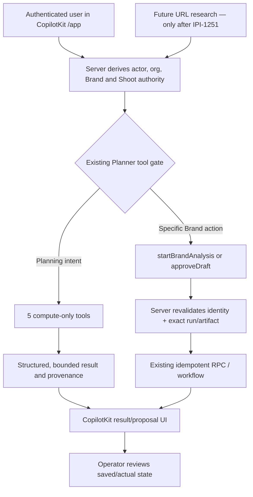

# iPix Mastra Tools — Core → Advanced Roadmap

**Reviewed:** 2026-11-20. **Authority:** `amoai-tech/ipixai` GitHub `origin/main` at `07829181` when inspected; Mastra Core `1.84.0`, CLI `1.40.0`. Reverify exact SHA and deployment before implementing. **This is planning documentation, not feature certification.**

## The decision

**Make the existing seven iPix tools correct, well-selected, safe and useful before adding more.** Reuse the Production Planner, `planner-tool-gate.ts`, CopilotKit v2, Supabase domain services/RPCs and the approved Brand/Shoot workflow journeys. New native Mastra tools should solve a named user problem, not fill an empty Studio page.

**Real-world example:** An operator asks, “Create a 10-image campaign shoot for this fashion brand, then estimate the budget.” The Planner uses the **five existing planning tools**, respects the actual deliverable count, explains assumptions and shows a proposal. It does **not** automatically approve Brand DNA, save the Shoot or publish content.

## What iPix actually has

| Existing production tool | Class | Example | Registered in Planner? |
| --- | --- | --- | --- |
| `recommendShootType` | Compute | Choose an appropriate shoot type | Yes |
| `planDeliverables` | Compute | Plan a list of needed images and videos | Yes |
| `generateShotListDraft` | Compute | Produce shot list from selected deliverables | Yes |
| `estimateShootBudget` | Compute | Estimate bounded cost with disclosed assumptions | Yes |
| `composeShootPlan` | Compute | Assemble a complete structured proposal | Yes |
| `startBrandAnalysis` | External / consequential | Start a paid/external crawl and durable Brand workflow | Yes, gated |
| `approveDraft` | Consequential write | Approve/reject the exact Brand DNA draft hash | Yes, gated |
| `weatherTool` (`get-weather`) | Demo/legacy | Current weather, unrelated to fashion planning | Present in `src/mastra/tools/index.ts`; **not part of Planner's seven-tool map** |

**Source files:** `src/mastra/agents/production-planner.ts`; `src/mastra/tools/planning.ts`; `src/mastra/tools/compose-shoot-plan.ts`; `src/mastra/tools/brand-intelligence.ts`; `src/mastra/planner-tool-gate.ts`; `src/mastra/tools/index.ts`.

**Important:** Studio listing a tool proves registration/introspection, **not** that an operator can run it safely. The local Studio auth is read-only by design. Product tests belong in authenticated `/app` plus authorized API/DB readback, not unrestricted Studio execution.

## Architecture / ownership

### Quick feature choices

| Mastra feature | Recommendation | Why |
| --- | --- | --- |
| `createTool()`, Zod input/output and `execute(inputData, context)` | **Core** | Already used; test input, output, domain correctness, caller identity and routing |
| `toModelOutput` | **Conditional core** | Reduce model tokens while preserving safe UI data; inspect installed version and CopilotKit transport |
| Built-in provider web search | **Conditional** | Could help cited research, but iPix already has specific Brand research requirements and Firecrawl path |
| Built-in `webFetchTool` | **Conditional** | Useful for a pasted public URL; compare with Gemini URL Context/Google Search under IPI-1251 |
| `askUserTool` | **Conditional** | Missing budget/campaign details could be collected, but first test CopilotKit native input/interrupt handling |
| `submitPlanTool` | **Do not add to Product Planner now** | Designed for a file-backed coding-plan host; not a substitute for iPix's exact Shoot proposal review |
| Built-in task tracking / TaskSignalProvider | **Defer** | iPix has persisted Brand/Shoot state and AG-UI; avoid a second misleading task progress system |
| ToolSearchProcessor | **Defer** | Seven product tools + a narrow activeTools gate do not justify discovery/extra latency; it does not grant authorization |
| Mastra Client SDK tool execution | **Server only unless explicitly authorized** | Browser-accessible direct execution could bypass current reviewed action path |
| New MCP/CometChat tools/third-party skills | **Reference only** | Reuse existing services; no new chat transport or broad tool supply |

## Read the deliverables

1. [01 — Prioritized Core and Advanced Tools Roadmap](./01-roadmap.md): tasks, use cases, implementation boundaries, files and success criteria.
2. [02 — Review of all 17 requested official and community references](./02-reference-review.md): what each page supports, what is relevant now, and what to skip.

**Implementation rule:** Verify current code and installed package types → choose the existing Linear owner → make the smallest change → focused deterministic tests → natural-language routing → authenticated UI/API/DB proof → exact-head CI. If no new capability is needed, don't create code.

**Status:** Documentation drafted for review. No tool executions, Supabase writes, Studio security relaxations, environment/secret changes, or tool registry modifications were made.
