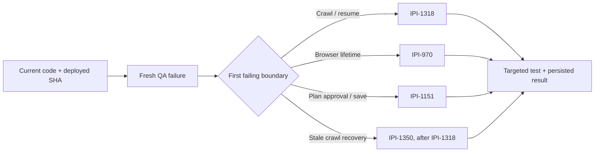
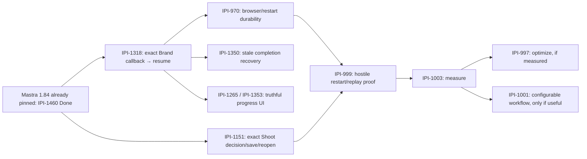

# 01 — Core and advanced implementation roadmap

**Planning baseline:** verified GitHub origin/main 07829181, Mastra Core 1.84.0 / CLI 1.40.0, as of 2026-11-20. Check exact main/deployed/runtime state again when implementing. **No feature completion is asserted by this document.**

## Stage 0 — Reproduce before editing

Before code changes: record current GitHub SHA, deployed SHA, account/org, first failing real step and owning Linear issue. Use one fresh QA user journey, not the read-only Studio catalog as proof. Reuse iPix's Next.js, authenticated CopilotKit, Mastra, Supabase, Postgres, existing services/RPCs and provider callbacks.

## Stage 1 — CORE: Finish Brand website → Brand DNA

### P0 — [IPI-1318 · BRAND-MASTRA-PARITY-001 — Restore and Prove Exact Crawl → Mastra Resume → Brand DNA Draft](https://linear.app/amo100/issue/IPI-1318) — Todo / Urgent

**Use case:** A fashion brand submits its website. Firecrawl finishes asynchronously and the signed callback resumes the *same* persisted workflow run to produce a reviewable Brand DNA draft.

**Existing files:** src/mastra/workflows/brand-intelligence.ts (validateBrand → startCrawl → waitForCrawl → extractProfile → saveDraftAndWait → commitOrReject); src/app/api/workflows/brand-intelligence/resume/route.ts; src/mastra/tools/brand-intelligence.ts; provider webhook and existing Brand RPCs.

**Decision:** Fix the first current failing boundary only. Check signed callback, expected crawl ID + run ID, precise resume label, approved draft hash and actual persisted status. Do not rebuild the workflow or start a second crawl.

**Acceptance:** One fresh QA Brand yields the matching persisted draft on the same run; duplicate/forged/stale/mismatched callbacks and wrong-tenant resumes fail safely; no second paid crawl.

### P1 — [IPI-970 · BI-RUN-001 — Keep Brand Intelligence Running After the Browser Closes](https://linear.app/amo100/issue/IPI-970) — Todo / High

**Use case:** Start research, close laptop, return later and see the exact run's draft or a recoverable error, not indefinite "running".

**Decision:** Prove native Mastra snapshot + current Postgres persistence + callback first; only add background execution if an actual request-lifetime gap remains. No second queue or worker by default.

**Acceptance:** Browser close, page refresh and server restart do not erase the suspended run; missing storage reports an error, not an in-memory false success.

### P1 after fresh parity — [IPI-1350 · BRAND-CRAWL-RECOVERY-002 — Recover Brands Stuck in Crawl Complete](https://linear.app/amo100/issue/IPI-1350) — Backlog / High

**Use case:** A genuinely stale completed crawl never reached extraction. The current recovery path makes it retryable without losing evidence or auto-buying another crawl.

**Dependency:** First verify IPI-1318; stale recovery must not conceal an active callback/resume defect.

**Acceptance:** Active and stale runs distinguished, existing recovery routine only, no extra scheduler/table, idempotent retry and truthful status.

## Stage 2 — CORE: Plan → exact review → save once → reopen

### P1 — [IPI-1151 · E2E-PLAYWRIGHT-002 — Certify Brand → Shoot → Planner Critical Journey](https://linear.app/amo100/issue/IPI-1151) — In Progress / High

**Use case:** The operator reviews one specific plan revision, approves or rejects it, saves it once, then reopens the same Shoot. A double-click or lost HTTP response must not create two Shoots.

**Existing files:** src/mastra/workflows/shoot-plan-review.ts (stageRevision → awaitDecision); src/lib/shoot/decide-shoot-plan-revision.ts; src/app/api/shoots/save/route.ts; existing CopilotKit review UI; existing save_approved_shoot RPC.

**Decision:** Reuse exact approvalId + revision + planHash; server re-reads the durable approval proof before resume, and saves through existing idempotent domain RPC. PR #367 is a lead; recheck PR status and implementation SHA before claiming merged.

**Acceptance:** approve, reject, changed revision, expired request, wrong tenant, retry/double-click, lost response, one saved Shoot, 390px mobile and refresh/reopen all pass with DB readback.

### Advanced standardization — [IPI-998 · MASTRA-WF-005 — Standardize Exact Human Approval Without a Second Approval Framework](https://linear.app/amo100/issue/IPI-998) — Backlog

Reuse the *proven business contract* only after another real consequential journey needs it. Do not add a generic approvals table or replace the current CopilotKit review UI. Approval ties authenticated actor, org, run, suspended step, exact immutable artifact/revision/hash and an idempotent domain action.

## Stage 3 — CORE: Show truthful progress and recovery

- [IPI-1265 · ONBOARD-DNA-UX-001 — Show Real Brand Analysis Progress, Recovery, and Human DNA Review During Onboarding](https://linear.app/amo100/issue/IPI-1265) — Backlog.
- [IPI-1353 · COPILOT-BRAND-STATUS-001 — Show Brand Intelligence Completion and Review Action in Production Copilot](https://linear.app/amo100/issue/IPI-1353) — Todo.

**Use case:** "Crawling website" → "Analyzing" → "Draft ready — Review", or "Failed — Retry." Persisted Brand state and workflow status, *not fabricated percentage progress*, drive CopilotKit UI. The Brand DNA review card already exists. Verify refresh, cross-org switching, failure and accessible 390px state.

- [IPI-996 · MASTRA-WF-003 — Show Real AI Work Progress Without a Second Task System](https://linear.app/amo100/issue/IPI-996) — Backlog / M7. Activate only if existing AG-UI/step events do not support the needed real journey.

## Stage 4 — ADVANCED: Apply only after a measured need

| Existing Linear owner — verified title/status | Real-world use case | Activation gate |
| --- | --- | --- |
| [IPI-1003 · MASTRA-WF-010 — Measure One Real Workflow with Native Observability and Evals](https://linear.app/amo100/issue/IPI-1003) — Backlog | Why do certain Brand crawls fail? | Inspect current Sentry/Mastra traces first, one measurable question and deterministic scorer only if useful |
| [IPI-997 · MASTRA-WF-004 — Parallelize Only Proven Independent Workflow Bottlenecks](https://linear.app/amo100/issue/IPI-997) — Backlog | Research independent items concurrently | Measure latency, prove independence, use native parallel/foreach with bounded concurrency, compare before/after cost and correctness |
| [IPI-995 · MASTRA-WF-002 — Govern the Real iPix Tool Surface Without a Custom Registry Framework](https://linear.app/amo100/issue/IPI-995) — Backlog | Planner computes budget but cannot silently publish | Inventory current tools; reuse existing planner-tool-gate, no custom tool registry |
| [IPI-1001 · MASTRA-WF-008 — Prove One Safe Configurable Workflow Only When Product Need Exists](https://linear.app/amo100/issue/IPI-1001) — Backlog | Configure read-only research steps without deploying | Proven user need, one registered allowlisted JSON definition, native persistence/restart/denial tests; no editor platform |
| [IPI-994 · MASTRA-WF-001 — Establish Reusable iPix Workflow Foundation](https://linear.app/amo100/issue/IPI-994) — Backlog | A third workflow reuses proven helpers | Two shipped, tested workflows and actual duplication first; extract only the smallest repeated helper |
| [IPI-1002 · MASTRA-WF-009 — Standardize External Integrations Only After Repeated Need](https://linear.app/amo100/issue/IPI-1002) — Backlog | Add a second provider integration safely | Existing service/API/RPC first; new Mastra tool or vendor MCP only if repeated need is proven |
| [IPI-1000 · MASTRA-WF-007 — Add Plan Review Before Complex Execution](https://linear.app/amo100/issue/IPI-1000) — Backlog | Review a costly campaign proposal before execution | Reuse exact proposal review; do not create another planner or approvals system |
| [IPI-993 · MASTRA-WF-000 — iPix Mastra Workflow & Tool Orchestration Platform](https://linear.app/amo100/issue/IPI-993) — Backlog / Post-MVP | Consolidate actual repeated workflows | Not an M1–M3 blocker; two shipped workflows plus measured repeated gap required |

### Native API selection, with examples

| Capability | When it is appropriate | iPix decision |
| --- | --- | --- |
| Typed createWorkflow/createStep and sequential then | Stable required order | **Use now** — both existing workflows already do |
| stateSchema + setState | A bounded shared value spans several steps | Use only if needed, not for Brand profiles, binary images or secrets |
| branch | A conditional path changes work | Use only after a real branch is necessary |
| parallel | Different independent operations on the same input | Measure dependency and latency first; no concurrent consequential writes |
| foreach | Same operation on many items | Bounded concurrency and deterministic aggregation |
| Workflow.agent() / typed tool step | Existing registered AI/tool fits the required input/output | Reuse only when it simplifies source and keeps auth |
| run.start() | Caller can await a short workflow | Use for short tests/operations |
| run.startAsync() | Long work must return runId promptly | Only with verified durable status/recovery; do not mistake return for successful completion |
| createWorkflowStateReader() | UI/recovery needs exact suspended step, labels or outputs | Prefer over parsing internal snapshot structure; inspect pinned 1.84 types |
| timeTravel() | Re-execute a step with test input | **Isolated synthetic read-only debugging only**; never generic Retry on paid crawls or approvals |
| Dynamic JSON workflows | Users truly need runtime configurable workflow definitions | **Defer** — beta API and additional tool/tenant/execution risks |

## Dependency and verification map

- **Existing long-lived run verification owner:** [IPI-999 · MASTRA-WF-006 — Prove Long-Lived Workflow Recovery and At-Most-Once Effects](https://linear.app/amo100/issue/IPI-999) — Backlog / M7. Do not defer a *currently broken* Brand/Shoot journey to this post-MVP epic; use IPI-1318 and IPI-1151 now.
- **Adversarial tests:** wrong tenant, forgery, stale/superseded revision, duplicate callback, double-click, API timeout, process restart, no Postgres, concurrent resume, secret leakage, non-idempotent provider side effect.
- **Proof sequence:** focused schema/contracts → storage-backed suspend/resume with real database → idempotency/RLS → Playwright actual UI/API/DB (390px) → typecheck/lint/build as relevant → exact-head CI → post-merge live smoke.
- **Core success definition:** one Brand yields one matching reviewable DNA draft, and one approved Shoot yields one persisted/reopened Shoot after retries, with unauthorized actors denied. Do not claim from a green Studio listing.
- **Domain invariant:** workflow state/snapshots preserve orchestration; business writes belong to existing Supabase RPCs and services. Mastra retries, restarts, background execution, and time travel **do not guarantee exactly-once side effects** without domain idempotency.

**No new Linear issues needed for workflow-state, control-flow, dynamic workflow, time travel or HITL documentation.** Map evidence to existing owners. Start with IPI-1318; progress IPI-1151 independently. This is a plan, not an application change.
