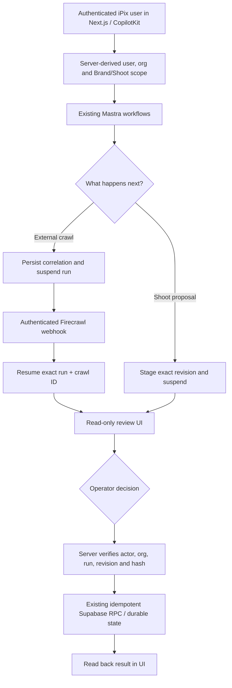

# iPix Mastra Workflows — Core & Advanced Roadmap

**Reviewed:** 2026-11-20 | **Canonical code:** amoai-tech/ipixai origin/main at 07829181 (short SHA at inspection) | **Pinned family:** Mastra Core 1.84.0, CLI 1.40.0.
**Scope:** roadmap and task recommendations; this document does **not** implement or certify new workflows.

## Decision in 30 seconds

**Build proof of existing workflows first.** iPix already registers two real Mastra workflows. Make Brand Intelligence and Shoot Plan Review finish correctly after browser close, callback delivery, review, retries, and process restart before adding new workflow builders or generic infrastructure.

| Level | Operator outcome | Order |
| --- | --- | --- |
| **Core A** | A brand website produces the *same run's* Brand DNA draft, even after an async crawl callback | 1 |
| **Core B** | Shoot proposal → review exact revision → save once → reopen after retry or refresh | 2 |
| **Core C** | Real status/recovery visible in CopilotKit, with precise errors and no invented progress | 3 |
| **Advanced A** | Observe and optimize the bottleneck of one working workflow | 4 — only if measured |
| **Advanced B** | Configurable/dynamic workflows, time travel and re-usable conventions | 5 — gated by real use case |

**Real-world example:** A fashion brand submits a website, closes the browser, returns later to a reviewable draft, approves the exact revision, and sees one persisted result. A second click or duplicate webhook cannot duplicate the action.

## Verified current application

| Fact | Evidence |
| --- | --- |
| Two registered workflows | src/mastra/runtime.ts: brand-intelligence; shoot-plan-review |
| Brand workflow uses six typed sequential steps | src/mastra/workflows/brand-intelligence.ts |
| Brand suspends for Firecrawl completion and operator review | waitForCrawl; saveDraftAndWait |
| Shoot workflow uses two steps | src/mastra/workflows/shoot-plan-review.ts: stageRevision → awaitDecision |
| Shoot resume verifies durable approval ID, revision, hash, and current status | awaitDecision; existing Supabase RPC |
| Exact authenticated run context and token validation | src/mastra/workflow-identity.ts; IPI-1326 (Done) |
| Main pins Mastra 1.84.0; local Studio 4211 was separately verified for read-only catalogs | package.json; prior local Studio test |
| Actual cross-restart/cross-server, payment/paid model, and user journey success | **Not verified by this planning exercise** |

**Important distinction:** A visible workflow card in http://127.0.0.1:4211/workflows proves registration, not runnable workflow operations. Studio's local auth restricts workflow execution; use the actual iPix Next.js/CopilotKit route and correctly scoped test fixtures for journey proofs.

## Architecture — no duplicate service

## Read this roadmap in order

1. [01 — Implementation roadmap and existing Linear tasks](./01-roadmap.md) — priorities, outcomes, file owners, acceptance tests, and advanced activation gates.
2. [02 — Official source-by-source reference review](./02-reference-review.md) — all 21 requested URLs, what each adds, and whether to adopt now.
3. Follow the existing skill contract at .claude/skills/mastra/references/workflows.md and testing-gates.md before implementation.

**Non-goals:** A second workflow engine, generic approvals DB, second scheduler/queue, new registry, unrestricted Studio execution, automatic dynamic-workflow editing, or storing secrets/raw Brand data in workflow snapshots.

**Status:** Documentation prepared for review. No business records, workflow runs, API permissions or database schema were changed.
