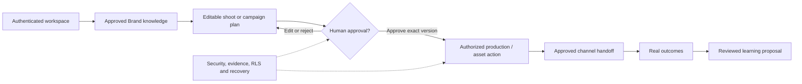

# iPix — Delivery Plan (HOW)

> **Purpose:** A *durable delivery sequence* connecting [product intent](./intent.md) and [observable requirements](./spec.md) to the current iPix architecture. **Not a second backlog:** [Linear V2](https://linear.app/amo100/project/v2-ipix-cd2f90b58cd2/issues) owns actual issue status, dependencies, priority, assignees and progress.
>
> For an executable task, **start with its live Linear issue and [AGENTS.md](../AGENTS.md)**, then use the existing `.claude/skills/tasks/SKILL.md` and relevant domain skills. This file does not authorize changes or replace the issue's runbook.

## Outcome and fastest path

Build the *smallest complete, trustworthy* fashion-production journey before adding broad agent features. Reuse iPix code → installed dependency → official provider capability → supported SDK/example → smallest necessary custom code. Do not add another task tracker, agent runtime, approval framework, database truth, or unnecessary test suite.

A useful first-user outcome is: **sign in → approve Brand DNA → review an AI-assisted shoot plan → save exactly one authorized shoot → review and deliver approved assets**. Publication and learning are later extensions, not launch claims.

## Product delivery sequence

The canonical durable sequence is described in [roadmap.md](./roadmap.md); Linear owns the current order among *ready* tasks and any hard `blockedBy` relations.

| Lane | Milestone outcome | Evidence / next-level owner |
|---|---|---|
| **M1 — Foundation** | One secure operator workspace and in-process CopilotKit/Mastra Production Planner with durable, tenant-isolated history and exact-run Stop. | [Linear M1](https://linear.app/amo100/project/v2-ipix-cd2f90b58cd2/issues); IPI-1329, IPI-1050, IPI-1117, IPI-1041 |
| **M2 — Workspace & Intelligence** | Trusted Brand/Shoot context, usable brand intelligence, dashboards and reviewable Production Copilot suggestions. | [Linear M2](https://linear.app/amo100/project/v2-ipix-cd2f90b58cd2/issues); IPI-1093, IPI-1247, Brand/Shoot dashboards |
| **M3 — Production** | An approved plan becomes one authorized Shoot; production, booking, asset QA/version review and delivery are provable. | [Linear M3](https://linear.app/amo100/project/v2-ipix-cd2f90b58cd2/issues); IPI-1085, IPI-1083, IPI-1119, IPI-1120 |
| **M4 — Campaigns** | Approved intelligence → reviewed strategy/content → exact approved media preview → explicit publish via Postiz. | [Linear M4](https://linear.app/amo100/project/v2-ipix-cd2f90b58cd2/issues); IPI-42, IPI-77, IPI-195 |
| **M5 — Measurement** | Real business/campaign/media/product metrics, attribution and accurate empty states before AI explanations. | [Linear M5](https://linear.app/amo100/project/v2-ipix-cd2f90b58cd2/issues); IPI-1139, IPI-1152 |
| **M6 — Learning** | Evidence-backed Brand Brain improvement proposals; human decision creates a new auditable version. | [Linear M6](https://linear.app/amo100/project/v2-ipix-cd2f90b58cd2/issues) |
| **M7 — Scale** | Standardize repeated patterns **only after** their real behavior is proved; no speculative abstractions. | [Linear M7](https://linear.app/amo100/project/v2-ipix-cd2f90b58cd2/issues) |
| **Parallel — Security & Reliability** | Auth, RLS, migration safety, current types, E2E, media/provider security, observability and release proof across all phases. | IPI-1075, IPI-1151 and [Linear](https://linear.app/amo100/project/v2-ipix-cd2f90b58cd2/issues) |
| **Parallel — Onboarding V2** | New operator can create/approve an initial Brand safely and resume without duplicate organizations or Brands. | [Onboarding milestone](https://linear.app/amo100/project/v2-ipix-cd2f90b58cd2/issues) |

**Scope caveat:** M4–M6 are roadmap outcomes, not proof of shipped integrations. Model Agency/Model Search Contest are separate Linear epics; do not move them onto the critical Brand → Shoot path without an explicit task dependency. Do **not** freeze milestone completion percentages or individual ticket statuses here.

## How value flows through the system

This is the **target user journey**. Solid arrows do not mean every stage is currently implemented or certified. AI drafts and proposes; the operator approves; the trusted server/database revalidates the exact action and records the durable result.

## One task → one reviewable PR

### Step 1 — Define the user's outcome

**Current owner:** Live IPI issue, with [intent.md](./intent.md) for product motivation.

- Capture **who** uses the feature, **why**, and the visible result. Include failure/recovery and the human approval decision if applicable.
- **Reference — MODEL:** [Anthropic Capture Intent](https://academy.claude.com/courses/ai-native-sdlc-playbook/capture-intent) → *Capture Intent* lesson: start with the problem, user and constraints.
- **Do not copy:** Claude-specific agent setup or another planning system.
- **Apply to:** existing Linear task Purpose / user journey, not a second ticket or roadmap.
- **Verify:** someone can describe the real user benefit in one sentence; the task's owner and blocker relations are clear.
- **STOP if:** it duplicates another active task or depends on an unproven user need.

### Step 2 — Make acceptance observable

**Current owner:** [Master PRD](./prd.md), [sitemap](./sitemap.md), relevant domain source/Linear task; [spec.md](./spec.md) summarizes cross-cutting expectations.

- Write concrete given/when/then behavior, denied and failed cases, exact approved artifacts, and the source of business truth.
- **Reference — MODEL:** [DataCamp: Spec-driven Development with Claude Code](https://www.datacamp.com/tutorial/spec-driven-development-with-claude-code) → *spec → plan → implementation* pattern.
- **Do not copy:** new Spec Kit/BMAD installation, duplicate checklists or generic acceptance that ignores RLS/tenant boundaries.
- **Apply to:** existing task's acceptance and test sections; resolve differences against current `origin/main` and installed types.
- **Verify:** every important claim has a targeted test or observable browser/database readback.
- **STOP if:** the product requirement conflicts with verified runtime or an accepted ADR; correct the authoritative contract first.

### Step 3 — Reuse real iPix architecture

**Current owners and implementation entrypoints:**

| Concern | Inspect first | Avoid rebuilding |
|---|---|---|
| Authenticated workspace | `src/app/app/page.tsx`; `src/lib/auth/app-shell.ts` | Parallel login/tenant identity |
| AI UI and runtime | `src/app/api/copilotkit/[[...slug]]/route.ts`; `src/mastra/agents/production-planner.ts` | Second AG-UI transport / remote default Planner |
| Memory and durable execution | `src/mastra/pg-store.ts`; [runtime-family contract](./mastra/runtime-family.md) | Process-local production memory / another run registry |
| Brand Intelligence | `src/mastra/workflows/brand-intelligence.ts`; [Brand docs](./ipix-platform/10-brands/BRANDS.md) | Duplicate crawl/evidence store |
| Shoot approval/save | `src/lib/shoot/decide-shoot-plan-revision.ts`; `src/app/api/shoots/save/route.ts` | Browser-trusted approval, second transaction path |
| Media | `src/app/api/cloudinary/sign/route.ts`; `src/app/api/cloudinary/webhook/route.ts`; [Cloudinary docs](./cloudinary/README.md) | Second CDN / unsigned uploads |
| Data tenancy | [Data contracts](./data/README.md); accepted [ADRs](./adr/README.md); current migrations | Unscoped SQL, duplicated durable truth |

**Reference — REFERENCE ONLY:** [Digital-Tvilling plan.md README](https://github.com/Digital-Tvilling/plan.md/blob/main/README.md) → schema-versus-plan concept. Keep the advantage of plain Markdown; **do not copy** its experimental schema, create a parallel plan database, or add a new validation framework.

**Apply to:** exact existing iPix paths discovered in current code, then minimal necessary code changes in the task's ordered implementation steps.

**Verify:** file/installed API match, tenant/approval ownership is unchanged, and the smallest targeted test catches the intended behavior.

### Step 4 — Build and test the smallest safe change

1. Confirm clean `origin/main` and use an isolated task branch/worktree; preserve existing uncommitted work.
2. Use Graphify and inspect only load-bearing files and official version-specific sources before custom code.
3. Change one coherent concern; no unrelated upgrades, refactors or generated agent infrastructure.
4. Run **static/diff check → targeted unit/contract → relevant RLS/integration → typecheck → broader suite/build/browser only when risk requires it**.
5. Independently verify the user's full interaction, *including* negative authorization, stale approval and retry/recovery paths where applicable.
6. Prepare an exact-head PR, resolve validated review findings, and wait for human merge approval. Re-check exact-main and deployment evidence before calling the task Done.

**Verify:** actual changed files, focused tests, CI/approval, and the appropriate final user journey. **STOP if:** auth, tenant isolation, exact-artifact HITL, persistence, migration safety or required tests are not proven.

### Step 5 — Close the loop without duplicate status

Record in **Linear only**: last verified checkpoint, blockers, PR + exact head SHA, real evidence, remaining risk, and exact next action. Let the [tasks skill](../.claude/skills/tasks/SKILL.md) govern post-merge certification.

- A PR opened ≠ merged.
- Merged ≠ deployed.
- Deployed ≠ a correctly authorized, durable and recoverable user journey.
- Do not mark Done until the applicable required proof exists.

## What the three files do (and do not do)

| File | Answers | Never owns |
|---|---|---|
| [intent.md](./intent.md) | Why iPix exists and what user value matters | Live priorities or per-task decisions |
| [spec.md](./spec.md) | Broad observable contracts and boundaries | Exact schema/task acceptance in place of the PRD/Linear |
| **plan.md** (this file) | How capabilities fit the delivery sequence and safe engineering workflow | Percent-complete, issue status, implementation version pins, or a second lifecycle |

**References:** [Master PRD](./prd.md) · [Product sitemap](./sitemap.md) · [Durable roadmap](./roadmap.md) · [Documentation home](./README.md) · [AGENTS.md](../AGENTS.md) · [Linear V2](https://linear.app/amo100/project/v2-ipix-cd2f90b58cd2/issues).
