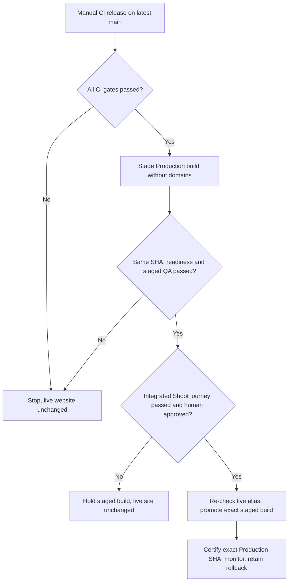

# iPix production release — stage, certify, approve, promote

**Owner:** [IPI-1091](https://linear.app/amo100/issue/IPI-1091).
**Safety prerequisite:** [PR #316](https://github.com/amoai-tech/ipixai/pull/316) changes the manual release job to **stage only**. It does not certify or finish IPI-1091.

**Business outcome:** fashion brands stay on the current website while the next exact-version release is checked. A human—not a workflow—decides when customer traffic moves.



### Step 1 — Stage one exact production candidate

**Destination:** `.github/workflows/ci.yml`, `vercel-production` job.

**Reference — ADAPT:** https://vercel.com/docs/cli/deploy#skip-domain — stage without assigning customer domains.

**Reference — ADAPT:** https://docs.github.com/en/actions/reference/workflows-and-actions/deployments-and-environments → **Required reviewers** and https://docs.github.com/en/actions/how-tos/deploy/configure-and-manage-deployments/review-deployments → **Approve and deploy**. Apply to `.github/workflows/ci.yml` → `vercel-production.environment: Production` and GitHub Settings → Environments → Production. Do not copy custom `workflow_dispatch` inputs: the iPix CI security policy forbids them. Verify the environment requires the `amoai-tech` reviewer, only allows `main`, and disables admin bypass. Only the designated owner can approve; self-review is currently permitted, so **this is an explicit owner approval gate, not independent two-person approval**.

**Reference — REFERENCE ONLY:** https://docs.github.com/en/rest/deployments/environments and https://docs.github.com/en/rest/deployments/branch-policies → inspect required reviewers, bypass policy and exact `main` branch restriction **before** the release. If any external protection rule changes or disappears, **STOP**.

**Consent required BEFORE dispatch:** Although the staged website is not promoted, its QA sends **paid AI model requests** and **persists QA Planner threads** in the **Production-configured backend**. These are actual charges and durable QA records, not a read-only preview. Before starting, the release operator must obtain and **record explicit approval in IPI-1091 for BOTH costs and persistent QA thread writes**, identify the approving person and exact commit, and use only approved QA identities. GitHub Actions manual release inputs are forbidden by the repository's CI security rule. **Required reviewers** on GitHub's protected `Production` environment enforce approval independently: after dispatch, the job stays **Waiting** until an authorized reviewer selects **Review deployments → Approve and deploy**. The reviewer must inspect the exact commit, recorded authorization for costs and durable QA threads, and QA account scope **before the job starts**; otherwise, reject. The environment is restricted to `main` and approval is separate from later promotion. **If either approval is missing or the environment protection rules are disabled, do not dispatch or approve.**

**Drift enforcement — REFERENCE ONLY:** https://docs.github.com/en/rest/deployments/environments and https://docs.github.com/en/rest/deployments/branch-policies → `scripts/check-production-environment.mjs` reads GitHub's public REST API without a privileged token. The manual release job checks required owner reviewer, disabled admin bypass, and *only* `main` branch **before Vercel pull, build, staging, or paid QA**. `.github/workflows/vercel-governance.yml` runs the same guard on its existing six-hour schedule. If GitHub returns an error, reviewer settings drift, or an extra branch/reviewer appears, checks **fail closed**. Do not copy an admin-token/PAT or trust a previous setting snapshot. Repository admins can still change settings and code, so this is release-time protection and periodic detection, not an immutable authorization ledger.

Use GitHub **Actions → CI → Run workflow → Branch: main**. The manual job confirms the tested SHA is still latest `main`, prepares a Production-configured build and runs `vercel deploy --prebuilt --prod --skip-domain`. It prints an exact staged URL, checks Vercel project/SHA/readiness, and verifies the live alias **before QA**. Never run a direct `--prod` release from a local checkout. If the SHA is stale, create a **new workflow dispatch** on latest main; rerunning the previous dispatch retains its outdated SHA.

**STOP if:** any required CI step fails, SHA/project mismatches, the live alias changed during inspection, or staging/QA fails.

### Step 2 — Certify the staged deployment before approval

**Destination:** the existing authenticated Playwright setup in `playwright.config.ts`, the staged QA steps in `.github/workflows/ci.yml`, and the future integrated journey tracked by [IPI-1151](https://linear.app/amo100/issue/IPI-1151).

**Reference — ADAPT:** https://playwright.dev/docs/ci

Existing staging checks cover login, Org A/Org B isolation, real Planner Stop and Planner-thread isolation on the **staged URL**. They use dedicated QA identities and an origin-scoped Vercel bypass; never send that bypass secret to other origins.

**Still REQUIRED, not implemented by PR #316:** once [IPI-1083](https://linear.app/amo100/issue/IPI-1083) and [IPI-1085](https://linear.app/amo100/issue/IPI-1085) supply the approved save and Shoot Wizard, the named integrated Playwright test must prove: sign in → generate plan → reject without save → edit/approve the exact revision → save exactly once → Shoot readback/reload → Org B denied. Record evidence against this same staging URL. **Do not call IPI-1091 complete without this test.**

### Step 3 — Obtain separate human authorization and promote

**Destination:** Vercel's existing deployment dashboard or CLI, **not** an automatic CI promotion job.

**Reference — REFERENCE ONLY:** https://vercel.com/docs/deployments/promoting-a-deployment

Release owner reviews the exact commit SHA, deployed staging URL, CI and user-journey evidence, and the previous live deployment as a rollback candidate. **Before promotion**, inspect `https://www.ipix.co` again and ensure no unexpected alias change since staging. If anything changed, **STOP and re-evaluate**.

Only after explicit human approval: in Vercel Deployments, choose the **staged Production** build and **Promote**; alternatively, with an authorized Vercel CLI session, use `vercel promote <exact-staged-production-deployment-url>`. **Do not promote a Preview build** as a substitute: Vercel may rebuild it with Production variables, invalidating the exact-artifact proof. Do not use `--yes` or trigger promotion unattended.

### Step 4 — Certify live Production and preserve recovery

**Destination:** `.github/workflows/production-planner-cert.yml` and Vercel Production deployment/logs.

**Reference — ADAPT:** https://vercel.com/docs/deployments/promoting-a-deployment

Immediately verify that `www.ipix.co` resolves to the **approved deployment and exact commit SHA**, then run guarded public/auth smoke. **Before** dispatching the separate live certification, confirm that the prior recorded QA authorization also covers **paid AI calls and persistent QA Planner threads in live Production**; if not, obtain that additional approval first. With approved test credentials, dispatch:

```bash
gh workflow run production-planner-cert.yml -R amoai-tech/ipixai --ref main \
  -f expected_sha=<exact-40-character-served-sha> -f confirm=certify-production
```

Review the run's authenticated Planner send/Stop/reconnect/reload proof and correlated CopilotKit 5xx check. Repeat the bounded integrated approved-Shoot journey on Production with authorized QA data, only after its owner spec is ready; account for safe cleanup. Check runtime errors and verify rollback target.

**If Production fails:** stop further promotion, use Vercel's native rollback to the previously recorded healthy deployment, verify the customer alias again, and document the incident. Never create another rollback registry or silently redeploy a different SHA.

**Release DONE only when:** exact deployed SHA, all approvals, staged QA, integrated Shoot journey, Production certification, healthy logs and rollback evidence are recorded in IPI-1091. A green unit test or staged-only notice is **not** release approval.
