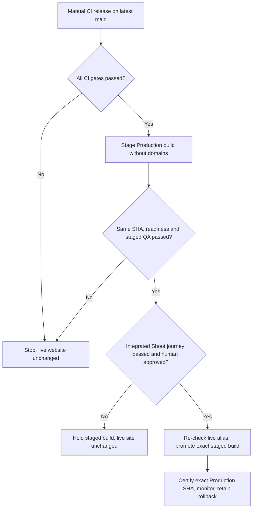
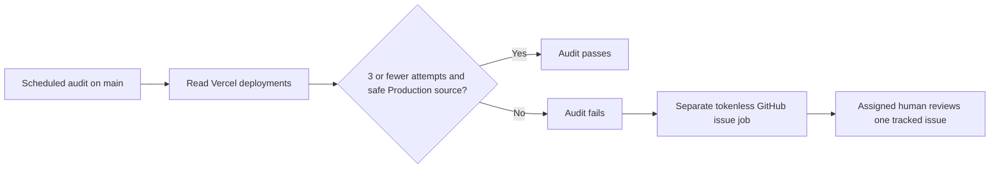

# iPix production release — stage, certify, approve, promote

**Owner:** [IPI-1091](https://linear.app/amo100/issue/IPI-1091).
**Safety prerequisite:** [PR #316](https://github.com/amoai-tech/ipixai/pull/316) changes the manual release job to **stage only**. It does not certify or finish IPI-1091.

**Business outcome:** fashion brands stay on the current website while the next exact-version release is checked. A human—not a workflow—decides when customer traffic moves.



### Before release — protected exact-SHA Preview

The manually dispatched Preview workflow is a separate QA gate, not a
production promotion. Its privileged workflow definition MUST come from
reviewed main, while its sha input names the exact candidate commit.
Never dispatch from a candidate feature branch with Vercel secrets.

~~~bash
gh workflow run vercel-preview.yml -R amoai-tech/ipixai --ref main \
  -f sha=<exact-reviewed-candidate-SHA> -f branch=<reviewed-branch-name>
~~~

The existing Production GitHub environment requires human approval before
either credential-bearing job can download Vercel variables or deploy.
These are separate runner jobs and GitHub may request approval for each.
Review
the candidate commit and authorize QA costs/persistent test threads before
approving. The workflow compares the candidate's full certified spec list with
main and stops rather than silently testing fewer specs.

The builder has no Vercel token during vercel build. It uploads only compiled
output and project linkage (one-day artifact retention). A fresh runner
uses the token for vercel deploy --prebuilt and verifies the exact READY
deployment, project, branch and commit through Vercel's API; another runner
performs Playwright tests without the Vercel management token.

Required credential follow-up: move repository-wide VERCEL_TOKEN into the
reviewed Production GitHub environment secret, then remove the repository
copy only after both Preview and Production workflows can read it.
Repository-level secrets can be accessed by other eligible workflows,
even when this particular Preview pipeline isolates the token. Use a
least-privilege token. Never upload pulled .vercel environment files.
Until token scoping and the workflow run are verified, do not treat this
as completed security certification.

### Step 1 — Stage one exact production candidate

**Destination:** `.github/workflows/ci.yml`, `vercel-production` job.

**Reference — ADAPT:** https://vercel.com/docs/cli/deploy#skip-domain — stage without assigning customer domains.

**Reference — ADAPT:** https://docs.github.com/en/actions/reference/workflows-and-actions/deployments-and-environments → **Required reviewers** and https://docs.github.com/en/actions/how-tos/deploy/configure-and-manage-deployments/review-deployments → **Approve and deploy**. Apply to `.github/workflows/ci.yml` → `vercel-production.environment: Production` and GitHub Settings → Environments → Production. Do not copy custom `workflow_dispatch` inputs: the iPix CI security policy forbids them. Verify the environment requires the `amoai-tech` reviewer, only allows `main`, and disables admin bypass. Only the designated owner can approve; self-review is currently permitted, so **this is an explicit owner approval gate, not independent two-person approval**.

**Reference — REFERENCE ONLY:** https://docs.github.com/en/rest/deployments/environments and https://docs.github.com/en/rest/deployments/branch-policies → inspect required reviewers, bypass policy and exact `main` branch restriction **before** the release. If any external protection rule changes or disappears, **STOP**.

**Consent required BEFORE dispatch:** Although the staged website is not promoted, its QA sends **paid AI model requests** and **persists QA Planner threads** in the **Production-configured backend**. These are actual charges and durable QA records, not a read-only preview. Before starting, the release operator must obtain and **record explicit approval in IPI-1091 for BOTH costs and persistent QA thread writes**, identify the approving person and exact commit, and use only approved QA identities. GitHub Actions manual release inputs are forbidden by the repository's CI security rule. **Required reviewers** on GitHub's protected `Production` environment enforce approval independently: after dispatch, the job stays **Waiting** until an authorized reviewer selects **Review deployments → Approve and deploy**. The reviewer must inspect the exact commit, recorded authorization for costs and durable QA threads, and QA account scope **before the job starts**; otherwise, reject. The environment is restricted to `main` and approval is separate from later promotion. **If either approval is missing or the environment protection rules are disabled, do not dispatch or approve.**

**Drift enforcement — REFERENCE ONLY:** https://docs.github.com/en/rest/deployments/environments and https://docs.github.com/en/rest/deployments/branch-policies → `scripts/check-production-environment.mjs` reads GitHub's public REST API without a privileged token. The manual release job checks required owner reviewer, disabled admin bypass, and *only* `main` branch **before Vercel pull, build, staging, or paid QA**. `.github/workflows/vercel-governance.yml` runs the same guard on its existing six-hour schedule. If GitHub returns an error, reviewer settings drift, or an extra branch/reviewer appears, checks **fail closed**. Do not copy an admin-token/PAT or trust a previous setting snapshot. Repository admins can still change settings and code, so this is release-time protection and periodic detection, not an immutable authorization ledger.

Use GitHub **Actions → CI → Run workflow → Branch: main**. The manual job confirms the tested SHA is still latest `main`, prepares a Production-configured build and runs `vercel deploy --prebuilt --prod --skip-domain`. It prints an exact staged URL, checks Vercel project/SHA/readiness, and verifies the live alias **before QA**. Never run a direct `--prod` release from a local checkout. If the SHA is stale, create a **new workflow dispatch** on latest main; rerunning the previous dispatch retains its outdated SHA.

**STOP if:** any required CI step fails, SHA/project mismatches, the live alias changed during inspection, or staging/QA fails.

### Step 2 — Certify the staged deployment before approval

**Destination:** the existing authenticated Playwright setup in `playwright.config.ts`, the staged QA steps in `.github/workflows/ci.yml`, and the future integrated journey tracked by [IPI-1151](https://linear.app/amo100/issue/IPI-1151).

**Reference — ADAPT:** https://playwright.dev/docs/ci

Existing staging checks cover login, Org A/Org B isolation, real Planner Stop and Planner-thread isolation on the **staged URL**. They use dedicated QA identities and an origin-scoped Vercel bypass; never send that bypass secret to other origins.

**Still REQUIRED, not implemented by PR #316:** once [IPI-1083](https://linear.app/amo100/issue/IPI-1083) and [IPI-1085](https://linear.app/amo100/issue/IPI-1085) supply the approved save and Shoot Wizard, the named integrated Playwright test must prove: sign in → generate plan → reject without save → edit/approve the exact revision → save exactly once → Shoot readback/reload → Org B denied. Record evidence against this same staging URL. **Do not call IPI-1091 complete without this test.**

### Step 3 — Obtain separate human authorization and promote

**Destination:** Vercel's existing deployment dashboard or CLI, **not** an automatic CI promotion job.

**Reference — REFERENCE ONLY:** https://vercel.com/docs/deployments/promoting-a-deployment

Release owner reviews the exact commit SHA, deployed staging URL, CI and user-journey evidence, and the previous live deployment as a rollback candidate. **Before promotion**, inspect `https://www.ipix.co` again and ensure no unexpected alias change since staging. If anything changed, **STOP and re-evaluate**.

Only after explicit human approval: in Vercel Deployments, choose the **staged Production** build and **Promote**; alternatively, with an authorized Vercel CLI session, use `vercel promote <exact-staged-production-deployment-url>`. **Do not promote a Preview build** as a substitute: Vercel may rebuild it with Production variables, invalidating the exact-artifact proof. Do not use `--yes` or trigger promotion unattended.

### Step 4 — Certify live Production and preserve recovery

**Destination:** `.github/workflows/production-planner-cert.yml` and Vercel Production deployment/logs.

**Reference — ADAPT:** https://vercel.com/docs/deployments/promoting-a-deployment

Immediately verify that `www.ipix.co` resolves to the **approved deployment and exact commit SHA**, then run guarded public/auth smoke. **Before** dispatching the separate live certification, confirm that the prior recorded QA authorization also covers **paid AI calls and persistent QA Planner threads in live Production**; if not, obtain that additional approval first. With approved test credentials, dispatch:

```bash
gh workflow run production-planner-cert.yml -R amoai-tech/ipixai --ref main \
  -f expected_sha=<exact-40-character-served-sha> -f confirm=certify-production
```

Review the run's authenticated Planner send/Stop/reconnect/reload proof and correlated CopilotKit 5xx check. Repeat the bounded integrated approved-Shoot journey on Production with authorized QA data, only after its owner spec is ready; account for safe cleanup. Check runtime errors and verify rollback target.

**If Production fails:** stop further promotion, use Vercel's native rollback to the previously recorded healthy deployment, verify the customer alias again, and document the incident. Never create another rollback registry or silently redeploy a different SHA.

**Release DONE only when:** exact deployed SHA, all approvals, staged QA, integrated Shoot journey, Production certification, healthy logs and rollback evidence are recorded in IPI-1091. A green unit test or staged-only notice is **not** release approval.

### Vercel deployment-volume governance (IPI-1369)

**Purpose:** Detect build storms and unexpected Production releases without mistaking missing Vercel source metadata for a Git-triggered or CLI-triggered action. This is an operational *creation-volume* audit, not a successful-deployment count or a new Production release gate.

**Rule:** Keep `VERCEL_MAX_DEPLOYMENTS_24H: "3"`. Count every distinct deployment ID created in the rolling 24 hours, including `READY`, `ERROR`, and `CANCELED`. One SHA retried three times counts as three attempts. De-duplicate only repeated IDs across paginated API pages. A real over-limit result remains a failure and is never made green by ignoring errors or previews.

### Step A — Classify from Vercel's actual response

**Destination:** `scripts/check-vercel-deployment-governance.mjs` → `listDeployments24h()`, `attributeDeployment()`, `runGovernance()`.

**Reference — ADAPT**

- URL: https://vercel.com/docs/rest-api/reference/endpoints/deployments/list-deployments
- Source: `GET /v7/deployments`, `since`, `until`, `pagination`, `source`, `target`, `readyState`.
- Use: query the exact project/team with a read-only Governance token, enforce 24-hour cutoff, keep error/canceled attempts, and count each deployment ID once.
- Do not copy: a metric that counts only `READY` builds, or assumptions that a repeated SHA is a duplicate deployment.
- Change: report every attempt with its ID, state, creator, provider-reported source, target, and available Git commit/branch/repository metadata.
- Verify: `tests/vercel-deployment-governance.test.ts` plus a sanitized live list response.

**Reference — REFERENCE ONLY**

- URL: https://github.com/vercel/sdk/blob/main/docs/models/deployments.md
- Source: deployment `target` (nullable), `source` (optional), `readyState`, `meta` fields.
- Use: explicit `target: null` means Preview; an absent target remains `unknown` and fails closed. Optional `source: null` means **unreported method**, not `cli` or `git`. Git SHA/ref proves code attribution only, not how the deployment was initiated.
- Do not copy: assumptions that Git metadata alone proves a GitHub webhook or an approved release.
- Verify: a null-source Git-referenced Preview is reported but not mistaken for an unauthorized Production release; an unreported or non-CLI Production source still fails.

### Step B — Route actual audit failures to a human

**Destination:** `.github/workflows/vercel-governance.yml` → `alert-on-audit-failure`.

**Reference — ADAPT**

- URL: https://docs.github.com/en/actions/tutorials/authenticate-with-github_token
- Source: examples using `GITHUB_TOKEN`, job-scoped `issues: write`, and GitHub CLI issue creation.
- Use: when the audit fails on trusted `main`, create one GitHub issue assigned to the repository maintainer `amoai-tech`; on subsequent failures, add a new run link to the same open issue. Also emit the issue URL into the job summary.
- Do not copy: a repository-wide write token or Vercel token in the issue-reporting job. Do not make an untrusted PR-branch dispatch able to create issues or access the Governance secret.
- Verify: YAML security contract, failing main workflow (issue exists, assigned to owner, links to exact run), repeated failure updates existing issue instead of creating another.

**Reference — REFERENCE ONLY**

- URL: https://docs.github.com/en/actions/concepts/workflows-and-actions/notifications-for-workflow-runs
- Use: GitHub also supports failure-only web/email workflow notifications, but owner notification preferences are independent. A durable assigned GitHub issue is the verified in-repository human handoff; inbox delivery itself requires owner readback.
- Do not copy: claiming notifications were read without proof, or a standalone service to deliver them.

**Checkpoint:** Normal-day run passes within the configured limit; over-limit or unknown Production provenance fails and creates an owned issue. Keep separate protected Production release approval as documented in IPI-1091. IPI-1369 may only be marked Done when exact-main runtime and human alert readback are recorded.


